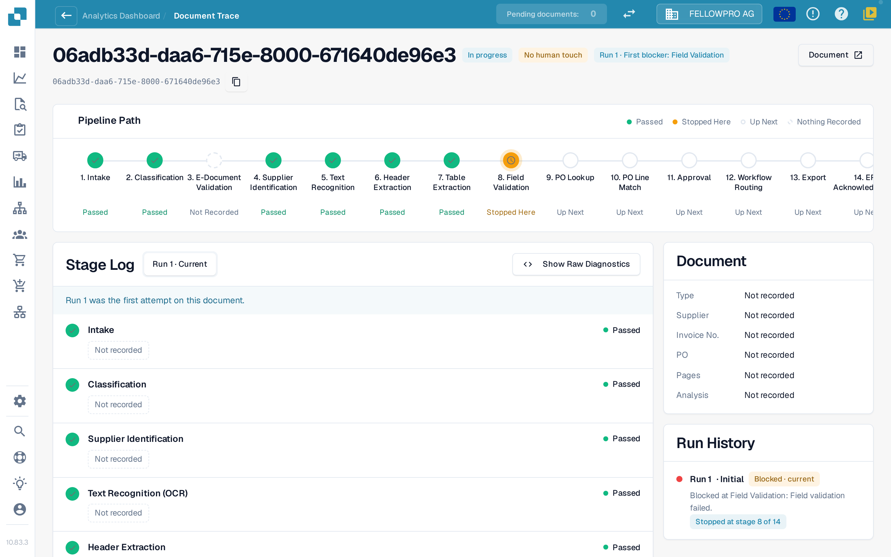
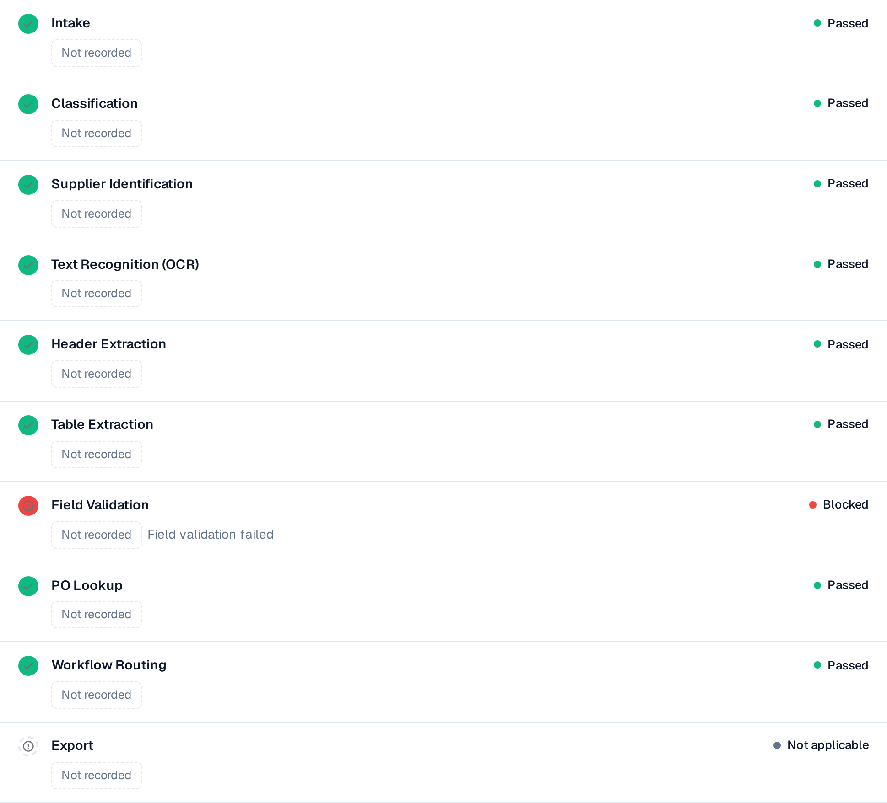

# Trag dokumenta

Unesite ID dokumenta u polje **Document ID** ili otvorite primer dokumenta iz klastera da biste videli **šta se dogodilo sa ovim dokumentom**.

Zaglavlje prikazuje datoteku, njen status (na primer **In progress**), izvršavanje koje gledate i njegov prvi blokator, kao i dugme **Document** sa ID-jem dokumenta.

<figure><figcaption>
Trag dokumenta: putanja procesa sa svim fazama i dnevnik faza sa onim što je svaka faza zabeležila.
</figcaption></figure>

**Pipeline Path** prikazuje 14 faza: Intake, Classification, E-Document Validation, Supplier Identification, Text Recognition, Header Extraction, Table Extraction, Field Validation, PO Lookup, PO Line Match, Approval, Workflow Routing, Export, ERP Acknowledgement. Svaka faza nosi jedno stanje:

| Stanje | Značenje |
| --- | --- |
| **Passed** (zeleno) | Faza je prošla bez problema |
| **Stopped Here** (narandžasto) | Faza je blokirala dokument |
| **Up Next** | Dokument nikada nije stigao dovde |
| **Nothing Recorded** (isprekidano) | Za ovu fazu nisu zabeleženi podaci |
| **Not applicable** | Faza se ne odnosi na ovaj dokument |

## Dnevnik faza

**Stage Log** ispod putanje navodi iste faze sa onim što je svaka od njih zabeležila. Tačka statusa i reč statusa stoje levo i desno u svakom redu.

* Svaka vrednost je **oznaka vrednosti**: broj sa svojom jedinicom, na primer **Confidence 100 %**, **Threshold 60 %**, **Failed rules 0**, **8 missing fields** ili **0 mapping gaps**. Procenti se prikazuju kao `97 %`, nikada kao `0.97`.
* **Details** otvara punu listu vrednosti koje je faza zabeležila, uključujući alternative koje je razmatrala.
* Faza koja je blokirala dokument navodi razlog, na primer **Field validation failed**.
* Vrednost koju nijedna faza nije zabeležila prikazuje se kao **Not recorded**, nikada kao izmišljena vrednost. Vrednosti su brojevi i utvrđeni izrazi, nikada tekst dokumenta.
* **Show Raw Diagnostics** uključuje sirove podatke kada ih podrška zatraži.

<figure><figcaption>
Svaka faza prikazuje šta je zabeležila; blokirana faza navodi svoj uzrok.
</figcaption></figure>

## Izvršavanja i promene

Birač izvršavanja na vrhu dnevnika faza (**Run 1 · Current**) prebacuje između izvršavanja dokumenta. **Run History** desno navodi svako izvršavanje sa ishodom i mestom na kom se zaustavilo. Kada je dokument izvršen više puta, izaberite izvršavanje u biraču da biste ga uporedili sa trenutnim: promenjene vrednosti tada nose oznaku sa razlikom i njenom jedinicom, na primer **−2 fields** ili **+3 %**.

Kartica **Document** pored dnevnika faza navodi tip dokumenta, dobavljača, broj fakture, narudžbenicu, broj stranica i da li se analiza zasniva na **pravilima** ili ju je napisala veštačka inteligencija.

**Primer.** Dokumenti jednog dobavljača svi se zaustavljaju u fazi 8. U tragu svaki put vidite ista nedostajuća polja. To nije problem izdvajanja pojedinačnih dokumenata, već nedostajuća podrazumevana vrednost u vašoj konfiguraciji polja: ispravite je jednom i ceo klaster postaje povratan.

Snimci ekrana na ovoj stranici prikazuju interfejs na engleskom, jer aplikacija ne nudi srpski interfejs.
