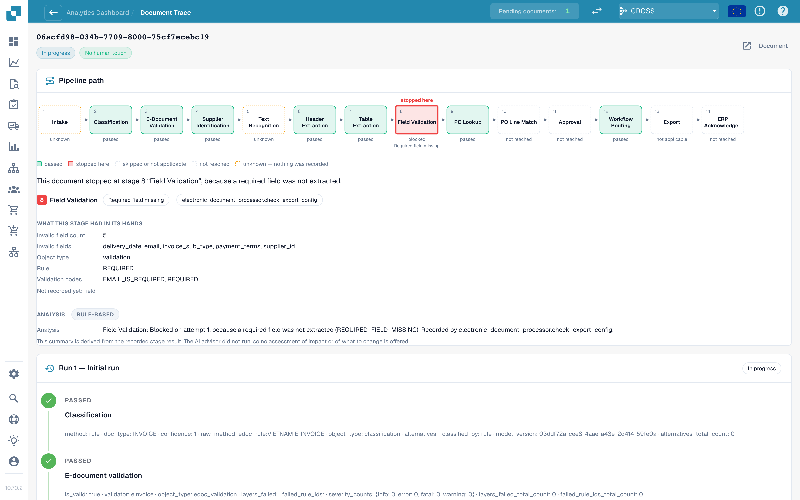

# Touchless Intelligence: Dokumentverlauf

Geben Sie eine Dokument-ID in **Dokument-ID** ein oder öffnen Sie ein Beispieldokument aus einem Cluster, um zu sehen, **was mit genau diesem Dokument passiert ist**.

<figure><figcaption>
Der Dokumentverlauf: der Pipeline-Pfad mit dem Schritt, an dem das Dokument stehen geblieben ist, den Daten, die dieser Schritt vorliegen hatte, und darunter die Laufhistorie.
</figcaption></figure>

Oben sehen Sie den **Pipeline-Pfad** mit 14 Schritten: Eingang, Klassifizierung, E-Dokument-Validierung, Lieferantenerkennung, Texterkennung, Kopfdatenextraktion, Tabellenextraktion, Feldvalidierung, Bestellsuche, Bestellpositionsabgleich, Freigabe, Workflow-Steuerung, Export, ERP-Bestätigung. Jedes Kästchen hat einen Zustand:

| Zustand | Bedeutung |
| --- | --- |
| **bestanden** (grün) | Der Schritt ist fehlerfrei gelaufen |
| **hier gestoppt** (rot) | Der Schritt hat das Dokument blockiert |
| **übersprungen oder nicht zutreffend** | Der Schritt gilt für dieses Dokument nicht |
| **nicht erreicht** | Das Dokument ist nie so weit gekommen |
| **unbekannt** (gestrichelt) | Für diesen Schritt wurde nichts aufgezeichnet |

Unter dem Pfad nennt ein Satz die Ursache. Im Screenshot: *Dieses Dokument ist bei Schritt 8 „Feldvalidierung“ stehen geblieben, weil ein Pflichtfeld nicht extrahiert wurde.* Der Block **Was dieser Schritt vorliegen hatte** listet die Fakten auf: **Anzahl ungültiger Felder 5** und die Felder (`delivery_date`, `email`, `invoice_sub_type`, `payment_terms`, `supplier_id`), die Regel (**REQUIRED**) und die Validierungscodes. Der Block **Analyse** sagt, ob sie **regelbasiert** ist oder von einer KI geschrieben wurde.

Die **Laufhistorie** darunter listet jeden Lauf auf (**Lauf 1 · Erster Lauf**, dann jeder Neustart) mit allen Schritten und ihren aufgezeichneten Fakten. Wurde das Dokument korrigiert und neu gestartet, erinnert ein Hinweis daran, dass es **weiterhin als bearbeitet gezählt wird**.

**Beispiel.** Die Dokumente eines Lieferanten bleiben alle bei Schritt 8 stehen. Im Verlauf sehen Sie jedes Mal dieselben fünf ungültigen Felder. Das ist kein Extraktionsproblem einzelner Dokumente, sondern ein fehlender Standardwert in Ihrer Feldkonfiguration: Beheben Sie ihn einmal, und das ganze Cluster ist rückgewinnbar.

## Weiterführende Seiten

* [Touchless Intelligence](touchless-intelligence.md)
* [Lieferantendiagnose und Fehlermuster](touchless-supplier-diagnosis.md)
* [Bestellabgleich-Diagnose](touchless-po-matching-diagnosis.md)
