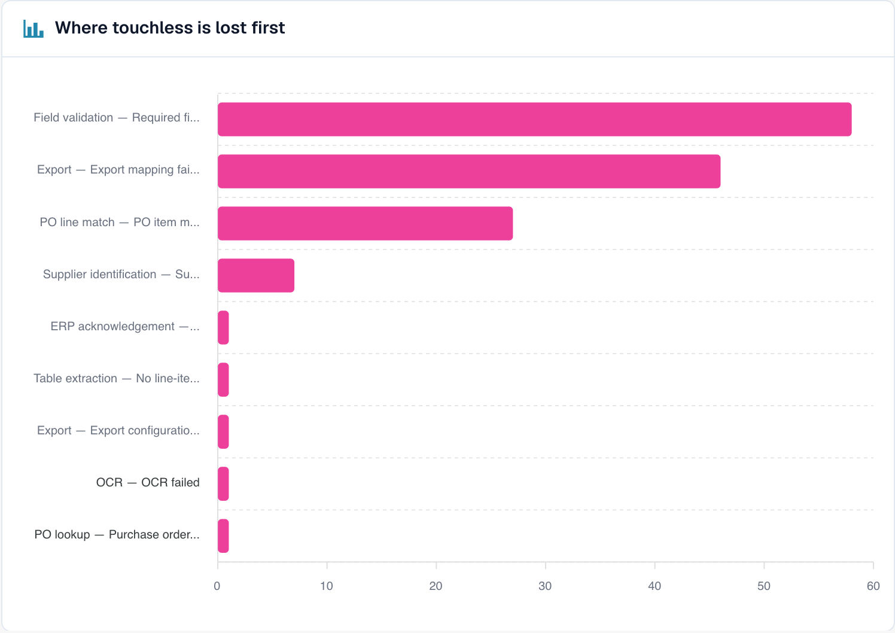
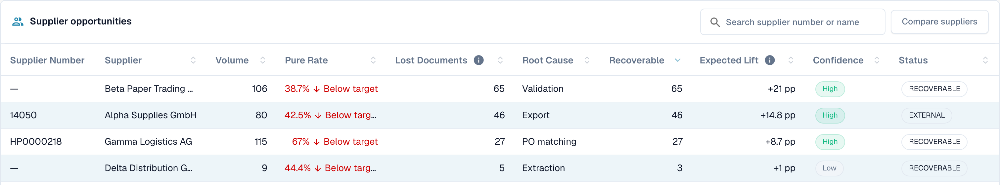

# Touchless Intelligence

## Visão geral

O **Touchless Intelligence** responde a duas perguntas sobre o processamento dos seus documentos:

1. **Quantos documentos passam pelo DocBits sem que ninguém toque neles?** Esta é a sua *taxa touchless*.
2. **Por que os outros param e o que devemos mudar para que menos documentos parem?** Este é o *diagnóstico*.

Ele é uma aba do [Painel de Análises](analytics-dashboard.md). Não gera nenhum trabalho extra para a sua equipe: o DocBits registra o que acontece com cada documento no pipeline de processamento e avalia o resultado a cada 15 minutos.

<figure><figcaption><p>A aba Touchless Intelligence: indicadores principais, melhorias, a taxa ao longo do tempo e o gráfico de onde o touchless se perde primeiro. Organização de exemplo com dados de demonstração; os nomes dos fornecedores são fictícios.</p></figcaption></figure>

### O que você pode fazer com ele

| Você quer… | Use | Exemplo |
| --- | --- | --- |
| Ver o quanto você está automatizado | Os cinco **indicadores principais** (key figures) no topo | "63,2 % dos nossos documentos passaram sem uma pessoa no mês passado" |
| Ver a tendência | **Touchless rate over time** (taxa touchless ao longo do tempo) | "A taxa subiu de 55 % para 68 % desde que corrigimos os dados mestres de fornecedores" |
| Descobrir onde os documentos ficam travados | **Where touchless is lost first** (onde o touchless se perde primeiro) | "A maioria dos documentos para na Validação de campos" |
| Decidir qual fornecedor corrigir primeiro | **Supplier opportunities** (oportunidades de fornecedores) | "O fornecedor A nos daria +4,0 pontos percentuais" |
| Entender um fornecedor | Página **Supplier Diagnosis** (diagnóstico do fornecedor) | "As faturas deles não têm número de PO, então o PO Matching falha" |
| Entender um documento | **Document Trace** (rastreamento do documento) | "Esta fatura parou na etapa 8, Validação de campos" |
| Comparar fornecedores | **Compare suppliers** (comparar fornecedores) | "Os fornecedores A e B usam o mesmo modelo, mas só o B falha" |
| Alterar uma configuração que ajuda | **Change proposals** (propostas de alteração) | "Ativar o PO match automático: pré-visualizar, aplicar, medir, desfazer" |

## Quem pode vê-lo

* A aba faz parte do Painel de Análises. O seu administrador a habilita para a organização. Se a aba não aparecer, pergunte ao seu administrador.
* Os **administradores da organização** sempre a veem.
* Os demais usuários a veem quando um administrador concedeu à função deles a aba **Analytics dashboard** (**Configurações → Funções**). Sem essa concessão, somente os administradores têm acesso.
* Algumas ações são exclusivas de administradores: **AI analysis** (análise com IA), **aplicar e desfazer uma alteração**, **propostas de regras aprendidas** e o **Consulting report** (relatório de consultoria).

Se você não tiver permissão, a página mostra *Action not allowed, please contact the administrator*.

## O que "touchless" significa

Todo documento termina com exatamente **um** resultado:

| Resultado | Significado | Conta na taxa |
| --- | --- | --- |
| **Pure touchless** | Processado da importação à exportação **sem nenhuma intervenção humana** | Sim, como sucesso |
| **AP touchless** | Rodou automaticamente, e uma pessoa deu apenas a **aprovação de negócio**. Nenhuma correção foi necessária | Sim, como sucesso |
| **AP assisted** | Uma pessoa precisou **corrigir um campo, reiniciar o documento** ou intervir de outra forma | Sim, como falha. Não é um erro, apenas automação que não levou o documento até o fim sozinha |
| **Process exception** | Terminou com um **erro**, foi **rejeitado**, foi **recusado pelo ERP** ou **ficou parado** no pipeline | Sim, como falha |
| **In progress** | Ainda não terminou | **Não**. Ainda não tem resultado |
| **Not eligible** | Excluído, arquivado, um documento de teste ou um tipo de documento excluído | **Não** |

A **taxa touchless** é:

```
rate = (Pure touchless + AP touchless)
       ÷ (Pure touchless + AP touchless + AP assisted + Process exception)
```

Documentos que ainda estão **em andamento** ou que **não são elegíveis** nunca entram no cálculo. Isso protege a taxa: um documento que chegou há cinco minutos não pode derrubá-la.


**Um toque conta para sempre.** Depois que uma pessoa tocou em um documento, ele continua contado como tocado, mesmo que uma execução automática posterior não precisasse de ninguém. **Reiniciar um documento não o torna touchless de novo.** A taxa reflete o trabalho que aconteceu.


### Exemplo de cálculo (números ilustrativos)

Em 30 dias, chegaram 200 documentos:

| Resultado | Documentos |
| --- | --- |
| Pure touchless | 120 |
| AP touchless | 30 |
| AP assisted | 30 |
| Process exception | 10 |
| In progress | 8 |
| Not eligible (documentos de teste) | 2 |

* Denominador: 120 + 30 + 30 + 10 = **190**. Os 8 documentos em andamento e os 2 não elegíveis ficam de fora.
* **Pure touchless**: 120 ÷ 190 = **63,2 %**
* **AP touchless**: 30 ÷ 190 = **15,8 %**
* **Taxa touchless**: (120 + 30) ÷ 190 = **78,9 %**

A aba mostra uma **meta** (70 %, a menos que a sua organização use outra). Neste exemplo, a taxa está acima da meta.

Clique em **How touchless is calculated** (como o touchless é calculado), no canto superior direito, para abrir esta explicação dentro do DocBits, com os números do seu próprio período (documentos no período, ainda em andamento, excluídos, medidos).

<figure><figcaption><p>A gaveta <strong>How touchless is calculated</strong>: a fórmula, <strong>Your numbers in this period</strong> (aqui 2.425 documentos, 2.115 ainda em andamento, 310 medidos) e o que cada resultado significa. Organização de exemplo com dados de demonstração; os nomes dos fornecedores são fictícios.</p></figcaption></figure>

### Quão atuais são os números

Os resultados são **recalculados a cada 15 minutos**. O resultado de um documento ainda pode mudar depois que aparece pela primeira vez: o ERP pode confirmar uma exportação horas depois. A linha **Data as of …** (dados de …) na parte inferior da aba mostra quando os números foram calculados pela última vez.

## A aba de visão geral

### Filtros

| Filtro | O que faz |
| --- | --- |
| **7D / 30D / 90D** | O período dos indicadores principais e da fila. O padrão é 30 dias |
| **Document Type** | Restringe todos os números a um tipo, por exemplo INVOICE |
| **Segment field / Segment value** | Somente se a sua organização executa vários processos por um mesmo tipo de documento (por exemplo, pedidos diretos, indiretos e EAM no campo `order_type`). Escolha um campo para ver a divisão e escolha um valor para restringir tudo a ele |
| **Document ID** | Abre o **Document Trace** de um documento |

A **suborganização** que você selecionou no topo do DocBits restringe os indicadores principais e a fila de fornecedores. Os clusters de problemas e a análise com IA sempre abrangem a organização inteira.

### Os cinco indicadores principais

<figure><figcaption><p>Os cinco indicadores principais. Aqui a taxa pure é de 50,3 % (156 documentos), que está 19,7 pontos abaixo da meta de 70 %, e a cobertura de diagnóstico é de 100 %. Organização de exemplo com dados de demonstração; os nomes dos fornecedores são fictícios.</p></figcaption></figure>

| Cartão | Mostra | Exemplo (ilustrativo) |
| --- | --- | --- |
| **Pure touchless** | A porcentagem e a diferença para a meta | **63,2 %** · "120 documents" · "−6.8 pp vs 70 % target" (vermelho, abaixo da meta) |
| **AP touchless** | A porcentagem | **15,8 %** · "30 documents" |
| **AP assisted** | O número de documentos e a sua participação | **30** · 15,8 % |
| **Process exceptions** | O número de documentos e a sua participação | **10** · 5,3 % |
| **Diagnosis coverage** | Quantos documentos bloqueados têm uma causa **conhecida** | **80 %** · "10 without a known cause" |

* Um cartão mostra um traço (—) em vez de **0 %** quando não há nada a medir. Um traço significa "sem dados", não "zero".
* **Diagnosis coverage** = documentos com um motivo de bloqueio conhecido ÷ todos os documentos bloqueados. Exemplo: 50 documentos bloqueados, 10 com causa desconhecida → 40 ÷ 50 = **80 %**. Um valor baixo significa "ainda não entendemos por que os documentos param". Melhore isso antes de tentar corrigir causas individuais.
* **Clique em um cartão** para abrir, em uma nova aba, a lista de documentos por trás do número ("View the documents behind this number"). Cartões com 0 documentos não são clicáveis.

### Touchless rate over time (taxa touchless ao longo do tempo)

<figure><figcaption><p>A taxa por dia com a linha da meta. Aqui a taxa fica entre 40 e 60 % e cai bruscamente a partir de 10 de outubro. Organização de exemplo com dados de demonstração; os nomes dos fornecedores são fictícios.</p></figcaption></figure>

Um gráfico com uma linha para **Pure touchless**, uma para **AP touchless** e a **linha da meta**. Períodos curtos mostram pontos diários, períodos longos mostram pontos semanais.

**Exemplo.** Depois que você ativou o PO Matching automático em 1º de outubro, a taxa pure sobe de 55 % para 68 % em duas semanas. O gráfico mostra o dia em que a curva vira, para que você possa relacioná-lo com a sua alteração.

### Where touchless is lost first (onde o touchless se perde primeiro)

<figure><figcaption><p>Documentos bloqueados por etapa e motivo em que pararam primeiro. Aqui <strong>Field validation: Required field missing</strong> custa mais documentos (58), depois <strong>Export mapping failed</strong> (46) e <strong>PO item mismatch</strong> (27). Organização de exemplo com dados de demonstração; os nomes dos fornecedores são fictícios.</p></figcaption></figure>

Um gráfico de barras de **Blocked documents** (documentos bloqueados) por etapa do pipeline: a **primeira** etapa que parou um documento.

**Exemplo.** Barras: Identificação do fornecedor 12, Validação de campos 41, Match de linhas do PO 7. A maior barra diz para você olhar primeiro a **Validação de campos**, geralmente porque um campo obrigatório não é extraído.

### Supplier opportunities (oportunidades de fornecedores)

<figure><figcaption><p>A fila de fornecedores (reduzida às primeiras quatro linhas). O primeiro fornecedor tem 106 documentos, uma taxa pure de 38,7 % e 65 documentos recuperáveis, então corrigi-lo vale <strong>+21 pp</strong>. Organização de exemplo com dados de demonstração; os nomes dos fornecedores são fictícios.</p></figcaption></figure>

A fila responde a **"Qual fornecedor devemos corrigir primeiro?"** Ela é ordenada por documentos **Recoverable** (recuperáveis), do maior para o menor, com 25 linhas por página.

| Coluna | Significado |
| --- | --- |
| **Supplier Number / Supplier** | O fornecedor. Documentos sem fornecedor reconhecido aparecem como **No supplier identified (n documents)** |
| **Volume** | Documentos elegíveis do fornecedor no período |
| **Pure Rate** | Participação dos documentos pure touchless. Verde se estiver na meta ou acima, vermelho se abaixo |
| **Lost Documents** | Documentos que terminaram como AP assisted ou como exceção de processo. Nem sempre uma pessoa: uma rejeição do ERP ou um documento parado por sete dias também contam |
| **Root Cause** | Quem é o responsável pela correção: Configuration, ERP integration, Export, Extraction, Master data, Measurement, PO matching, User process, Validation ou Unknown |
| **Recoverable** | Documentos perdidos cuja causa o DocBits pode corrigir: configuração, dados mestres ou modelo do fornecedor |
| **Expected Lift** | Quantos **pontos percentuais** a taxa da sua organização ganharia se todos os documentos recuperáveis deste fornecedor passassem touchless (**+x pp**) |
| **Confidence** | **High**, **Medium** ou **Low**: o quão segura é a causa diagnosticada |
| **Status** | New, Open, Investigating, In progress, Confirmed, Resolved, Dismissed. Um fornecedor com poucos documentos mostra **NEEDS_DIAGNOSIS** |

**Exemplo.** A sua organização tem 1.000 documentos elegíveis no período. O fornecedor A tem 40 documentos recuperáveis, o fornecedor B tem 90 documentos perdidos, mas apenas 10 recuperáveis (o problema deles está do lado deles).

* Fornecedor A: 40 ÷ 1.000 = **+4,0 pp de ganho esperado**
* Fornecedor B: 10 ÷ 1.000 = **+1,0 pp**, embora B tenha mais documentos perdidos

A fila classifica A acima de B porque o **ganho esperado** é medido em relação à sua organização inteira, não em relação ao fornecedor. Um fornecedor com quatro documentos ruins não pode superar um com quatrocentos.

Use a caixa de busca ("Search supplier number or name") para encontrar um fornecedor. Clique em uma linha para abrir o **Supplier Diagnosis**.

### Compare suppliers (comparar fornecedores)

<figure><figcaption><p>Três fornecedores lado a lado: taxa pure, documentos perdidos e recuperáveis, causa raiz, ganho esperado e um gráfico de barras dos resultados. Cada <strong>Open</strong> leva ao Supplier Diagnosis. Organização de exemplo com dados de demonstração; os nomes dos fornecedores são fictícios.</p></figcaption></figure>

Clique em **Compare suppliers**, marque **de dois a cinco** fornecedores (cada um aparece com o seu número de documentos bloqueados) e clique em **Compare**.

A comparação mostra os fornecedores lado a lado: **Pure rate**, **Lost documents**, **Recoverable**, **Root cause**, **Expected lift**, um gráfico de barras dos resultados e um link para cada **Supplier Diagnosis**.

**Exemplo.** Os fornecedores A e B enviam o mesmo layout de fatura. B tem uma taxa pure de 80 %, A apenas 35 %. Os dois têm a causa raiz "Master data". A comparação mostra que o layout está correto e que o cadastro do fornecedor A está incompleto. Corrija os dados mestres de A em vez de alterar o modelo.

### Analyse with AI (analisar com IA)

O botão **Analyse n clusters with AI** analisa os clusters de problemas com o maior potencial touchless (com no mínimo um número mínimo de documentos cada). Leva cerca de 13 segundos por cluster e abrange a **organização inteira**. Somente administradores podem iniciá-lo.

Enquanto ele roda, você vê **Queued**, **Running**, **Done**, **Already analysed** ou **Error** para cada cluster, com um link **Open cluster**. Se a IA estiver desativada ou não configurada no ambiente, o botão fica desabilitado com o motivo, e **todo o resto da página continua funcionando**.

## Aprofunde-se

| Página | O que ela cobre |
| --- | --- |
| [Diagnóstico de fornecedores e clusters de problemas](touchless-supplier-diagnosis.md) | Um fornecedor em detalhe: cartões de resultados, tendência, clusters de problemas, de onde vem uma recomendação |
| [Diagnóstico de PO Matching](touchless-po-matching-diagnosis.md) | Por que os documentos param na consulta do PO ou no match de linhas do PO, e o fluxo de decisão que mostra como o DocBits faz o match das linhas da fatura com as linhas do PO |
| [Rastreamento do documento](touchless-document-trace.md) | O que aconteceu com um documento, etapa por etapa |
| [Propostas de alteração e relatórios](touchless-change-proposals.md) | Pré-visualizar, aplicar, medir e desfazer uma alteração; propostas de regras aprendidas; o Consulting report |

## Trabalhar com o Touchless Intelligence: uma rotina

1. **Semanalmente**: abra a aba e confira a **taxa** e a **tendência** em relação à meta.
2. Veja o **Diagnosis coverage**. Abaixo de cerca de 80 %, primeiro descubra por que os documentos param.
3. Leia **Where touchless is lost first** e escolha a maior etapa.
4. Abra **Supplier opportunities**. Ordene por **Expected lift** e pegue o primeiro fornecedor com o status **RECOVERABLE**.
5. Leia os **clusters de problemas**, confira **Missing evidence** e depois siga **What to change**.
6. Aplique uma alteração por vez com uma **pré-visualização**, para que o **Change history** possa medi-la.
7. Após duas semanas, confira o resultado de **antes/depois**.

## Pergunte em linguagem simples: DocBits MCP

Tudo isso também está disponível para o seu assistente de IA por meio do [DocBits MCP](../advanced-functions-and-tools/docbits-mcp/README.md). Exemplos do que você pode perguntar:

* "Qual é a nossa taxa touchless dos últimos 30 dias?"
* "Quais três fornecedores nos custam mais documentos touchless?"
* "Por que os documentos deste fornecedor param para uma pessoa?"
* "Por que o PO match falhou para este documento?"

## FAQ

**As taxas mostram um traço (—).**
Nenhum documento chegou a um resultado final no período, ou foram medidos menos documentos do que o mínimo. Documentos que ainda estão em andamento não são contados.

**A aba não aparece.**
Peça ao seu administrador para habilitar o módulo e conceder à sua função a aba **Analytics dashboard**.

**Um documento é contado como tocado, mas desta vez ele passou sem ninguém.**
Ele foi tocado em uma execução anterior (uma correção ou uma reinicialização). A taxa conta o trabalho que aconteceu.

**Por que o número muda depois de algumas horas?**
O ERP pode confirmar uma exportação horas depois de ela ser enviada. O resultado é recalculado a cada 15 minutos.

**A IA altera algo por conta própria?**
Não. A IA escreve apenas explicações. Uma configuração só muda depois que um administrador a pré-visualiza e a aplica.

## Páginas relacionadas

* [Diagnóstico de fornecedores e clusters de problemas](touchless-supplier-diagnosis.md)
* [Diagnóstico de PO Matching](touchless-po-matching-diagnosis.md)
* [Rastreamento do documento](touchless-document-trace.md)
* [Propostas de alteração e relatórios](touchless-change-proposals.md)
* [Painel de Análises](analytics-dashboard.md)
* [Assistente de Configurações](settings/global-settings/company-information/settings-assistant.md)
* [DocBits MCP](../advanced-functions-and-tools/docbits-mcp/README.md)

<!-- Source notes (not shown): screenshots come from the dev test organisation with synthetic demo data (seed script) and fictional supplier names; the PO matching decision flow has no screenshot yet. facts read from the doc2app code (TouchlessIntelligence pages and components) and the dev UI on 14 Oct 2026; NOVA gates the tab with its own organisation flag, VESTA with the Analytics module. Consulting report export format not verified, so no export is described.
