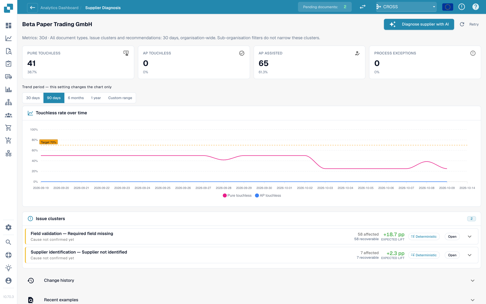

# Touchless Intelligence: Diagnoza dostawcy i klastry problemów

Kliknij dostawcę w kolejce, aby otworzyć stronę jego diagnozy.

<figure><figcaption>
Strona Diagnoza dostawcy (Supplier Diagnosis): kafelki wyników, trend z wyborem okresu i dwa klastry problemów uporządkowane według oczekiwanego wzrostu. Przykładowa organizacja z danymi demonstracyjnymi; nazwy dostawców są fikcyjne.
</figcaption></figure>

Strona pokazuje:

* **Sześć kafelków wyników** (Czysty touchless, AP touchless, AP wspomagany, Wyjątek procesu, W toku, Niekwalifikujące się), każdy z linkiem do dokumentów.
* **Trend** z własnym wyborem okresu: 30 dni, 90 dni, 6 miesięcy, 1 rok lub zakres niestandardowy (do dwóch lat). Zmienia to tylko wykres.
* **Klastry problemów** (patrz niżej).
* **Historia zmian** (Change history): zmiany zastosowane dla tego dostawcy i ich efekt.
* **Ostatnie przykłady** (Recent examples): przykładowe dokumenty w dwóch kartach: **Wymagały uwagi** (Needed attention) i **Przeszły touchless** (Went touchless).
* **Diagnozuj dostawcę z AI** (Diagnose supplier with AI): analizuje wszystkie klastry dostawcy (administratorzy).

Krótka notatka wyjaśnia pustą stronę, na przykład: *5 documents from this supplier are still being processed and have no analysis result yet.* (5 dokumentów tego dostawcy jest jeszcze przetwarzanych i nie ma jeszcze wyniku analizy) lub *All 40 completed documents from this supplier ran touchless: there is nothing to diagnose.* (Wszystkie 40 zakończonych dokumentów tego dostawcy przeszło touchless: nie ma czego diagnozować).

### Klastry problemów

**Klaster** (cluster) grupuje dokumenty jednego dostawcy, które zatrzymały się z **tego samego pierwszego powodu**. Zamiast 40 pojedynczych problemów widzisz „3 problemy".

<figure><figcaption>
Otwarta karta klastra: pierwsza blokada, <strong>Co zmienić</strong> (What to change) i <strong>Propozycja zmiany</strong> (Change proposal) z ryzykiem, zakresem i otwartymi pytaniami. Tutaj klaster obejmuje 58 dokumentów i jest wart +18,7 pp. Przykładowa organizacja z danymi demonstracyjnymi; nazwy dostawców są fikcyjne.
</figcaption></figure>

**Przykładowy klaster (poglądowy).**

* **Nagłówek**: *Brak wymaganego pola* na etapie *Walidacja pól*
* **Dotyczy**: 28 dokumentów. **Do odzyskania**: 28 dokumentów. **Oczekiwany wzrost**: +2,8 pp
* **Podejrzewana przyczyna**: dostawca drukuje numer PO pod tabelą, gdzie ekstrakcja nie szuka
* **Co zmienić**: *Zmiana danych podstawowych*: dodaj układ tego dostawcy. **Otwórz** prowadzi do właściwej strony ustawień
* **Właściciel**: Konsultant. **Pewność**: Średnia. **Źródło**: Hipoteza

Co pokazuje karta klastra:

| Część | Znaczenie |
| --- | --- |
| **Pierwsza blokada** (First blocker) i **etap** | Powód i etap potoku, na którym dokumenty się zatrzymują. Powodów jest ponad 30, na przykład *Nie zidentyfikowano dostawcy*, *Nie znaleziono zamówienia zakupu*, *Cena jednostkowa poza tolerancją PO*, *Odrzucone przez ERP*, *Walidacja e-faktury nie powiodła się* |
| **Dotyczy / Do odzyskania / Oczekiwany wzrost** (Affected / Recoverable / Expected lift) | Ile dokumentów, ile można odzyskać, ile punktów procentowych by to dało |
| **Podejrzewana przyczyna / Potwierdzona przyczyna** (Suspected cause / Confirmed cause) | Co według DocBits (lub według człowieka, który to potwierdził) jest powodem |
| **Dowody** i **Brakujące dowody** (Evidence, Missing evidence) | Na czym opiera się ustalenie i czego DocBits **nie** mógł ustalić. Przeczytaj **Brakujące dowody**, zanim zaufasz reszcie |
| **Co zmienić** | Konkretne kroki z linkami **Otwórz** do ustawień. Etykieta podaje rodzaj: *Zmiana konfiguracji*, *Zmiana danych podstawowych*, *Zmiana szablonu dostawcy*, *Zmiana procesu*, *Wymagane działanie dostawcy*, *Nie do naprawienia* |
| **Właściciel** (Owner) | DocBits, Klient, Konsultant, Dostawca lub Nieprzypisany |
| **Przykładowe dokumenty** (Sample documents) | Prawdziwe dokumenty klastra do obejrzenia |

**Do naprawy w DocBits** i **Tylko działanie dostawcy** są pokazane w dwóch grupach. W przypadku *Tylko działanie dostawcy* nic w DocBits nie zmienia wyniku: dostawca musi poprawić dokument i wysłać go ponownie.

### Skąd pochodzi rekomendacja

Każda przyczyna pokazuje swoje **źródło**, dzięki czemu odróżnisz ustalenie wyprowadzone od domysłu:

| Źródło | Znaczenie |
| --- | --- |
| **Deterministyczne** / **Oparte na regułach** (Deterministic / Rule-based) | Wyprowadziła je reguła z zarejestrowanych dowodów potoku. Nie użyto modelu językowego |
| **Hipoteza** (Hypothesis) | Zaproponował ją model językowy na podstawie dowodów klastra. Traktuj ją jako trop i sprawdź, zanim zadziałasz |
| **Potwierdzone** (Confirmed) | Człowiek przejrzał dowody i potwierdził przyczynę |

Teksty AI są pisane w języku Twojej organizacji. Jeśli klaster został przeanalizowany w innym języku, użyj **Analizuj w tym języku** (Analyse in this language).

## Klastry dopasowania PO

Jeśli pierwszą blokadą klastra jest powód związany z dopasowaniem PO (na przykład *Niezgodność pozycji PO* lub *Nie znaleziono zamówienia zakupu*), karta klastra pokazuje, jak DocBits próbuje dopasować fakturę do zamówienia zakupu. Zobacz [Diagnoza dopasowania PO](touchless-po-matching-diagnosis.md).

## Powiązane strony

* [Touchless Intelligence](touchless-intelligence.md)
* [Diagnoza dopasowania PO](touchless-po-matching-diagnosis.md)
* [Ślad dokumentu](touchless-document-trace.md)
* [Propozycje zmian i raporty](touchless-change-proposals.md)
