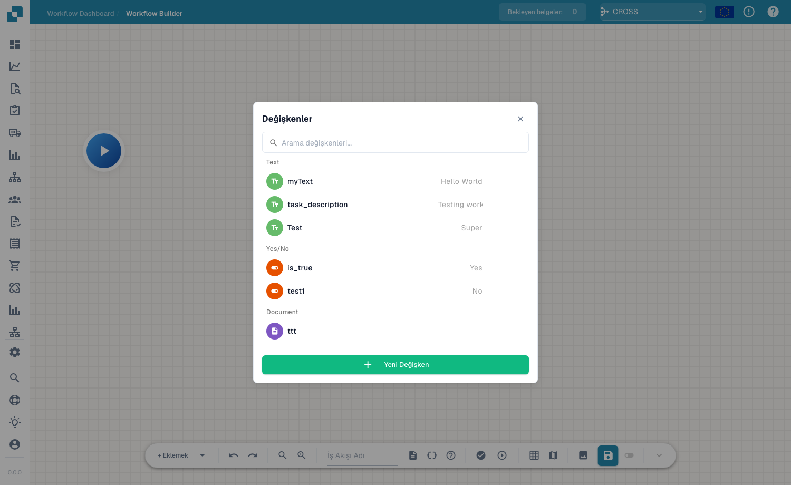

# Variablen

## Video: Variablen, Tests und Aktivierung



[Video öffnen](https://docbits-videos.fra1.cdn.digitaloceanspaces.com/settings-assistant/advanced_workflows_testing/v3/de.mp4) · [Untertitel (WebVTT)](https://docbits-videos.fra1.cdn.digitaloceanspaces.com/settings-assistant/advanced_workflows_testing/v3/de.vtt)

Transkript

Öffnen Sie Variablen über die geschweiften Klammern. Wählen Sie Text, Number, Yes oder No oder Document. Die Suche findet Namen. Eine Workflow Aktion setzt die Dokumentreferenz. Das Formular nimmt keinen Dokumentwert an.

Wählen Sie eindeutigen Namen, Typ und Anfangswert. Anlegen, Bearbeiten und Löschen speichern sofort für die Organisation. Andere Workflows können die Werte teilen. Speichern oder Verwerfen des Canvas macht Variablenänderungen nicht rückgängig.

Wählen Sie Validieren. Ein Klick auf Fehler oder Warnungen zeigt den Knoten. Prüfen Sie Aktionen, Einstiegsverbindungen, Anschlüsse, Schleifen und Zusammenführungen. Strukturvalidierung beweist keine korrekten Laufzeitdaten.

Die Wiedergabetaste öffnet Select Test Document. Wählen Sie Dokument, Custom Data oder Test Without Document für unabhängige Karten. Start spielt direkt ab. Tests verwenden ungespeicherte Änderungen und simulieren destruktive Aktionen.

Bereite getrennte Tests über, unter und genau bei eintausend sowie mit fehlenden Daten vor. Prüfe nach dem Lauf Meldungen und Laufzeiten: Grün bedeutet Erfolg, Orange falsch, Rot Fehler und Grau übersprungen. Teste Korrekturen erneut. Der Testmanager verwaltet wiederholbare Szenarien.

Auto-Save sichert Änderungen etwa alle dreißig Sekunden als lokalen Browserentwurf. Speichern Sie ausdrücklich auf dem Server. Der Aktivierungsschalter bleibt vor dem ersten Speichern gesperrt. Prüfen Sie den aktiven Zustand in der Workflow Liste.

[Alle fünf Kapitel ansehen](../advanced-workflow-videos.md)

Mit **Variablen** speichern Sie Werte einmal und verwenden sie über die Knoten eines Advanced Workflows hinweg wieder — zum Beispiel einen Schwellenwert, einen festen Empfänger oder einen Wert, den Sie aus dem Dokument lesen und an einen späteren Knoten weitergeben. Öffnen Sie das Variablen-Panel über die Schaltfläche **Variables** (das `{ }`-Symbol) in der Symbolleiste.

<figure><figcaption>
Das Variables-Panel — Variablen nach Typ gruppiert, mit Suche und <strong>New Variable</strong>.
</figcaption></figure>

## Variablentypen

Variablen werden nach ihrem Typ gruppiert:

- **Text** — ein Zeichenkettenwert (z. B. eine Beschreibung oder eine feste Bezeichnung).
- **Number** — ein numerischer Wert, etwa ein Schwellenwert ohne Währungssymbol.
- **Yes/No** — ein boolesches Kennzeichen (Yes / No).
- **Document** — eine Dokumentreferenz, die eine geeignete Workflow-Aktion setzt; das Formular nimmt keinen eingegebenen Dokument-Standardwert an.

Verwenden Sie das Suchfeld, um eine Variable schnell zu finden, wenn die Liste wächst.

## Eine Variable erstellen

Klicken Sie auf **New Variable**, geben Sie ihr einen Namen und einen Typ und legen Sie ihren Wert fest. Die Variable steht dann zur Verwendung in den Karten Ihrer Knoten zur Verfügung, sodass Sie die Konfiguration an einem Ort halten und ändern können, ohne jeden Knoten einzeln zu bearbeiten.

## Nächste Schritte

- Sehen Sie, wie Knoten diese Werte verwenden, unter [Knoten](nodes.md).
- Validieren und starten Sie den Workflow unter [Validierung & Test](validation-and-testing.md).

## Datenumfang und Speichern

Variablen gelten für die **Organisation**. Anlegen, Bearbeiten und Löschen werden sofort auf dem Server gespeichert. Andere Workflows können dieselben Werte verwenden. Speichern oder Verwerfen des Canvas macht diese Änderungen nicht rückgängig. Verwenden Sie für pro Rechnung unterschiedliche Werte die von der Karte unterstützten Dokumentdaten. [Das Ausführungsmodell](../workflow-execution-model.md) und [die Fehlerdiagnose](../workflow-troubleshooting.md) erklären den Zusammenhang.
