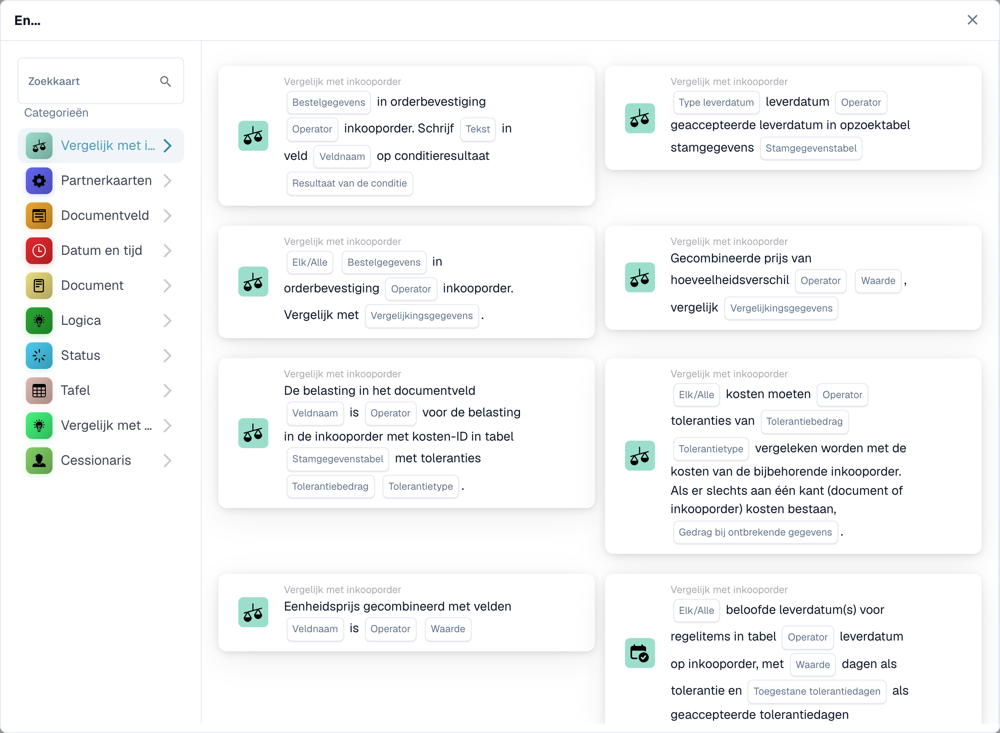
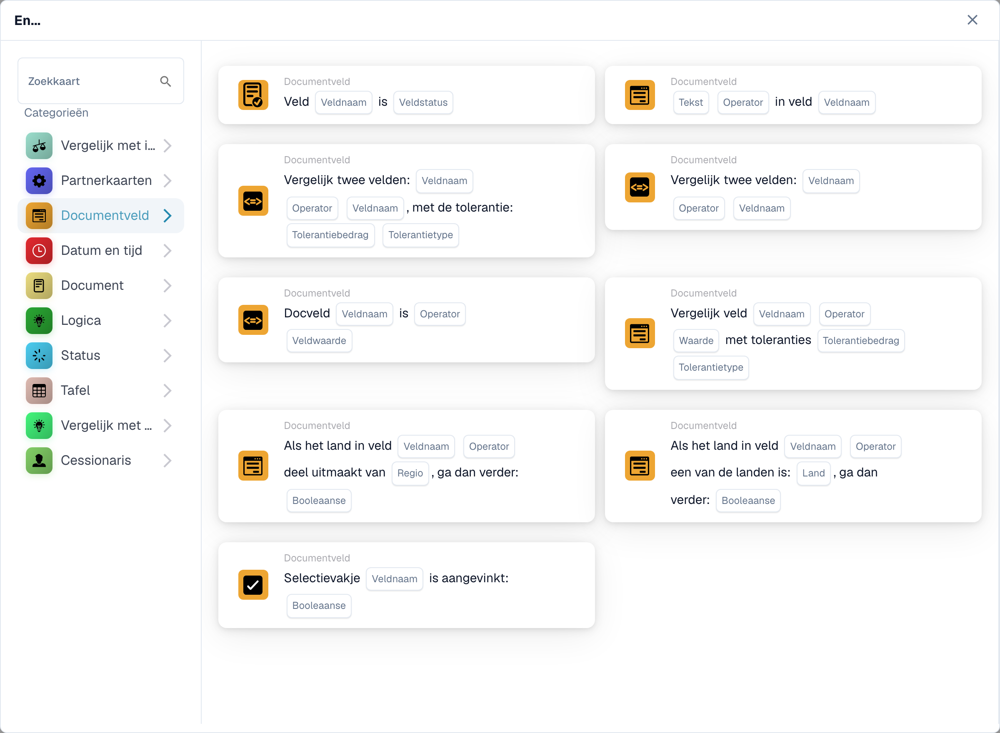
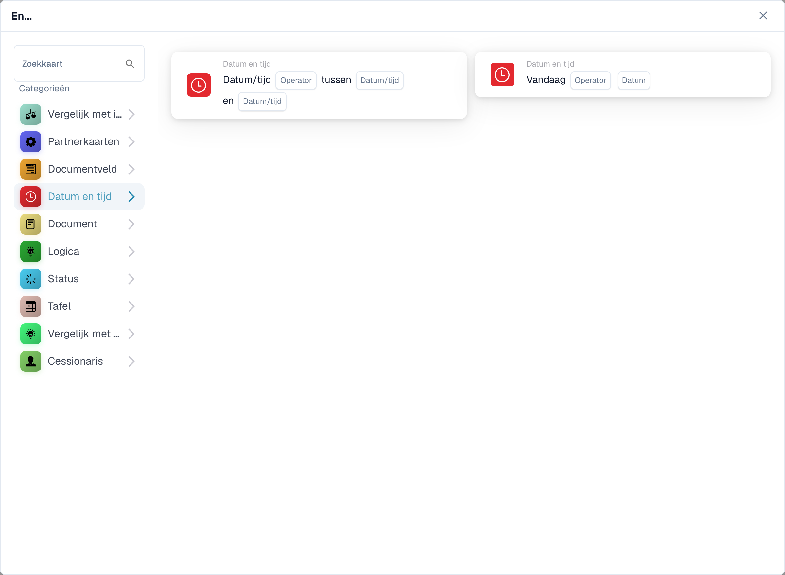
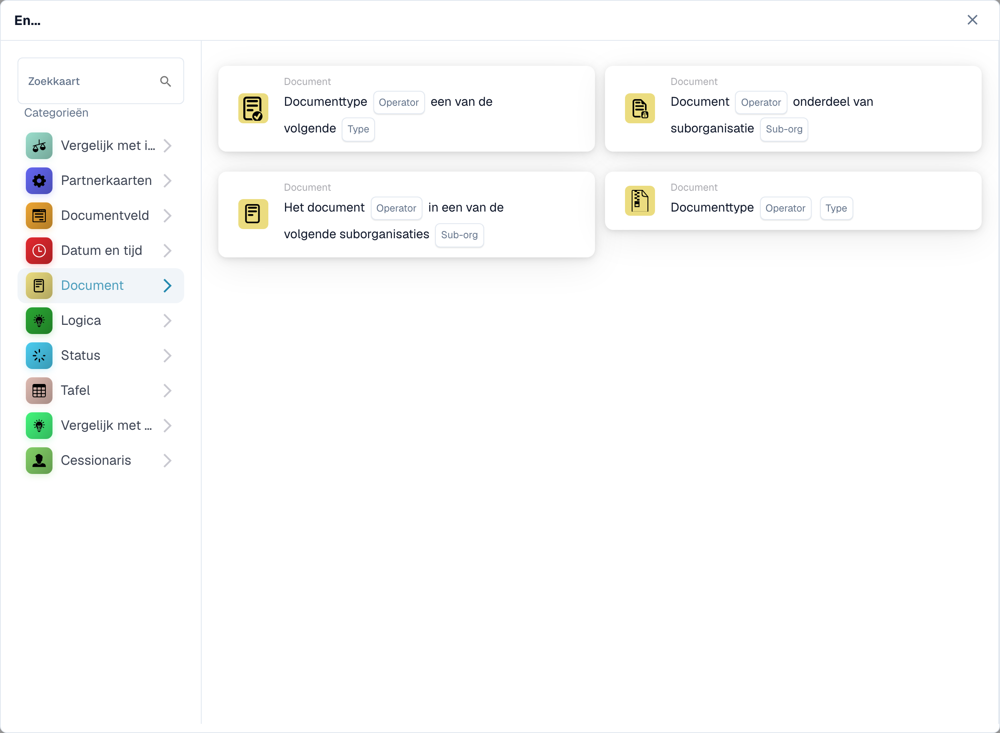
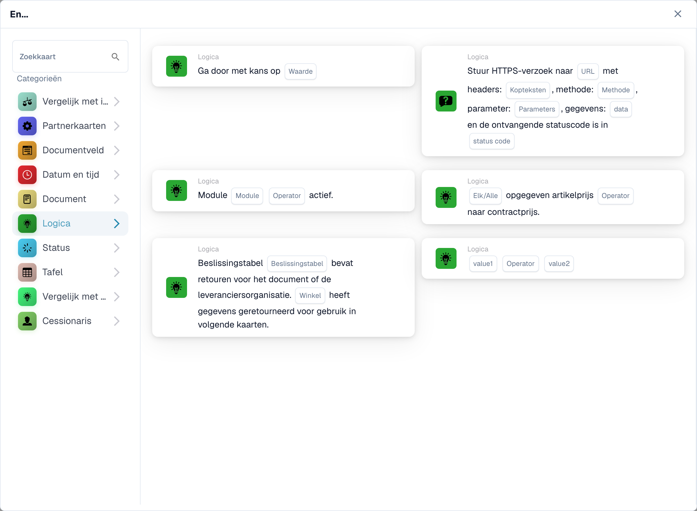
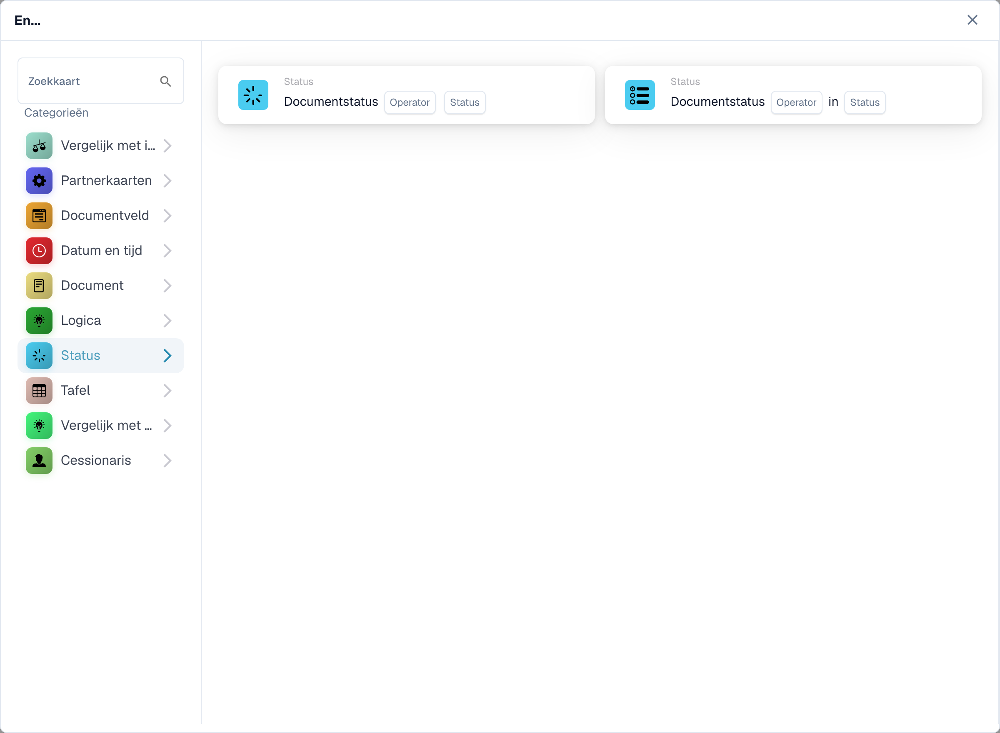
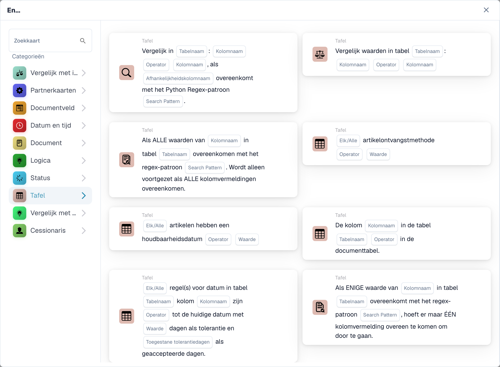
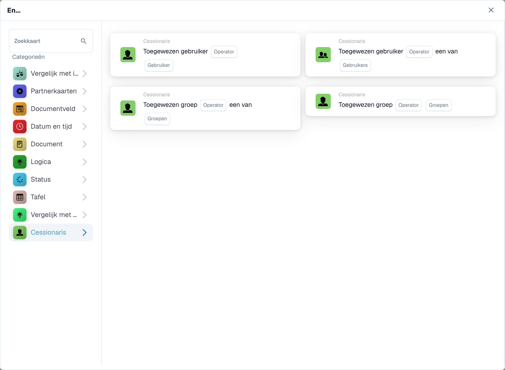

# En

Gebruik een **En**-kaart om te beslissen of een workflow moet worden voortgezet na de **Wanneer**-trigger. Voeg de controles toe die u nodig heeft vóór de actie **Dan**. Elke kaart toont velden die moeten worden ingevuld, zoals **Exploitant**, **Veldnaam** of **Waarde**; de schermafbeeldingen tonen de beschikbare kaartsjablonen, niet de voltooide regels.

In de **Workflow-bouwer** selecteert u **Kaart toevoegen** onder **En...**. Kies een categorie aan de linkerkant of typ een kaartnaam in **Zoek kaart**. Selecteer een kaartvoorbeeld om deze aan de workflow toe te voegen. U kunt door de voorbeeldlijst scrollen om meer kaarten te zien. Gebruik **×** om de kiezer te sluiten zonder een andere kaart te kiezen. Nadat u de kaarten heeft geconfigureerd, slaat u de workflow op. Zie [Workflow](..) voor de omliggende stappen **Wanneer**, **En** en **Dan**.

## Vergelijk met inkooporder

Gebruik deze kaarten om bestel- of factuurgegevens te vergelijken met een inkooporder, zoals eenheidsprijs, beloofde leverdatum, kosten of hoeveelheid. Kies de velden, operator en eventuele tolerantie waar de geselecteerde kaart om vraagt. Zie [Vergelijken met inkooporder](compare-with-purchase-order) voor de afzonderlijke kaarten.

<figure><figcaption>
Beschikbare kaarten in de geselecteerde categorie. Vul de velden vóór gebruik in. Sommige labels van deze versie zijn in de interface nog niet of onjuist vertaald. De uitleg op deze pagina gebruikt de juiste termen; de afbeelding toont de werkelijke interface.
</figcaption></figure>

## Documentveld

Kies deze categorie om de status van een selectievakje of veld te controleren, een veld met een waarde te vergelijken of twee velden te vergelijken. Vul de tijdelijke aanduidingen **Veldnaam** en **Exploitant** in op de gekozen kaart. Sommige vergelijkingen vragen ook om tolerantie. Zie [Documentveld](document-field).

<figure><figcaption>
Beschikbare kaarten in de geselecteerde categorie. Vul de velden vóór gebruik in. Sommige labels van deze versie zijn in de interface nog niet of onjuist vertaald. De uitleg op deze pagina gebruikt de juiste termen; de afbeelding toont de werkelijke interface.
</figcaption></figure>

## Datum en tijd

Gebruik **Datum en tijd** om een datum of tijd met een bereik te vergelijken, of vergelijk **Vandaag** met een gekozen datum. Selecteer de **Exploitant** en datumwaarden op de kaart. Zie [Datum en tijd](date-and-time).

<figure><figcaption>
Beschikbare kaarten in de geselecteerde categorie. Vul de velden vóór gebruik in. Sommige labels van deze versie zijn in de interface nog niet of onjuist vertaald. De uitleg op deze pagina gebruikt de juiste termen; de afbeelding toont de werkelijke interface.
</figcaption></figure>

## Document

Gebruik deze kaarten wanneer een workflow afhankelijk moet zijn van het **documenttype** of **suborganisatie**. Kies het type of de organisatie genoemd op de kaart. Zie [Document](document).

<figure><figcaption>
Beschikbare kaarten in de geselecteerde categorie. Vul de velden vóór gebruik in. Sommige labels van deze versie zijn in de interface nog niet of onjuist vertaald. De uitleg op deze pagina gebruikt de juiste termen; de afbeelding toont de werkelijke interface.
</figcaption></figure>

## Logica

Deze categorie omvat controles met behulp van een beslissingstabel, een HTTPS-antwoord, de beschikbaarheid van modules, een opgegeven artikelprijs, een kanswaarde of twee waarden. Open de specifieke kaart en vul de benoemde tijdelijke aanduidingen in; De HTTPS-kaart vraagt ​​bijvoorbeeld om een ​​URL, methode en geaccepteerde statuscode. Zie [Logica](logic).

<figure><figcaption>
Beschikbare kaarten in de geselecteerde categorie. Vul de velden vóór gebruik in. Sommige labels van deze versie zijn in de interface nog niet of onjuist vertaald. De uitleg op deze pagina gebruikt de juiste termen; de afbeelding toont de werkelijke interface.
</figcaption></figure>

## Status

Gebruik **Status** om te controleren of een document een gekozen status heeft of dat de status zich in een geselecteerde set bevindt. Kies de **Exploitant** en **Status** op de kaart. Zie [Status](status).

<figure><figcaption>
Beschikbare kaarten in de geselecteerde categorie. Vul de velden vóór gebruik in. Sommige labels van deze versie zijn in de interface nog niet of onjuist vertaald. De uitleg op deze pagina gebruikt de juiste termen; de afbeelding toont de werkelijke interface.
</figcaption></figure>

## Tabel

Deze kaarten onderzoeken documenttabelrijen. De zichtbare opties omvatten datumcontroles, tekstpatronen, houdbaarheid en vergelijkingen tussen kolommen. Selecteer de **Tabelnaam** en **Kolomnaam** voordat u een operator of patroon kiest. Zie [Tabel](table).

<figure><figcaption>
Beschikbare kaarten in de geselecteerde categorie. Vul de velden vóór gebruik in. Sommige labels van deze versie zijn in de interface nog niet of onjuist vertaald. De uitleg op deze pagina gebruikt de juiste termen; de afbeelding toont de werkelijke interface.
</figcaption></figure>

## Vergelijk met offerteprijs

Gebruik deze kaarten om een artikel te vergelijken met prijsgegevens. De zichtbare keuzes omvatten artikel-ID, leveranciertype, artikel-ID leverancier, eenheidsprijs en maateenheid. De **Exploitant** en tijdelijke aanduidingen voor gegevens zijn afhankelijk van de kaart die u selecteert.

<figure><figcaption>
Beschikbare kaarten in de geselecteerde categorie. Vul de velden vóór gebruik in. Sommige labels van deze versie zijn in de interface nog niet of onjuist vertaald. De uitleg op deze pagina gebruikt de juiste termen; de afbeelding toont de werkelijke interface.
</figcaption></figure>

## Toewijzing

Gebruik **Toegewezene** wanneer de voorwaarde afhangt van de toegewezen gebruiker of groep. Kies of u wilt vergelijken met één gebruiker of groep of met een geselecteerde set. Zie [Toegewezene](assignee).

<figure><figcaption>
Beschikbare kaarten in de geselecteerde categorie. Vul de velden vóór gebruik in. Sommige labels van deze versie zijn in de interface nog niet of onjuist vertaald. De uitleg op deze pagina gebruikt de juiste termen; de afbeelding toont de werkelijke interface.
</figcaption></figure>

[Gedetailleerde offertevergelijkingskaarten en elk/alles-gedrag](../cards-overview/quote-comparison-guide.md).
