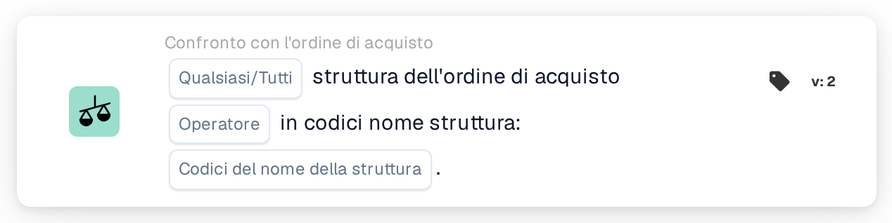

# Struttura dell'ordine di acquisto

<figure><figcaption>
Versione 2
</figcaption></figure>

## Scopo:

Questa scheda del workflow verifica la struttura degli ordini di acquisto abbinati a un documento rispetto a un elenco di codici di struttura. Può essere utilizzata per gestire i documenti in modo diverso a seconda della struttura (sede) per cui è stato effettuato l'ordine, ad esempio per instradarli al team responsabile di quella struttura.

L'abbinamento dell'ordine di acquisto dovrebbe essere eseguito prima di questa scheda. Senza un ordine di acquisto abbinato, la scheda segnala dati mancanti.

## Componenti della scheda:

1. **Qualsiasi/Tutti**
   * **Descrizione:** Come i codici di struttura degli ordini di acquisto abbinati vengono valutati rispetto all'elenco.
   * **Opzioni:**
     * **Qualsiasi:** Almeno una voce dell'elenco si trova tra i codici di struttura degli ordini di acquisto abbinati.
     * **Tutti:** Ogni codice di struttura degli ordini di acquisto abbinati è presente nell'elenco. Se non è impostato alcun valore, la scheda utilizza **Tutti**.
2. **Operatore**
   * **Descrizione:** Se la struttura dovrebbe essere presente nell'elenco o no.
   * **Opzioni:**
     * **È**
     * **Non è**
3. **Codici del nome della struttura**
   * **Descrizione:** I codici di struttura con cui viene confrontata la struttura dell'ordine di acquisto.
   * **Dettaglio:** È possibile inserire più codici, separati da virgole.

## Funzionalità:

* **Valutazione della condizione:** La scheda legge i numeri degli ordini di acquisto abbinati al documento, carica questi ordini di acquisto e raccoglie la struttura (sede) di ciascuno di essi. Gli ordini di acquisto senza struttura vengono saltati. I codici di struttura raccolti vengono quindi confrontati con i **Codici del nome della struttura** indicati sulla scheda.
  * Con **Qualsiasi** ed **È**, il confronto non distingue tra maiuscole e minuscole, e una voce dell'elenco conta anche quando fa parte di un codice di struttura più lungo (ad esempio, la voce `WH` viene trovata in `WH01`).
  * Con **Tutti** ed **È**, ogni codice di struttura degli ordini di acquisto dovrebbe comparire nell'elenco esattamente con la stessa grafia, comprese maiuscole e minuscole.
  * Se nessuno degli ordini di acquisto abbinati ha una struttura, **Tutti** è soddisfatto e **Qualsiasi** no.
  * Con **Non è**, il risultato non è semplicemente l'opposto di **È**. Il log della scheda mostra quali codici sono stati trovati e quali non hanno trovato corrispondenza, il che aiuta a verificare il comportamento per una determinata configurazione.
* **Esecuzione dell'azione:**
  * **Condizione vera:**\
    Se la condizione è soddisfatta, il workflow prosegue, ad esempio con un passaggio specifico per le strutture elencate.
  * **Condizione falsa:**\
    Se la condizione non è soddisfatta, il workflow si arresta con una condizione non soddisfatta.
* **Dati mancanti:** Se sulla scheda non è inserito alcun codice di struttura, oppure il documento non ha un ordine di acquisto abbinato, la scheda non valuta la condizione e segnala i dati mancanti nel log del workflow.

## Configurazione e impostazione:

* La scheda può essere aggiunta come condizione And dopo l'abbinamento dell'ordine di acquisto, dalla categoria **Confronto con l'ordine di acquisto**. Successivamente è possibile impostare **Qualsiasi** o **Tutti**, l'operatore e i codici di struttura, separati da virgole. Inserire i codici con la stessa grafia dell'ordine di acquisto è la scelta più sicura, perché **Tutti** li confronta in modo esatto.
* Per provare la configurazione su un documento esistente è possibile utilizzare **Scheda di prova** nel menu della scheda del Workflow Builder. Il log della scheda elenca gli ordini di acquisto abbinati, i codici di struttura trovati su di essi e i codici che non hanno trovato corrispondenza.

## Conclusione:

La scheda del workflow "Facility of Purchase Order" rende disponibile la struttura della merce ordinata come condizione del workflow. In questo modo un unico workflow può trattare in modo diverso i documenti destinati a strutture diverse, basandosi sui dati dell'ordine di acquisto anziché su quanto stampato sul documento.
