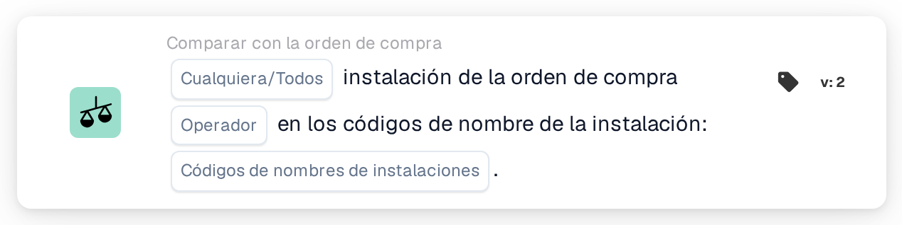

# Instalación de la orden de compra

<figure><figcaption>
Versión 2
</figcaption></figure>

## Propósito:

Esta tarjeta de flujo de trabajo comprueba la instalación de las órdenes de compra emparejadas con un documento frente a una lista de códigos de instalación. Puede utilizarse para tratar los documentos de forma diferente según la instalación (ubicación) para la que se realizó el pedido, por ejemplo para dirigirlos al equipo responsable de esa instalación.

La conciliación de la orden de compra debería ejecutarse antes de esta tarjeta. Sin una orden de compra emparejada, la tarjeta informa de datos faltantes.

## Componentes de la tarjeta:

1. **Cualquiera/Todos**
   * **Descripción:** Cómo se evalúan los códigos de instalación de las órdenes de compra emparejadas frente a la lista.
   * **Opciones:**
     * **Cualquier:** Al menos una entrada de la lista se encuentra en los códigos de instalación de las órdenes de compra emparejadas.
     * **Todos:** Cada código de instalación de las órdenes de compra emparejadas está en la lista. Si no se ha definido ningún valor, la tarjeta utiliza **Todos**.
2. **Operador**
   * **Descripción:** Si la instalación debería estar en la lista o no.
   * **Opciones:**
     * **Es**
     * **No Es**
3. **Códigos de nombres de instalaciones**
   * **Descripción:** Los códigos de instalación con los que se compara la instalación de la orden de compra.
   * **Detalle:** Se pueden introducir varios códigos, separados por comas.

## Funcionalidad:

* **Evaluación de la condición:** La tarjeta lee los números de orden de compra emparejados con el documento, carga estas órdenes de compra y recoge la instalación (ubicación) de cada una de ellas. Las órdenes de compra sin instalación se omiten. A continuación, los códigos de instalación recogidos se comparan con los **Códigos de nombres de instalaciones** de la tarjeta.
  * Con **Cualquier** y **Es**, la comparación no distingue entre mayúsculas y minúsculas, y una entrada de la lista también cuenta cuando forma parte de un código de instalación más largo (por ejemplo, la entrada `WH` se encuentra en `WH01`).
  * Con **Todos** y **Es**, cada código de instalación de las órdenes de compra debería aparecer en la lista con exactamente la misma grafía, incluidas las mayúsculas y minúsculas.
  * Si ninguna de las órdenes de compra emparejadas tiene instalación, **Todos** se cumple y **Cualquier** no.
  * Con **No Es**, el resultado no es simplemente lo contrario de **Es**. El registro de la tarjeta muestra qué códigos se encontraron y cuáles no coincidieron, lo que ayuda a comprobar el comportamiento para una configuración concreta.
* **Ejecución de la acción:**
  * **Condición verdadera:**\
    Si se cumple la condición, el flujo de trabajo continúa, por ejemplo con un paso específico para las instalaciones indicadas.
  * **Condición falsa:**\
    Si no se cumple la condición, el flujo de trabajo se detiene con una condición no cumplida.
* **Datos que faltan:** Si no se han introducido códigos de instalación en la tarjeta, o el documento no tiene ninguna orden de compra emparejada, la tarjeta no evalúa la condición y registra los datos que faltan en el registro del flujo de trabajo.

## Configuración:

* La tarjeta se puede añadir como condición And después de la conciliación de la orden de compra, desde la categoría **Comparar con la orden de compra**. A continuación se pueden definir **Cualquier** o **Todos**, el operador y los códigos de instalación, separados por comas. Introducir los códigos con la misma grafía que en la orden de compra es la opción más segura, porque **Todos** los compara de forma exacta.
* Para probar la configuración con un documento existente, se puede utilizar **Tarjeta de prueba** en el menú de la tarjeta del Workflow Builder. El registro de la tarjeta enumera las órdenes de compra emparejadas, los códigos de instalación encontrados en ellas y los códigos que no coincidieron.

## Conclusión:

La tarjeta de flujo de trabajo «Facility of Purchase Order» pone la instalación de los bienes pedidos a disposición como condición del flujo de trabajo. Así, un mismo flujo de trabajo puede tratar de forma diferente los documentos de distintas instalaciones, basándose en los datos de la orden de compra y no en lo que figura impreso en el documento.
