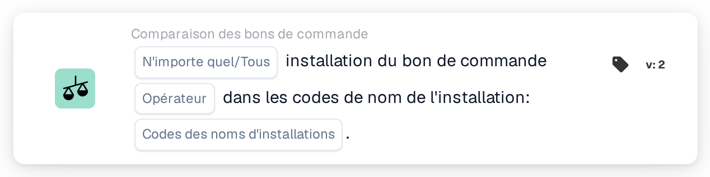

# Établissement du bon de commande

<figure><figcaption>
Version 2
</figcaption></figure>

## Objectif :

Cette carte de workflow vérifie l'établissement des bons de commande rapprochés d'un document par rapport à une liste de codes d'établissement. Elle peut servir à traiter les documents différemment selon l'établissement (le site) pour lequel la commande a été passée, par exemple pour les acheminer vers l'équipe responsable de cet établissement.

Le rapprochement de bon de commande devrait s'exécuter avant cette carte. Sans bon de commande rapproché, la carte signale des données manquantes.

## Composants de la carte :

1. **N'importe quel/Tous**
   * **Description :** la manière dont les codes d'établissement des bons de commande rapprochés sont évalués par rapport à la liste.
   * **Options :**
     * **N'importe quel :** au moins une entrée de la liste figure parmi les codes d'établissement des bons de commande rapprochés.
     * **Tous :** chaque code d'établissement des bons de commande rapprochés figure dans la liste. Si aucune valeur n'est définie, la carte utilise **Tous**.
2. **Opérateur**
   * **Description :** indique si l'établissement devrait figurer dans la liste ou non.
   * **Options :**
     * **Est**
     * **N'est pas**
3. **Codes des noms d'installations**
   * **Description :** les codes d'établissement auxquels l'établissement du bon de commande est comparé.
   * **Détail :** plusieurs codes peuvent être saisis, séparés par des virgules.

## Fonctionnalité :

* **Évaluation de la condition :** la carte lit les numéros des bons de commande rapprochés du document, charge ces bons de commande et relève l'établissement (le site) de chacun d'eux. Les bons de commande sans établissement sont ignorés. Les codes d'établissement relevés sont ensuite comparés aux **Codes des noms d'installations** indiqués sur la carte.
  * Avec **N'importe quel** et **Est**, la comparaison ne tient pas compte des majuscules et des minuscules, et une entrée de la liste compte également lorsqu'elle fait partie d'un code d'établissement plus long (par exemple, l'entrée `WH` est trouvée dans `WH01`).
  * Avec **Tous** et **Est**, chaque code d'établissement des bons de commande devrait figurer dans la liste avec exactement la même orthographe, majuscules comprises.
  * Si aucun des bons de commande rapprochés n'a d'établissement, **Tous** est satisfait et **N'importe quel** ne l'est pas.
  * Avec **N'est pas**, le résultat n'est pas simplement l'inverse de **Est**. Le journal de la carte indique quels codes ont été trouvés et lesquels n'ont pas été appariés, ce qui aide à vérifier le comportement pour une configuration donnée.
* **Exécution de l'action :**
  * **Condition vraie :**\
    Si la condition est remplie, le workflow se poursuit, par exemple avec une étape propre aux établissements listés.
  * **Condition fausse :**\
    Si la condition n'est pas remplie, le workflow s'arrête sur une condition non satisfaite.
* **Données manquantes :** si aucun code d'établissement n'est saisi sur la carte, ou si le document n'a pas de bon de commande rapproché, la carte n'évalue pas la condition et signale les données manquantes dans le journal du workflow.

## Mise en place et configuration :

* La carte peut être ajoutée comme condition And après le rapprochement de bon de commande, depuis la catégorie **Comparaison des bons de commande**. Ensuite, **N'importe quel** ou **Tous**, l'opérateur et les codes d'établissement, séparés par des virgules, peuvent être définis. Saisir les codes avec la même orthographe que sur le bon de commande est le choix le plus sûr, car **Tous** les compare à l'identique.
* **Tester la carte** dans le menu de la carte du Workflow Builder peut être utilisé pour essayer la configuration sur un document existant. Le journal de la carte liste les bons de commande rapprochés, les codes d'établissement qui y ont été trouvés et les codes qui n'ont pas été appariés.

## Conclusion :

La carte de workflow « Facility of Purchase Order » met l'établissement des marchandises commandées à disposition comme condition de workflow. Un même workflow peut ainsi traiter différemment les documents destinés à différents établissements, en se fondant sur les données du bon de commande plutôt que sur ce qui est imprimé sur le document.
