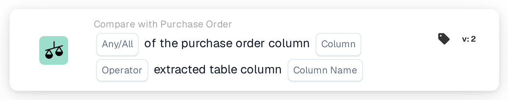
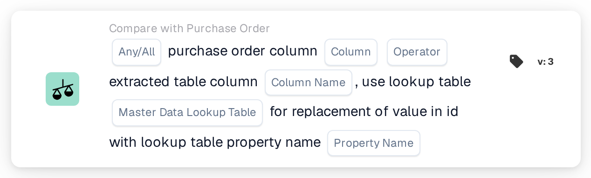

# Purchase Order Column and Extracted Table Column

<figure><figcaption>
Version 2
</figcaption></figure>

<figure><figcaption>
Version 3
</figcaption></figure>

## Purpose:

This workflow card compares a column of the matched purchase order lines with a column of the extracted line item table on the document. For every document row that purchase order matching paired with a purchase order line, the value in the selected purchase order column is compared with the value in the selected table column of that row. The individual results are then combined with the **Any / All** setting into the single result of the card.

Version 3 can additionally translate the purchase order value through a master data lookup table before comparing, which helps when the purchase order and the document use different codes for the same thing, for example different unit codes.

Purchase order matching should run before this card. Without a matched purchase order the card reports missing data.

## Components of the Card:

1. **Any / All**
   * **Description:** How the comparisons of the individual rows are combined into the result of the card.
   * **Options:**
     * **Any:** At least one compared row satisfies the condition.
     * **All:** Every compared row satisfies the condition. If no value is set, the card uses **All**.
2. **Column**
   * **Description:** The column of the purchase order line whose value is compared.
   * **Detail:** The value is read from the purchase order line that was matched to the document row.
3. **Operator**
   * **Description:** How the purchase order value is compared with the document value. The purchase order value is on the left side of the comparison, so **Greater Than** means the purchase order value is greater than the document value.
   * **Options:**
     * **Equals**
     * **Not Equals**
     * **Greater Than**
     * **Greater or Equals**
     * **Less Than**
     * **Less or Equals**
4. **Column Name**
   * **Description:** The column of the extracted table on the document that is compared with the purchase order column.
   * **Detail:** The card uses the first extracted table of the document.
5. **Master Data Lookup Table (version 3 only)**
   * **Description:** An optional lookup table used to translate the purchase order value before the comparison.
   * **Detail:** The purchase order value, converted to upper case, is searched in the lookup table property **codevalue**. If a record is found and it has a value for the selected **Property Name**, the purchase order value is replaced by the cleaned value of that property. If no record or no value is found, the upper-case purchase order value is used. The document value is not translated.
6. **Property Name (version 3 only)**
   * **Description:** The property of the lookup table record whose value replaces the purchase order value.
   * **Detail:** **Master Data Lookup Table** and **Property Name** can both be left empty, in which case the card compares the values without translation. If only one of the two is set, the card reports missing data.

## Functionality:

* **Condition Evaluation:** For every matched purchase order line, the card finds the document table row (or, in version 3, the rows) paired with it and compares the two values with the selected operator.
  * If both values are numbers, they are compared as numbers.
  * Otherwise they are compared as text. With **Equals**, differences in capitalisation do not count. In version 3 both values are converted to upper case before the comparison; a value taken from the lookup table is used as it is stored there. The **Greater** and **Less** operators compare text in plain character order, so they are mainly useful for numeric columns.
* **Action Execution:**
  * **True Condition:**\
    With **All**, every compared row satisfies the operator; with **Any**, at least one does. The workflow continues.
  * **False Condition:**\
    If the combined result is not met, the workflow stops with an unmet condition.
* **Missing Data:** The card does not evaluate the condition and reports missing data in the workflow log when:
  * the document has no matched purchase order, or the data of a matched purchase order is not available,
  * the document has no extracted table,
  * the purchase order column of a compared line is empty (a numeric value of 0 counts as empty as well),
  * the table column of a compared row is empty or not present,
  * no row could be compared at all,
  * a required input is not set (in version 3 also when only one of the two lookup inputs is set).

## Setup and Configuration:

* The card can be added as an And condition after purchase order matching, from the **Compare with Purchase Order** category. After that, **Any / All**, the purchase order **Column**, the **Operator** and the document table **Column Name** can be selected. On version 3, a **Master Data Lookup Table** and a **Property Name** could be added when the purchase order uses different codes than the document.
* To check a configuration, **Test Card** in the card menu of the Workflow Builder can be used on an existing document. The card log lists every comparison with both values and its result.

## Conclusion:

The "Purchase Order Column and Extracted Table Column" workflow card checks a single line item column against the matched purchase order, row by row. It can be used for any column that exists on both sides, and version 3 also covers cases where the two sides use different codes for the same value.
