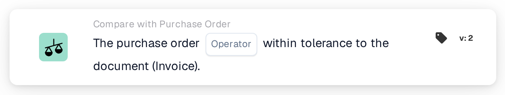

# Purchase Order Full Match

<figure><figcaption>
Version 2
</figcaption></figure>

## Purpose:

This workflow card checks whether the matched purchase order agrees with the document within the tolerances, as a whole. Quantity, unit price and additional charges of every matched line are checked in one step, so a single card can decide whether a document can be processed without manual review.

Purchase order matching should run before this card. Without a matched purchase order the card reports missing data.

## Components of the Card:

1. **Operator**
   * **Description:** Whether the purchase order should be a full match to the document or not.
   * **Options:**
     * **Is:** The condition is met if every check is within tolerance.
     * **Is Not:** The condition is met if at least one check is outside the tolerance.

## Functionality:

* **Condition Evaluation:** The card goes through every matched purchase order line (including sub-lines) and uses the comparison data that purchase order matching stored for it:
  * **Quantity:** The document quantity is compared with the purchase order quantity, within the quantity tolerance of the line.
  * **Unit price:** The document unit price is compared with the purchase order unit price, within the unit price tolerance of the line. Where the line carries no unit price in its comparison data but only in its general matching information, the card uses the unit price tolerance configured for the document type instead of the tolerance stored on the line; a percentage tolerance is then measured from the purchase order price.
  * **Additional charges:** For every additional charge of the line, the charge rate, the unit price and the amount are each compared with the purchase order, within their tolerances.
  * For delivery notes, which carry no prices, only the quantity is compared.
* All checks of all lines are combined: the purchase order is a full match only if every single check is within tolerance.
* **Action Execution:**
  * **True Condition:**\
    With **Is**, every check is within tolerance; with **Is Not**, at least one is not. The workflow continues.
  * **False Condition:**\
    Otherwise the workflow stops with an unmet condition.
* **Missing Data:** The card does not evaluate the condition and reports missing data in the workflow log when the document has no matched purchase order, or when a matched line lacks part of the data needed for its checks, for example a quantity, a unit price, an additional charge value or the tolerance of one of them (including a missing or unusable unit price tolerance on the document type, where that one is needed). A missing tolerance is not treated as a tolerance of 0. This also applies with **Is Not**: missing data is reported as missing data, not as a mismatch.

## Setup and Configuration:

* The card can be added as an And condition after purchase order matching, from the **Compare with Purchase Order** category. After that, the operator (**Is** or **Is Not**) can be selected. The tolerances themselves are not set on the card; they come from purchase order matching and the document type settings.
* **Test Card** in the card menu of the Workflow Builder can be used to try the card on an existing document. The card log lists each quantity, unit price and charge comparison with the document and purchase order values.

## Conclusion:

The "Purchase Order Full Match" workflow card summarises the purchase order comparison of a document in one condition. Documents that agree with their purchase order on every line can pass automatically, while any difference outside the tolerances is reported as an unmet condition and missing comparison data as missing data, never as a match.
