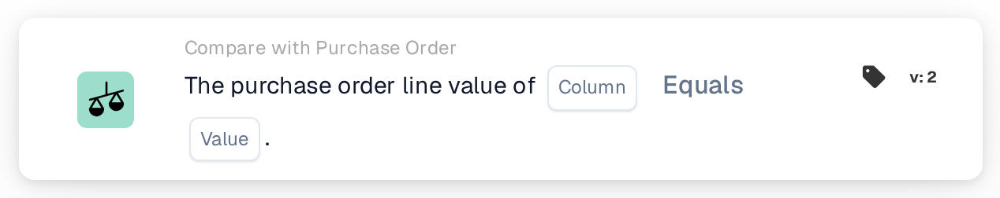

# Purchase Order Line Value

<figure><figcaption>
Version 2
</figcaption></figure>

## Purpose:

This workflow card compares a column of the matched purchase order lines with a fixed value. It can be used to check a property of the ordered lines that is not printed on the document, for example a status, a unit code or a delivery method, and to handle the document accordingly.

Purchase order matching should run before this card. Without a matched purchase order the card reports missing data.

## Components of the Card:

1. **Column**
   * **Description:** The purchase order line column whose value is compared.
2. **Operator**
   * **Description:** How the purchase order line value is compared with the value on the card. The default is **Equals**.
   * **Options:**
     * **Equals:** The line value equals the value. For text, capitalisation is ignored.
     * **Not Equals:** The line value differs from the value. For text, capitalisation counts.
     * **Greater Than**, **Greater or Equals**, **Less Than**, **Less or Equals:** Mainly useful for numeric columns.
     * **Contains:** The line value is exactly one of the entries in **Value**, including capitalisation. Partial matches are not counted.
     * **Not Contains:** The line value is none of the entries in **Value** (compared in the same exact way).
3. **Value**
   * **Description:** The value the purchase order line value is compared with.
   * **Detail:** With **Contains** and **Not Contains**, several entries can be entered, separated by commas. With the **Greater** and **Less** operators, a list of values is not supported.

## Functionality:

* **Condition Evaluation:** For every matched purchase order line (including sub-lines), the card reads the value of the selected column and compares it with **Value** using the operator. If both are numbers, they are compared as numbers, otherwise as text.
* Every compared line has to satisfy the condition; there is no **Any / All** option on this card.
* **Action Execution:**
  * **True Condition:**\
    If every compared line satisfies the condition, the workflow continues.
  * **False Condition:**\
    If at least one line does not satisfy it, the workflow stops with an unmet condition.
* **Missing Data:** The card does not evaluate the condition and reports missing data in the workflow log when **Column** or **Value** is not set, when the document has no matched purchase order or its data is not available, when the selected column of a matched line is empty (a numeric value of 0 counts as empty as well), or when no line could be compared.
* **Setup Error:** If **Value** contains a comma and one of the **Greater** or **Less** operators is selected, the card stops with a setup error.

## Setup and Configuration:

* The card can be added as an And condition after purchase order matching, from the **Compare with Purchase Order** category. After that, the purchase order line **Column**, the operator and the **Value** can be set. For a check against several allowed values, **Contains** with a comma-separated list could be used.
* **Test Card** in the card menu of the Workflow Builder can be used to try the card on an existing document. The card log lists each compared line value with the operator and the value used.

## Conclusion:

The "Purchase Order Line Value" workflow card brings purchase order line data into the workflow as a simple condition. It lets a workflow react to how the goods were ordered, even when that information does not appear on the document itself.
