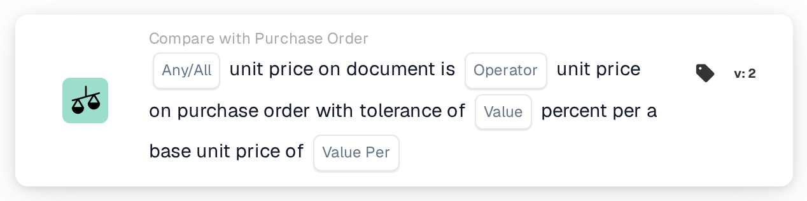

# Unit Price Tolerance per Base Price

<figure><figcaption>
Version 2
</figcaption></figure>

## Purpose:

This workflow card compares the unit prices on the document with the unit prices on the matched purchase order lines, using a percentage tolerance that grows with the purchase order price. The tolerance is entered as a percentage per base unit price, so higher-priced items get a larger percentage tolerance than lower-priced ones.

For a fixed tolerance, the card **Any / All Unit Price is** can be used.

Purchase order matching should run before this card. Without a matched purchase order the card reports missing data.

## Components of the Card:

1. **Any / All**
   * **Description:** How the comparisons of the individual lines are combined into the result of the card.
   * **Options:**
     * **Any:** At least one line satisfies the comparison.
     * **All:** Every compared line satisfies the comparison. If no value is set, the card uses **All**.
2. **Operator**
   * **Description:** How the document unit price is compared with the purchase order unit price, taking the tolerance into account.
   * **Options:**
     * **Equals:** The document price is within the tolerance range around the purchase order price.
     * **Not Equals:** The document price is outside the tolerance range.
     * **Greater Than:** The document price is above the tolerance range.
     * **Greater or Equals:** The document price is within or above the tolerance range.
     * **Less Than:** The document price is below the tolerance range.
     * **Less or Equals:** The document price is within or below the tolerance range.
3. **Value**
   * **Description:** The tolerance in percent that applies at the base unit price.
   * **Detail:** A number, for example `1` for 1 percent.
4. **Value Per**
   * **Description:** The base unit price the tolerance percentage refers to.
   * **Detail:** A number greater than 0, for example `100`.

## Functionality:

* **Tolerance Calculation:** For every line, the tolerance percentage is scaled by the ratio of the purchase order unit price to the base unit price:\
  tolerance % = **Value** × (purchase order unit price ÷ **Value Per**)\
  The tolerance range is the purchase order unit price plus and minus this percentage.\
  Example with **Value** 1 and **Value Per** 100: a purchase order price of 50 gives a tolerance of 0.5 %, so the range is 49.75 to 50.25. A purchase order price of 200 gives 2 %, so the range is 196 to 204.
* **Condition Evaluation:** For every matched purchase order line, the document unit price is compared with the unit price of the purchase order line, using the operator and the calculated range. Matched entries without a purchase order line are skipped. The results are combined with **Any / All**.
* **Action Execution:**
  * **True Condition:**\
    If the combined result is met, the workflow continues.
  * **False Condition:**\
    If the combined result is not met, the workflow stops with an unmet condition. This is also the case when no line could be compared.
* **Missing Data:** The card does not evaluate the condition and reports missing data in the workflow log when **Value** or **Value Per** is not set, when the document has no matched purchase order, or when the document or the purchase order is missing the unit price of a compared line (an empty unit price or a numeric unit price of 0 counts as missing).
* **Errors:** The card stops with an error when **Value** or **Value Per** is not a number, when a unit price cannot be read as a number, when **Value Per** is 0, or when the calculated tolerance for a line is below 0 % or above 100 %.

## Setup and Configuration:

* The card can be added as an And condition after purchase order matching, from the **Compare with Purchase Order** category. After that, **Any / All**, the operator, the tolerance percentage in **Value** and the base unit price in **Value Per** can be entered. The base unit price should be chosen so that the calculated tolerance stays between 0 % and 100 % for the price range of the items.
* **Test Card** in the card menu of the Workflow Builder can be used to try the card on an existing document. The card log shows, for every line, both prices, the calculated tolerance in percent and the resulting range.

## Conclusion:

The "Unit Price Tolerance per Base Price" workflow card applies a price-dependent tolerance to the unit price comparison with the purchase order. This allows a tight tolerance for low-priced items and a wider one for high-priced items with a single card.
