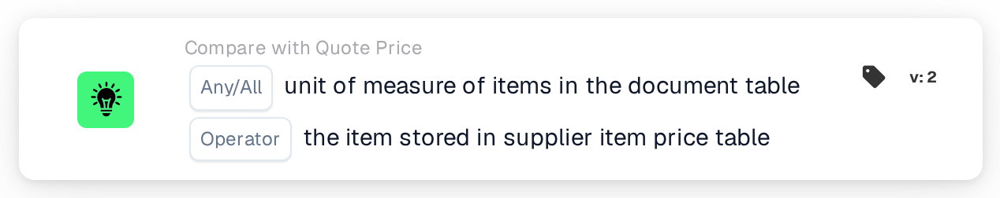
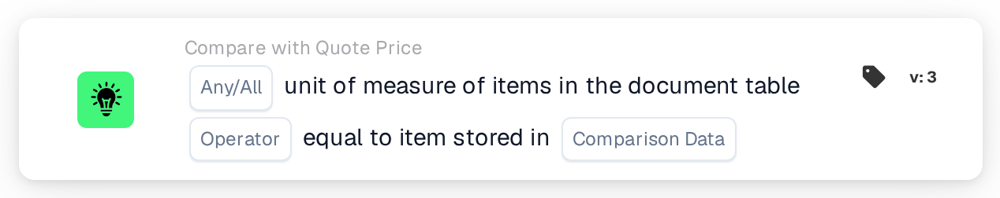

# Unit of Measure

<figure><figcaption>
Version 2
</figcaption></figure>

<figure><figcaption>
Version 3
</figcaption></figure>

## Purpose:

This workflow card compares the unit of measure of the items in the document table with the unit of measure stored for the same items elsewhere. In version 2, the comparison is always made with the supplier item price table. Version 3 adds a choice between the supplier item price table and the line items of the matched purchase order. The card can be used to detect lines where an item is quoted or invoiced in a different unit than expected. Based on the result, the workflow continues with the true or the false condition.

## Components of the Card:

1. **Any/All**
   * **Description:** Defines whether one line or every compared line of the document table should meet the condition.
   * **Options:**
     * **Any:** The condition is true if at least one compared line meets the condition.
     * **All:** The condition is true only if every compared line meets the condition.
2. **Operator**
   * **Description:** Defines whether the units of measure should be equal or different.
   * **Options:**
     * **Equals:** The unit of measure on the document line is the same as the stored one.
     * **Not Equals:** The unit of measure on the document line differs from the stored one.
3. **Comparison Data** (version 3 only)
   * **Description:** The source the unit of measure of the document is compared with.
   * **Options:**
     * **quoted supplier item price:** The unit of measure stored for the supplier item in the supplier item price table, as in version 2.
     * **purchase order line item:** The unit of measure of the matched purchase order line.

## Functionality:

* **Condition Evaluation:** The card reads the unit of measure (column `UNIT`) of the lines in the first document table and compares it with the selected source. The comparison does not distinguish between upper and lower case. The results of all compared lines are then combined with **Any** or **All**.
  * **quoted supplier item price:** Only lines that are linked to an entry of the matched quote data are compared. For each of these lines, the unit of measure stored for its supplier item is used.
  * **purchase order line item** (version 3): Only lines that are matched to a purchase order line are compared. The unit of measure of the purchase order line is first translated with the unit of measure lookup table (from the EDI unit to the M3 unit). On both sides, a few spellings are treated as the same: "each" as "ea", and "lbs" and "lbp" as "lb".
* **Skipped Lines:** A line is left out of the comparison if the source has no unit of measure for it. Each skipped line is noted in the workflow log.
* **Action Execution:**
  * **True Condition:**\
    The units of measure meet the selected operator for any or all compared lines. The workflow continues with the true condition.
  * **False Condition:**\
    If the condition is not met, the workflow continues with the false condition, for example to send the document for a manual review. The false condition is also used if no line could be linked to the selected source, and in version 3 if no **Comparison Data** option is selected, because then no line is compared.
* **Missing Data:** The card does not evaluate the condition and reports the missing data in the workflow log if:
  * the document has no table,
  * **quoted supplier item price** (or version 2) is used and the document has no matched quote data or no supplier item price data,
  * **purchase order line item** is selected and the document has no matched purchase order,
  * a compared line has an empty unit of measure on the document,
  * none of the lines could be compared because every line was skipped.

  If no **Any/All** option is set, the card notes this in the log and uses **All**.
* **Errors:** With **purchase order line item**, if a purchase order line is split into sub-lines that carry different units of measure, the card ends with an error.

## Setup and Configuration:

* The card can be added from the **Compare with Quote Price** category. After that, **Any** or **All** and the operator can be selected. In version 3, the source to compare with can also be selected in the **Comparison Data** field. Finally, the continue condition (true or false) is set, which determines the next step in the workflow.
* The document table should contain a `UNIT` column. For the comparison with purchase order line items, the unit of measure lookup table should hold the mappings between the units used on documents and on purchase orders.

## Conclusion:

The "Unit of Measure" workflow card makes sure that items are quoted or invoiced in the expected unit. Lines without a stored unit of measure are skipped instead of being counted as differences, and version 3 extends the check from the supplier item price table to purchase order lines.
