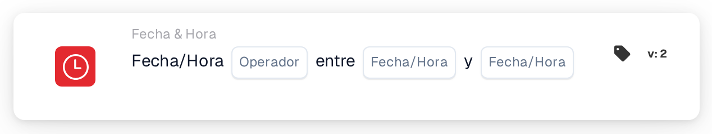

# Fecha u hora

<figure><figcaption>
Versión 2
</figcaption></figure>

## Propósito:

Esta tarjeta de flujo de trabajo comprueba si la fecha y la hora actuales están dentro o fuera de un intervalo establecido en la tarjeta. Se puede utilizar para limitar pasos a determinadas horas, por ejemplo al horario laboral o a una ventana de mantenimiento prevista.

## Componentes de la tarjeta:

1. **Operador**
   * **Opciones:**
     * **Es:** La fecha y la hora actuales están dentro del intervalo.
     * **No Es:** La fecha y la hora actuales están fuera del intervalo.
2. **Primera fecha/hora**
   * **Descripción:** Un extremo del intervalo, como fecha y hora o solo como hora.
3. **Segunda fecha/hora**
   * **Descripción:** El otro extremo del intervalo.

## Funcionalidad:

* **Evaluación de la condición:** Cuando el flujo de trabajo llega a la tarjeta, esta toma la fecha y la hora actuales en UTC y comprueba si están entre los dos valores de la tarjeta. El valor anterior se utiliza como inicio, por lo que el orden de los dos campos no importa.
  * Un valor que solo contiene una hora (por ejemplo `09:00`) se utiliza con la fecha de hoy, de modo que el intervalo se repite cada día.
  * El inicio y el fin forman parte del intervalo: exactamente a la hora de inicio o de fin, **Es** es verdadero.
  * Un intervalo que cruza la medianoche se puede introducir solo con horas, por ejemplo de `22:00` a `04:00`. En ese caso, la tarjeta comprueba el tiempo desde las 22:00 hasta las 04:00; las horas exactas de inicio y de fin no forman parte del intervalo en este caso.
  * Un intervalo que cruza la medianoche con fechas completas (por ejemplo de `2026-11-01 22:00` a `2026-11-02 04:00`) actualmente no se evalúa correctamente y no debería utilizarse.
* **Ejecución de la acción:**
  * **Condición verdadera:**\
    Si la condición se cumple, el flujo de trabajo continúa con las siguientes tarjetas.
  * **Condición falsa:**\
    Si no se cumple, el flujo de trabajo se detiene con una condición no cumplida.
* **Datos que faltan:** Si falta uno de los dos valores en la tarjeta, la tarjeta no evalúa la condición e informa de la entrada que falta en el registro del flujo de trabajo.

## Configuración:

* La tarjeta se puede añadir como condición And desde la categoría **Fecha & Hora**. A continuación se establecen los dos valores y el operador. Todas las horas deberían introducirse en UTC.
* **Ejemplo:** Con **Es**, `09:00` y `17:00`, la tarjeta se cumple cuando el flujo de trabajo se ejecuta entre las 09:00 y las 17:00 UTC de cualquier día.

## Conclusión:

La tarjeta de flujo de trabajo «Date or Time» convierte el momento de la ejecución en una condición del flujo de trabajo. Los pasos se pueden limitar a horas fijas o a un único intervalo previsto sin modificar el flujo de trabajo cada vez.
