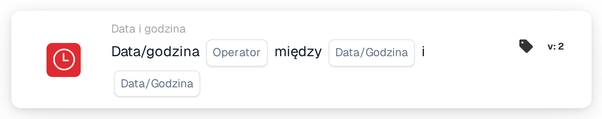

# Data lub godzina

<figure><figcaption>
Wersja 2
</figcaption></figure>

## Cel:

Ta karta przepływu pracy sprawdza, czy bieżąca data i godzina mieszczą się w przedziale ustawionym na karcie, czy poza nim. Może być używana do ograniczania kroków do określonych godzin, na przykład do godzin pracy lub planowanego okna serwisowego.

## Komponenty karty:

1. **Operator**
   * **Opcje:**
     * **Jest:** Bieżąca data i godzina mieszczą się w przedziale.
     * **Nie jest:** Bieżąca data i godzina są poza przedziałem.
2. **Pierwsza data/godzina**
   * **Opis:** Jeden koniec przedziału, jako data i godzina lub tylko jako godzina.
3. **Druga data/godzina**
   * **Opis:** Drugi koniec przedziału.

## Funkcjonalność:

* **Ocena warunku:** Gdy przepływ pracy dociera do karty, karta pobiera bieżącą datę i godzinę w UTC i sprawdza, czy mieszczą się one między dwiema wartościami na karcie. Wcześniejsza wartość jest używana jako początek, więc kolejność obu pól nie ma znaczenia.
  * Wartość zawierająca tylko godzinę (na przykład `09:00`) jest używana z dzisiejszą datą, dzięki czemu przedział powtarza się codziennie.
  * Początek i koniec należą do przedziału: dokładnie w czasie początku lub końca **Jest** jest prawdziwe.
  * Przedział obejmujący północ można wprowadzić w postaci samych godzin, na przykład od `22:00` do `04:00`. Karta sprawdza wtedy czas od 22:00 do 04:00; w tym przypadku dokładne godziny początku i końca nie należą do przedziału.
  * Przedział obejmujący północ z pełnymi datami (na przykład od `2026-11-01 22:00` do `2026-11-02 04:00`) nie jest obecnie oceniany poprawnie i nie powinien być używany.
* **Wykonanie akcji:**
  * **Warunek prawdziwy:**\
    Jeśli warunek jest spełniony, przepływ pracy jest kontynuowany kolejnymi kartami.
  * **Warunek fałszywy:**\
    Jeśli nie jest spełniony, przepływ pracy zatrzymuje się z niespełnionym warunkiem.
* **Brakujące dane:** Jeśli na karcie brakuje jednej z dwóch wartości, karta nie ocenia warunku i zgłasza brakujące dane wejściowe w dzienniku przepływu pracy.

## Instalacja i konfiguracja:

* Kartę można dodać jako warunek And z kategorii **Data i godzina**. Następnie ustawia się obie wartości i operator. Wszystkie godziny powinny być wprowadzane w UTC.
* **Przykład:** Z operatorem **Jest** oraz wartościami `09:00` i `17:00` warunek karty jest spełniony, gdy przepływ pracy jest wykonywany między 09:00 a 17:00 UTC w dowolnym dniu.

## Podsumowanie:

Karta przepływu pracy „Date or Time” zamienia czas wykonania w warunek przepływu pracy. Kroki można ograniczyć do stałych godzin lub jednego zaplanowanego przedziału bez każdorazowej zmiany przepływu pracy.
