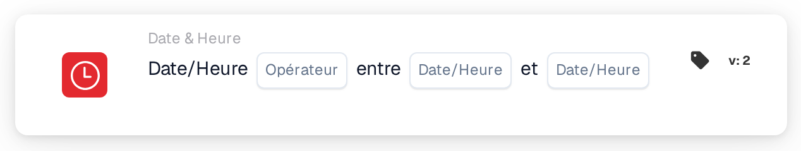

# Date ou heure

<figure><figcaption>
Version 2
</figcaption></figure>

## Objectif :

Cette carte de workflow vérifie si la date et l'heure actuelles se situent à l'intérieur ou à l'extérieur d'une plage définie sur la carte. Elle peut servir à limiter des étapes à certaines heures, par exemple aux heures de travail ou à une fenêtre de maintenance prévue.

## Composants de la carte :

1. **Opérateur**
   * **Options :**
     * **Est :** la date et l'heure actuelles se situent à l'intérieur de la plage.
     * **N'est pas :** la date et l'heure actuelles se situent à l'extérieur de la plage.
2. **Première date/heure**
   * **Description :** une extrémité de la plage, sous forme de date et heure ou d'heure seule.
3. **Deuxième date/heure**
   * **Description :** l'autre extrémité de la plage.

## Fonctionnalité :

* **Évaluation de la condition :** lorsque le workflow atteint la carte, celle-ci prend la date et l'heure actuelles en UTC et vérifie si elles se situent entre les deux valeurs de la carte. La valeur la plus ancienne est utilisée comme début, l'ordre des deux champs n'a donc pas d'importance.
  * Une valeur contenant uniquement une heure (par exemple `09:00`) est utilisée avec la date du jour, de sorte que la plage se répète chaque jour.
  * Le début et la fin font partie de la plage : exactement à l'heure de début ou de fin, **Est** est vrai.
  * Une plage qui passe minuit peut être saisie avec des heures seules, par exemple de `22:00` à `04:00`. La carte vérifie alors la période de 22:00 à 04:00 ; dans ce cas, les heures exactes de début et de fin ne font pas partie de la plage.
  * Une plage qui passe minuit avec des dates complètes (par exemple de `2026-11-01 22:00` à `2026-11-02 04:00`) n'est actuellement pas évaluée correctement et ne devrait pas être utilisée.
* **Exécution de l'action :**
  * **Condition vraie :**\
    Si la condition est remplie, le workflow continue avec les cartes suivantes.
  * **Condition fausse :**\
    Si elle n'est pas remplie, le workflow s'arrête avec une condition non remplie.
* **Données manquantes :** si l'une des deux valeurs manque sur la carte, la carte n'évalue pas la condition et signale la saisie manquante dans le journal du workflow.

## Mise en place et configuration :

* La carte peut être ajoutée comme condition And depuis la catégorie **Date & Heure**. Ensuite, les deux valeurs et l'opérateur sont définis. Toutes les heures devraient être saisies en UTC.
* **Exemple :** avec **Est**, `09:00` et `17:00`, la carte est remplie lorsque le workflow s'exécute entre 09:00 et 17:00 UTC, quel que soit le jour.

## Conclusion :

La carte de workflow « Date or Time » fait du moment de l'exécution une condition de workflow. Les étapes peuvent être limitées à des heures fixes ou à une seule plage prévue sans modifier le workflow à chaque fois.
