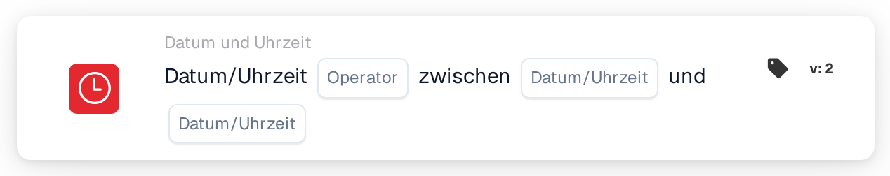

# Datum oder Uhrzeit prüfen

<figure><figcaption>
Version 2
</figcaption></figure>

## Zweck:

Diese Workflow-Karte prüft, ob das aktuelle Datum und die aktuelle Uhrzeit innerhalb oder außerhalb eines auf der Karte festgelegten Zeitfensters liegen. Sie kann verwendet werden, um Schritte auf bestimmte Zeiten zu beschränken, zum Beispiel auf die Arbeitszeit oder ein geplantes Wartungsfenster.

## Admin-Video:



[Video mit deutschen Untertiteln und Sprechertext öffnen](https://docbits-videos.fra1.cdn.digitaloceanspaces.com/settings-assistant/workflow-masterclass-14-admin/v1/de.html)

## Bestandteile der Karte:

1. **Operator**
   * **Optionen:**
     * **Ist:** Das aktuelle Datum und die aktuelle Uhrzeit liegen innerhalb des Zeitfensters.
     * **Ist nicht:** Das aktuelle Datum und die aktuelle Uhrzeit liegen außerhalb des Zeitfensters.
2. **Erstes Datum/Uhrzeit**
   * **Beschreibung:** Ein Ende des Zeitfensters, als Datum und Uhrzeit oder nur als Uhrzeit.
3. **Zweites Datum/Uhrzeit**
   * **Beschreibung:** Das andere Ende des Zeitfensters.

## Funktionalität:

* **Bedingungsauswertung:** Wenn der Workflow die Karte erreicht, nimmt sie das aktuelle Datum und die aktuelle Uhrzeit in UTC und prüft, ob sie zwischen den beiden Werten auf der Karte liegen. Der frühere Wert wird als Beginn verwendet, die Reihenfolge der beiden Felder spielt also keine Rolle.
  * Ein Wert nur mit Uhrzeit (zum Beispiel `09:00`) wird mit dem heutigen Datum verwendet, sodass sich das Zeitfenster jeden Tag wiederholt.
  * Beginn und Ende gehören zum Zeitfenster: Genau zur Beginn- oder Endzeit ist **Ist** wahr.
  * Ein Zeitfenster über Mitternacht kann nur mit Uhrzeiten eingetragen werden, zum Beispiel `22:00` bis `04:00`. Die Karte prüft dann auf die Zeit von 22:00 bis 04:00; die genauen Beginn- und Endzeiten gehören in diesem Fall nicht zum Zeitfenster.
  * Ein Zeitfenster über Mitternacht mit vollständigen Daten (zum Beispiel `2026-11-01 22:00` bis `2026-11-02 04:00`) wird derzeit nicht korrekt ausgewertet und sollte nicht verwendet werden.
* **Ausführung der Aktion:**
  * **True-Bedingung:**\
    Ist die Bedingung erfüllt, wird der Workflow mit den nächsten Karten fortgesetzt.
  * **False-Bedingung:**\
    Ist sie nicht erfüllt, stoppt der Workflow mit einer nicht erfüllten Bedingung.
* **Fehlende Daten:** Fehlt einer der beiden Werte auf der Karte, wertet die Karte die Bedingung nicht aus und meldet die fehlende Eingabe im Workflow-Protokoll.

## Einrichtung und Konfiguration:

* Die Karte kann als And-Bedingung aus der Kategorie **Datum und Uhrzeit** hinzugefügt werden. Danach werden die beiden Werte und der Operator festgelegt. Alle Uhrzeiten sollten in UTC eingetragen werden.
* **Beispiel:** Mit **Ist**, `09:00` und `17:00` ist die Karte erfüllt, wenn der Workflow an einem beliebigen Tag zwischen 09:00 und 17:00 UTC läuft.

## Fazit:

Die Workflow-Karte „Date or Time“ macht den Zeitpunkt der Ausführung zu einer Workflow-Bedingung. Schritte können auf feste Zeiten oder ein einzelnes geplantes Zeitfenster beschränkt werden, ohne den Workflow jedes Mal zu ändern.
