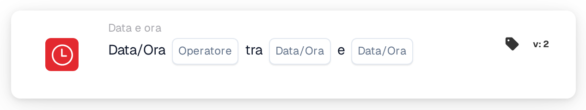

# Data o ora

<figure><figcaption>
Versione 2
</figcaption></figure>

## Scopo:

Questa scheda del workflow verifica se la data e l'ora attuali si trovano all'interno o all'esterno di una finestra impostata sulla scheda. Può essere utilizzata per limitare dei passaggi a determinati orari, ad esempio all'orario di lavoro o a una finestra di manutenzione pianificata.

## Componenti della scheda:

1. **Operatore**
   * **Opzioni:**
     * **È:** La data e l'ora attuali si trovano all'interno della finestra.
     * **Non è:** La data e l'ora attuali si trovano all'esterno della finestra.
2. **Prima data/ora**
   * **Descrizione:** Un estremo della finestra, come data e ora oppure solo come ora.
3. **Seconda data/ora**
   * **Descrizione:** L'altro estremo della finestra.

## Funzionalità:

* **Valutazione della condizione:** Quando il workflow raggiunge la scheda, questa prende la data e l'ora attuali in UTC e verifica se si trovano tra i due valori della scheda. Il valore precedente viene usato come inizio, quindi l'ordine dei due campi non ha importanza.
  * Un valore con solo un'ora (ad esempio `09:00`) viene usato con la data di oggi, quindi la finestra si ripete ogni giorno.
  * Inizio e fine fanno parte della finestra: esattamente all'ora di inizio o di fine, **È** è vero.
  * Una finestra a cavallo della mezzanotte può essere inserita solo con orari, ad esempio da `22:00` a `04:00`. La scheda verifica quindi l'intervallo dalle 22:00 alle 04:00; in questo caso gli orari esatti di inizio e di fine non fanno parte della finestra.
  * Una finestra a cavallo della mezzanotte con date complete (ad esempio da `2026-11-01 22:00` a `2026-11-02 04:00`) attualmente non viene valutata correttamente e non dovrebbe essere utilizzata.
* **Esecuzione dell'azione:**
  * **Condizione vera:**\
    Se la condizione è soddisfatta, il workflow prosegue con le schede successive.
  * **Condizione falsa:**\
    Se non è soddisfatta, il workflow si ferma con una condizione non soddisfatta.
* **Dati mancanti:** Se uno dei due valori manca sulla scheda, la scheda non valuta la condizione e segnala l'input mancante nel log del workflow.

## Configurazione e impostazione:

* La scheda può essere aggiunta come condizione And dalla categoria **Data e ora**. Successivamente si impostano i due valori e l'operatore. Tutti gli orari dovrebbero essere inseriti in UTC.
* **Esempio:** Con **È**, `09:00` e `17:00`, la scheda è soddisfatta quando il workflow viene eseguito tra le 09:00 e le 17:00 UTC di qualsiasi giorno.

## Conclusione:

La scheda del workflow "Date or Time" rende il momento dell'esecuzione una condizione del workflow. I passaggi possono essere limitati a orari fissi o a un'unica finestra pianificata senza modificare ogni volta il workflow.
