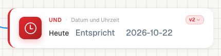
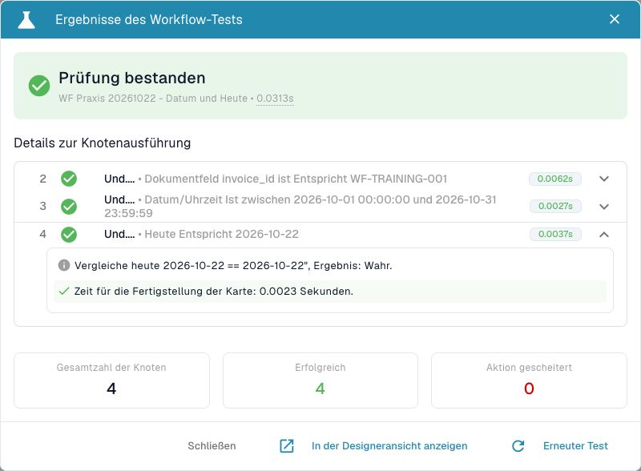

# Heute mit einem Datum vergleichen

<figure><figcaption>
Version 2
</figcaption></figure>

Die Karte **Today** (`condition_today_is_isnot`, Version 2) vergleicht das aktuelle Datum der Ausführung mit einem eingetragenen Datum. Im geprüften Dev-Stand wird „heute“ aus UTC gebildet. Die Karte startet keinen Workflow zu einem Termin und wartet nicht bis zum eingetragenen Datum.

<figure><figcaption>
Heute-Karte mit Gleich-Vergleich und konkretem Datum.
</figcaption></figure>

<figure><figcaption>
Tatsächlicher Vergleich am 22. Oktober 2026: wahr.
</figcaption></figure>

## Beispiel vollständig ausfüllen

Nutzen Sie einen eigenen inaktiven Trainingsworkflow mit dem Dokumenttyp Rechnung und der synthetischen Rechnungsnummer `WF-TRAINING-001`. Fügen Sie unter **UND → Datum und Uhrzeit** die Heute-Karte hinzu.

| Parameter | Beispielwert | Bedeutung |
| --- | --- | --- |
| Datum (`date`) | `2026-10-22` | Vergleichsdatum im Format Jahr-Monat-Tag |
| Operator | `eq` / Gleich | Heute muss auf dasselbe Kalenderdatum fallen. |
| Kartenversion | `2` | Geprüfter Katalogstand des Beispiels |

Führen Sie **Test → Benutzerdefinierte Daten** aus und öffnen Sie **Details**. Klappen Sie die Heute-Karte auf. Das Protokoll nennt das tatsächliche heutige Datum, das Vergleichsdatum, den Operator und das Ergebnis. Am 22. Oktober 2026 war der Vergleich mit `2026-10-22` erfolgreich.

Ein späterer Test desselben gespeicherten Beispiels darf ein anderes Ergebnis liefern: „Heute“ wird bei jeder Ausführung neu ermittelt. Passen Sie für eine neue Übung das Datum bewusst an und notieren Sie das tatsächliche Testdatum.

## Die Operatoren wählen

| Operator | Bedeutung von links nach rechts |
| --- | --- |
| `eq` | Heute ist gleich dem Vergleichsdatum. |
| `neq` | Heute ist ungleich dem Vergleichsdatum. |
| `gt` | Heute liegt nach dem Vergleichsdatum. |
| `ge` | Heute liegt auf oder nach dem Vergleichsdatum. |
| `lt` | Heute liegt vor dem Vergleichsdatum. |
| `le` | Heute liegt auf oder vor dem Vergleichsdatum. |

Für „Frist ist ab heute abgelaufen“ wählen Sie den Operator nach Ihrer fachlichen Grenze: `gt` schließt das Fristdatum aus, `ge` schließt es ein. Verbinden Sie den passenden Bedingungsausgang mit der Folgeaktion.

## Tatsächlich geprüfte Fälle

| Eingabe bei Ausführung am 22.10.2026 | Operator | Knotenpfad |
| --- | --- | --- |
| `2026-10-22` | `eq` | `success` |
| `2026-10-23` | `eq` | `failed_condition` |
| `2026-10-22 23:59:59` | `eq` | `success` |

Die dritte Prüfung zeigt: Die Karte vergleicht die **Datumsanteile**. Sie eignet sich nicht für eine sekundengenaue Fristprüfung. Verwenden Sie für Uhrzeitgrenzen die entsprechende Zeitkarte und prüfen Sie ihre Zeitzone separat.

Ein unlesbares oder fehlendes Datum ist ein Eingabefehler. Verwenden Sie eindeutige ISO-Datumswerte. Zeitzonenangaben werden im geprüften Parser nicht als Umrechnungsauftrag behandelt. Rund um Mitternacht kann das UTC-Datum vom lokal angezeigten Datum abweichen.

## Vor einer produktiven Nutzung

Prüfen Sie jeweils den Tag vor der Grenze, den Grenztag und den Tag danach. Erfassen Sie aktuelles Ausführungsdatum, Kartenversion, Parameter und Knotenpfad. Ein grünes Ergebnis am Erstellungstag garantiert kein dauerhaft grünes Ergebnis an späteren Tagen.

[Datum oder Uhrzeit prüfen](date-or-time.md) · [Test und Echtlauf unterscheiden](../../workflow-logs.md) · [Sicher aktivieren](../../workflow-go-live.md)
