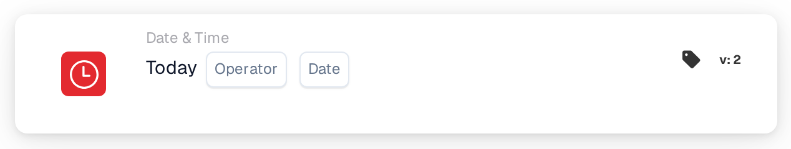

# Today

<figure><figcaption>
Version 2
</figcaption></figure>

## Purpose:

This workflow card compares today's date with a date set on the card. It can be used for rules that should only apply from or until a certain date, for example a process change from a planned start date.

## Components of the Card:

1. **Operator**
   * **Description:** How today's date is compared with the date on the card.
   * **Options:**
     * **Equals:** Today is the date on the card.
     * **Not Equals:** Today is any other day.
     * **Greater Than:** Today is after the date on the card.
     * **Greater or Equals:** Today is the date on the card or later.
     * **Less Than:** Today is before the date on the card.
     * **Less or Equals:** Today is the date on the card or earlier.
2. **Date**
   * **Description:** The date today is compared with.

## Functionality:

* **Condition Evaluation:** When the workflow reaches the card, it takes the current date in UTC and compares it with the date on the card using the operator. Only the dates are compared; times of day are ignored. The dates on the document play no part.
* **Action Execution:**
  * **True Condition:**\
    If the comparison is true, the workflow continues with the next cards.
  * **False Condition:**\
    If it is not true, the workflow stops with an unmet condition.
* **Missing Data:** If no date is set on the card, the card does not evaluate the condition and reports the missing input in the workflow log.

## Setup and Configuration:

* The card can be added as an And condition from the **Date & Time** category. Then an operator and a date are selected.
* **Example:** With **Greater or Equals** and `2026-11-01`, the card is met from 1 November 2026 (UTC) onward and not met on 31 October 2026.
* Because the date is taken in UTC, it can differ from the local date around midnight: in Europe the card still sees the previous day shortly after midnight, in America it already sees the next day in the evening.

## Conclusion:

The "Today" workflow card makes the calendar date a workflow condition. Date-based rules, such as a start or end date for a process, can be set up once and take effect automatically.
