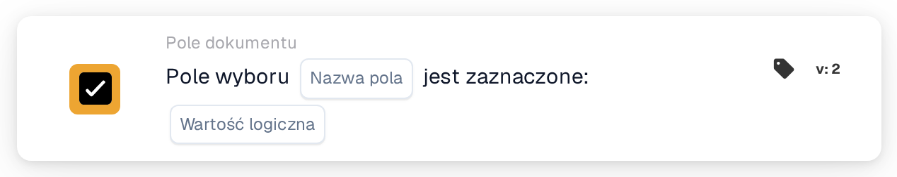

# Pole wyboru jest zaznaczone

<figure><figcaption>
Wersja 2
</figcaption></figure>

## **Cel:**

Ta karta przepływu pracy służy do automatyzacji akcji na podstawie stanu (zaznaczone lub niezaznaczone) pola wyboru w systemie ERP. Oceniając stan pola wyboru, ułatwia wyzwalanie określonych procesów lub egzekwowanie określonych reguł w aplikacji.

## **Komponenty karty:**

* **Nazwa pola**
  * **Opis:** Określa nazwę pola wyboru, które będzie oceniane.
  * **Szczegóły:** Powinna ona odpowiadać dokładnemu identyfikatorowi pola używanemu w systemie. Określa, którego pola wyboru stan jest monitorowany.
* **Wartość logiczna**
  * **Opis:** Definiuje warunek wyzwalający przepływ pracy.
  * **Opcje:**
    * **True:** Przepływ pracy jest wyzwalany, jeśli pole wyboru jest zaznaczone.
    * **False:** Przepływ pracy jest wyzwalany, jeśli pole wyboru jest niezaznaczone.

#### **Funkcjonalność:**

* **Wykrywanie stanu:** Karta na bieżąco monitoruje stan określonego pola wyboru.
* **Ocena warunku:** System sprawdza, czy pole wyboru znajduje się w stanie (zaznaczone lub niezaznaczone) określonym przez warunek Boolean.
* **Wykonanie akcji:**
  * **Warunek prawdziwy:**\
    Jeśli stan pola wyboru odpowiada określonemu warunkowi Boolean (true dla zaznaczonego lub false dla niezaznaczonego), system inicjuje powiązane akcje. Mogą one obejmować włączanie lub wyłączanie pól formularza, wyzwalanie powiadomień, uruchamianie przepływów pracy lub aktualizację rekordów.
  * **Warunek fałszywy:**\
    Jeśli stan pola wyboru nie odpowiada warunkowi, mogą zostać podjęte alternatywne akcje lub żadne, w zależności od konfiguracji przepływu pracy.

## **Konfiguracja:**

* Użytkownicy konfigurują kartę, wybierając pole wyboru z listy dostępnych pól i ustawiając warunek Boolean.

## Podsumowanie:

Karta przepływu pracy "Checkbox Field Condition" jest podstawowym narzędziem do zarządzania dynamicznymi formularzami i dokumentami w systemie ERP, gdzie dane wprowadzane przez użytkownika mogą dyktować kolejne procesy danych. Automatyzując akcje na podstawie stanu pola wyboru, karta ta zwiększa efektywność przepływu pracy i zapewnia, że zachowania systemu są zgodne z danymi wprowadzanymi przez użytkownika. Jasna dokumentacja tej karty pomoże użytkownikom skutecznie wdrożyć ją w swoich operacjach, umożliwiając lepszą kontrolę nad zachowaniami formularzy i automatyzacją procesów.

**Note: Nie każdy klient ma to pole wyboru, ale można je dodać w razie potrzeby.**

<!-- workflow-card-practical-example-20261021 -->

## Praktyczny przykład

**Kiedy używać:** Kontynuację należy przeprowadzić dopiero po ustawieniu wyraźnej flagi przeglądu.

**Konfiguracja:** Zaznacz pole wyboru `review_complete` i wartość logiczną `true`.

**Oczekiwany wynik i kontrprzykład:** Zaznaczone pole wyboru zostaje uznane. Niezaznaczone pole wyboru kończy się niepowodzeniem; nie używaj brakującego pola jako dowodu zakończenia przeglądu.

To jest ilustracyjna konfiguracja i oczekiwany wynik. Korzystaj z pól, użytkowników i grup skonfigurowanych w Twojej organizacji testowej; nie jest to twierdzenie, że ten przykład został wykonany.
