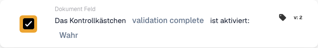

# Das Kontrollkästchen ist aktiviert

## Wann und wo diese Karte verwenden

Verwenden Sie diese Bedingung, wenn eine Folgeaktion von einem Kontrollkästchen im Dokument abhängt. Beispielsweise darf eine Rechnung erst weiterverarbeitet werden, nachdem ihre Prüfmarkierung gesetzt wurde.

Fügen Sie die Karte im Workflow-Designer unter **Und… → Dokument Feld** hinzu. Die Karte vergleicht den Feldwert bei der Ausführung des Workflows; sie überwacht kein ERP-Feld dauerhaft und verändert das Kontrollkästchen nicht.

## Voraussetzungen

Der Dokumenttyp muss ein Boolesches Feld für das Kontrollkästchen enthalten. Verwenden Sie dessen genaue technische Kennung. Dieses Beispiel nutzt `validation_complete`; ersetzen Sie die Kennung durch das entsprechende Feld Ihrer Organisation.

## Karte konfigurieren

1. Wählen Sie **Das Kontrollkästchen … ist aktiviert** unter **Dokument Feld**.
2. Geben Sie unter **Feldname** `validation_complete` ein und bestätigen Sie den Wert.
3. Wählen Sie den Booleschen Vergleichswert **Wahr**, wenn das Kontrollkästchen gesetzt sein muss. Mit **Falsch** prüfen Sie, ob es nicht gesetzt ist.

## Praxisbeispiel: Nach einer Prüfung fortfahren

**Wann verwenden:** Eine Rechnung benötigt eine vorgelagerte Prüfung. Der Prozess hält deren Abschluss in `validation_complete` fest.

**Wo einfügen:** Unter den Bedingungen in **Und…**, vor der Folgeaktion, die Sie unter **Dann…** konfigurieren. Richten Sie diese Aktion und das Ereignis, das den Workflow startet, getrennt ein.

**Beispielkonfiguration:** Feld `validation_complete`, Vergleich **Wahr** (`true`), Kartenversion 2.

<figure><figcaption>
Konfiguriertes Beispiel in Version 2: validation complete im Vergleich mit Wahr.
</figcaption></figure>

Für diese Konfiguration gelten die folgenden erwarteten Ergebnisse:

| Feldwert im Dokument | Ergebnis der Bedingung |
| --- | --- |
| Vorhandenes, gesetztes Kontrollkästchen (`true`) | Die Bedingung ist erfüllt. |
| Vorhandenes, nicht gesetztes Kontrollkästchen (`false`) | Die Bedingung ist nicht erfüllt. |
| Vorhandenes Kontrollkästchen mit leerem Wert (`None`) | Wird als nicht gesetzt gewertet; die Bedingung ist nicht erfüllt. |
| Das Feld fehlt im Dokument | `NOT_FOUND_IN_DOCUMENT`; dieser Fall unterscheidet sich von einem vorhandenen, nicht gesetzten Kontrollkästchen. |

Bei Auswahl von **Falsch** erfüllt ein vorhandenes, nicht gesetztes Kontrollkästchen die Bedingung und ein gesetztes Kontrollkästchen nicht. Ein fehlendes Feld liefert weiterhin ein eigenes Fehlerergebnis.

## Vor der Aktivierung prüfen

Prüfen Sie, ob das gewählte Feld Boolesch ist und zum verwendeten Dokumenttyp gehört. Testen Sie ein Dokument mit gesetztem Kontrollkästchen, eines mit nicht gesetztem Kontrollkästchen und den Fall eines fehlenden Felds. Kontrollieren Sie jeweils das Kartenergebnis und den weiteren Workflow-Pfad.

Diese Karte prüft den Zustand des Kontrollkästchens; der vorgelagerte Prozess muss die Prüfmarkierung setzen. Ein automatisches Setzen ohne tatsächliche Prüfung belegt keinen abgeschlossenen Prüfschritt.

## Admin-Beispielvideo

Wann ich ein angehaktes Kontrollkästchen als Bedingung verwende und wie ich den Booleschen Wert prüfe. Die Beispiele zeigen erwartete Ergebnisse.



[Video mit deutschen Untertiteln öffnen](https://docbits-videos.fra1.cdn.digitaloceanspaces.com/settings-assistant/workflow-card-checkbox-admin/v1/de.html)

[Transkript lesen](https://docbits-videos.fra1.cdn.digitaloceanspaces.com/settings-assistant/workflow-card-checkbox-admin/v1/de.txt)
