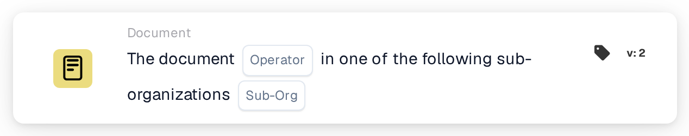

# Document Operator for Sub-Organizations one of

<figure><figcaption>
Version 2
</figcaption></figure>

## Purpose:

This workflow card checks whether a document belongs to one of several sub-organizations. Instead of comparing the document with a single sub-organization, it compares it with a list, so one card can cover a whole group of sub-organizations that should be handled the same way. Based on the result, the workflow continues with the true or the false condition.

For a comparison with a single sub-organization, the card **Document Operator for Sub-Organizations** can be used.

## Components of the Card:

1. **Operator**
   * **Description:** Defines whether the document should belong to one of the listed sub-organizations or to none of them.
   * **Options:**
     * **Is:** The condition is true if the document's sub-organization is one of the listed sub-organizations.
     * **Is Not:** The condition is true if the document's sub-organization is not in the list.
2. **Sub-Org**
   * **Description:** The list of sub-organizations the document is compared with.
   * **Detail:** One or more sub-organizations of the organization can be selected. The comparison uses the sub-organization the document is assigned to.

## Functionality:

* **Condition Evaluation:** The system reads the sub-organization of the document and checks whether it is one of the sub-organizations selected on the card.
* **Action Execution:**
  * **True Condition:**\
    With **Is**, the document's sub-organization is in the list. With **Is Not**, it is not in the list. The workflow continues with the true condition, for example to route the document to the team responsible for these sub-organizations or to apply rules that only apply to them.
  * **False Condition:**\
    If the condition is not met, the workflow continues with the false condition, for example to apply general rules or to route the document elsewhere.
* **Missing Data:** If the document is not assigned to any sub-organization, or no sub-organization is selected on the card, the card does not evaluate the condition. It reports the missing data in the workflow log instead of continuing with the false condition.

## Setup and Configuration:

* The card can be added from the **Document** category. After that, the operator (**Is** or **Is Not**) and, in the **Sub-Org** field, the sub-organizations to check against can be selected. Finally, the continue condition (true or false) is set, which determines the next step in the workflow.

## Conclusion:

The "Document Operator for Sub-Organizations one of" workflow card lets one condition cover several sub-organizations at once. This keeps workflows short when several sub-organizations share the same processing rules, and makes sure documents are handled in the correct organizational context.
