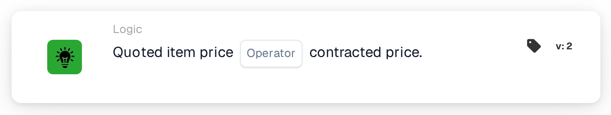
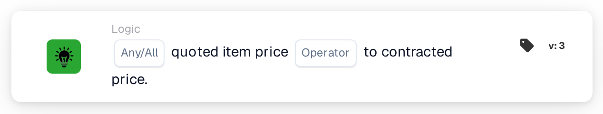

# Quoted Item Price

<figure><figcaption>
Version 2
</figcaption></figure>

<figure><figcaption>
Version 3
</figcaption></figure>

## **Purpose:**

This DocBits card compares the quoted price of an item to its contracted price, allowing workflows to trigger actions based on whether the two values match or differ. It helps ensure pricing consistency and compliance with contract terms.

## **Functionality:**

* **Price Comparison:** This card evaluates whether the quoted item price meets the specified condition relative to the contracted price.
* **Operators:** The following conditions can be applied:
  * **Equals (=):** Checks if the quoted price matches the contracted price.
  * **Not Equals (≠):** Ensures the quoted price is different from the contracted price.

## **Usage:**

This card is particularly useful in procurement, sales, or contract management workflows, where it is crucial to validate that quoted prices align with agreed-upon contract terms before proceeding with approvals or order processing.

## **Example Scenario:**

* A user configures the card to check if the **quoted price equals (=)** the **contracted price**. If the prices match, the workflow proceeds to approval; if not, it triggers a notification for manual review to resolve the discrepancy.

By using the "Quoted Item Price vs. Contracted Price" card, organizations can enforce pricing policies, maintain contract compliance, and reduce errors in financial transactions.
