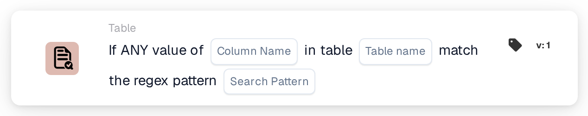
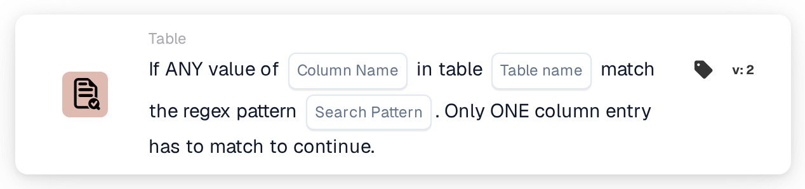

# Any Value of

<figure><figcaption>
Version 1
</figcaption></figure>

<figure><figcaption>
Version 2
</figcaption></figure>

## **Purpose:**

This DocBits card is used to validate whether any value in a specific column of a table matches a provided regex pattern. If any single entry in the column matches the pattern, the workflow will continue, making it ideal for use cases where identifying even a single match triggers the next steps in the process.

## **Functionality:**

* **Regex Pattern Validation:** This card checks if any value in a given column of a table matches the provided regular expression pattern. The card will trigger and allow the workflow to continue if at least one entry in the column meets the condition.
* **Operator:** Users define the column and specify the regex pattern. The available condition includes:
  * **Matches Regex Pattern:** Verifies that at least one value in the specified column matches the regex pattern.
* **Table and Column Selection:** Users specify the table and column they wish to check for regex pattern matches.

## **Usage:**

This card is particularly useful for scenarios where a table contains data that might require specific matches, such as validating email addresses, invoice numbers, or product IDs. It ensures that workflows proceed when any relevant entry matches the defined pattern, without needing to check every entry.

## **Example Scenario:**

* A user sets the card to check for entries in the "Email Address" column of the "Customers" table, using a regex pattern for valid email formats. If at least one email address in the column matches the pattern, the card will trigger the next workflow step, ensuring that the system processes the valid entry.

By using the "Regex Pattern Matching" card, organizations can automate workflows based on dynamic, pattern-based validations, streamlining processes and ensuring that only relevant entries trigger further actions.
