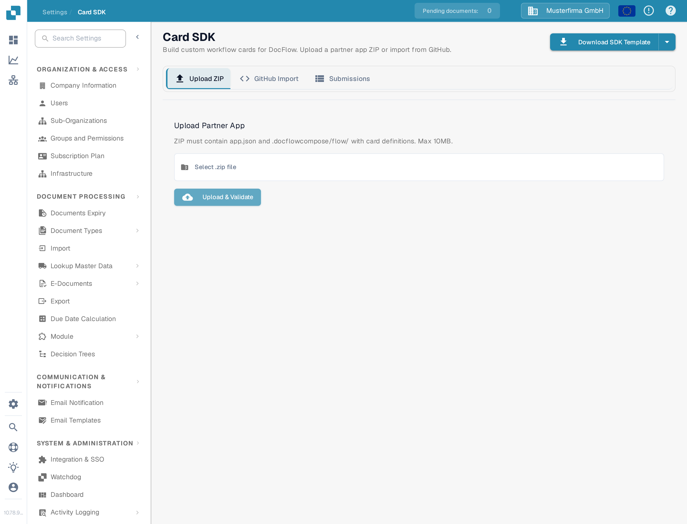
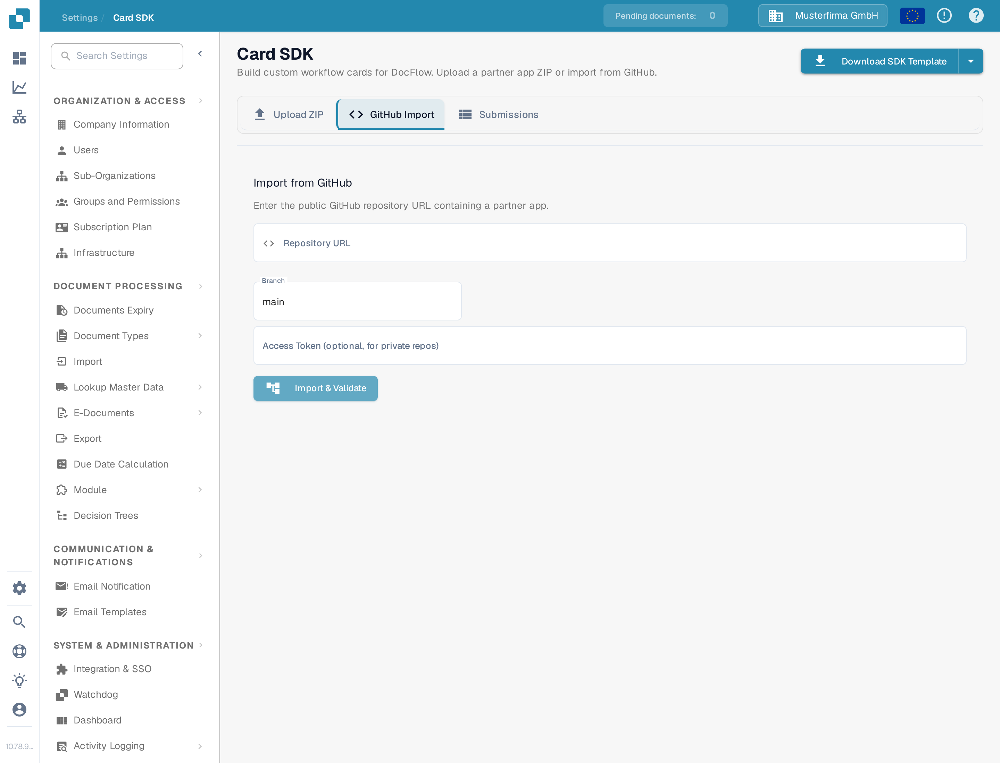
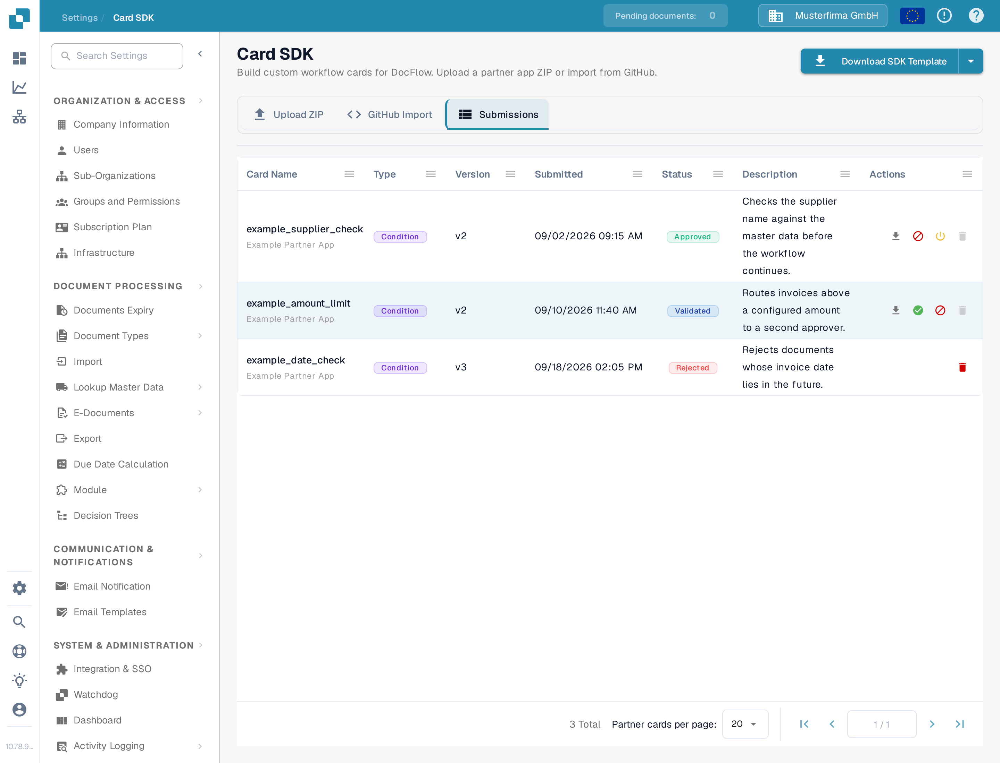

# Card SDK

The **Card SDK** lets partners and developers build custom workflow cards for DocFlow. You package a card as a partner app and upload it, or import it directly from GitHub.

<figure><figcaption>
The Card SDK page on the <strong>Upload ZIP</strong> tab.
</figcaption></figure>


The Card SDK page is only visible when the DocNet subscription is enabled for your organization. Without it, the page shows a lock and an **Enable DocNet** button instead of the tabs below.


## How it works

- **Download SDK Template** — start from the official template that contains the expected structure.
- **Upload ZIP** — the ZIP must contain `app.json` and a `.docflowcompose/flow/` folder with the card definitions (max 10 MB). **Upload & Validate** checks the package before it is accepted.
- **GitHub Import** — import a card definition straight from a GitHub repository.
- **Submissions** — track the status of cards you have submitted and manage them.

Once validated and accepted, your custom cards appear in the **Add Card** library alongside the built-in cards.

## Upload a partner app ZIP

On the **Upload ZIP** tab, under the **Upload Partner App** heading, choose **Select .zip file**, pick your package, and click **Upload & Validate**. The ZIP must contain `app.json` and a `.docflowcompose/flow/` folder with the card definitions, and it may be at most 10 MB.

Validation then runs in two stages, both shown directly under the upload form:

1. **Static Validation** — a console that lists each structural check (file layout, manifests, code analysis, tests) with a green check or a red cross, plus the number of errors and warnings per stage. Expanding a stage shows the exact error and warning messages.
2. **AI Code Review** — a console with AI reviewers that examine the card in three batches: **Gate Check**, **Code Quality**, and **Best Practices**. Each reviewer shows a status (⏳ running, ✅ passed, ❌ failed); reviewers marked **GATE** must pass for the card to be importable. The review streams live while it runs.

When the review finishes, one of two banners appears:

- **"All gates passed — card is ready for import."** — click **Import Card** to add the card to your submissions. The card is only imported after the review passes.
- **"Gate check failed — card cannot be imported."** — fix the issues listed in the consoles and upload again.

If the reviewers suggest improvements, they appear under **Suggested Improvements** per file, and **Download Improved** saves a ZIP with the proposed changes.

## Import from GitHub

On the **GitHub Import** tab, enter the **Repository URL** of a public repository that contains a partner app. Optionally set the **Branch** (default `main`) and an **Access Token** if the repository is private. Click **Import & Validate** to fetch the repository and run the same validation; a **Validation Output** console lists any errors and warnings per stage.

<figure><figcaption>
The <strong>GitHub Import</strong> tab.
</figcaption></figure>

## Submissions

The **Submissions** tab lists every card your organization has submitted, with the columns **Card Name**, **Type**, **Version**, **Submitted**, **Status**, **Description**, and **Actions**. The status badge shows where the card stands:

| Status | Meaning |
| ------ | ------- |
| **Validating** | The card is being checked. |
| **Validated** | Validation passed; an organization admin still needs to approve it. |
| **Approved** | An admin approved the card; it is active and can be enabled or disabled. |
| **Rejected** | Validation failed or an admin rejected the card. Hover the badge to see the rejection reason. |
| **Disabled** | An approved card that was deactivated. |

Use the icon buttons in the **Actions** column of each row:

- **Download** — export the card as a ZIP (for validated or approved cards).
- **Approve** — activate a validated card (organization admin; shown only on validated rows).
- **Reject** — reject a validated or approved card and give a reason.
- **Enable / Disable** — switch an approved card on or off.
- **Delete** — remove the card. This is only possible once the card is rejected or disabled; the tooltip tells you to disable it first.

To remove several cards at once, tick their checkboxes — a bar appears above the table with a **Delete (n)** action for all selected rows.

<figure><figcaption>
The <strong>Submissions</strong> tab with approved, validated, and rejected cards.
</figcaption></figure>

## Related pages

- [Cards](cards-overview.md) — what workflow cards are and the built-in When / And / Then groups.
- [Card SDK Tools](../../advanced-functions-and-tools/docflow-mcp/card-sdk-tools.md) — the same lifecycle (validation stages, approval, rejection) driven through MCP tools instead of the web page.
