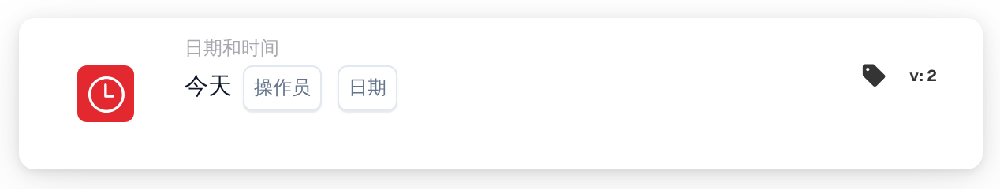

# 今天

<figure><figcaption>
版本 2
</figcaption></figure>

## **用途：**

此 DocBits 卡片将今天的日期与指定日期进行比较，使工作流能够根据当前日期与所提供日期之间的关系执行。它特别适用于基于时间的自动化、截止日期管理或触发计划任务。

## **功能：**

* **日期比较：** 此卡片根据以下条件将今天的日期与指定日期进行比较：
  * **等于 (=)：** 检查今天的日期是否与指定日期相同。
  * **不等于 (≠)：** 确认今天的日期与指定日期不同。
  * **大于 (>)：** 确认今天的日期晚于指定日期。
  * **大于或等于 (≥)：** 确认今天的日期为指定日期当天或之后。
  * **小于 (<)：** 检查今天的日期是否早于指定日期。
  * **小于或等于 (≤)：** 确认今天的日期为指定日期当天或之前。
* **日期输入：** 用户提供要与今天的日期进行比较的日期。

## **用法：**

此卡片适用于涉及截止日期、提醒或时间敏感条件的工作流，确保操作根据当前日期执行或受到限制。

## **示例场景：**

* 用户配置此卡片，检查**今天是否大于 (>)「2024-11-15」**。如果条件满足，工作流会触发一条针对逾期任务的后续通知；如果不满足，工作流会继续运行，不受影响。

通过使用“今日日期验证”卡片，组织可以自动化基于时间的流程，高效满足截止日期要求，并保持工作流准确性。
