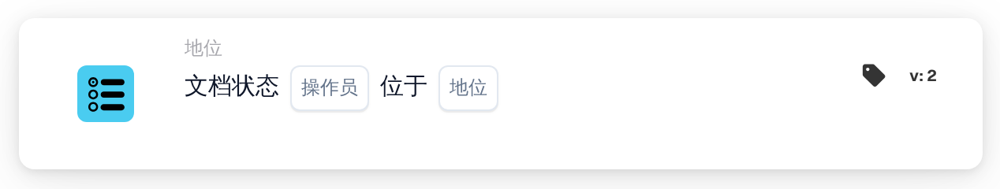

# 文档状态条件列表

<figure><figcaption>
版本 2
</figcaption></figure>

## 何时使用

当多个单据状态都应满足同一个附加条件时，使用此卡片。例如，在第一轮审批或第二轮审批期间继续执行同一项后续操作。卡片检查单据的当前状态是否属于所选列表；它不会更改单据状态。工作流的触发器和后续操作需分别配置。

**位置：** 标准工作流 → 附加条件（AND）→ 状态 → 状态列表卡片。

## 配置（版本 2）

| 设置 | 视频中的配置 |
| --- | --- |
| 运算符 | `is` — 当前状态属于所选列表 |
| 状态列表 | 待批准（`validated_pending_approval`）和等待第二次批准（`approved_pending_second_approval`） |

选择列表成员比较的运算符，再在多选列表中选择两个审批状态。关闭列表后，确认卡片显示了两个选项。一张单据只需处于其中任意一个状态，无需同时具有两个状态。

**当前界面用语：** 录制版本中显示“是 位于”。这里表示“当前状态属于以下任一所选状态”，与空间位置无关。这一界面译文尚待改进；视频保留实际界面。

选择 `isnot` 时，条件在当前状态不属于列表时成立。状态列表应通过实际多选控件配置。

<!-- workflow-card-practical-example-20261021 -->
<!-- workflow-card-complete-example-20261021 condition_doc_status_is_isnot_in_list -->

## 实用示例

将第一轮审批和第二轮审批合并为一个条件。对于视频中的 `is` 和上述两个状态：

| 单据的当前状态 | 预期结果 |
| --- | --- |
| 待批准（`validated_pending_approval`） | 条件成立 |
| 等待第二次批准（`approved_pending_second_approval`） | 条件成立 |
| 已经导出（`exported`） | 条件不成立 |

这些是示例的预期结果。`isnot` 会反转上述成员匹配结果。单据缺少状态时，版本 2 返回 `NOT_FOUND_IN_DOCUMENT`，而不是正常的“条件不成立”；卡片缺少状态列表配置时返回 `MISSING_VARIABLE`。

## 管理员示例视频

视频介绍何时使用此卡片、如何找到并选择两个审批状态，以及如何检查最终配置。管理员、办公室和配音均为合成内容；操作演示使用测试账号中的真实 DocBits 界面。结果示例为说明性预期结果。



[打开带中文字幕的视频](https://docbits-videos.fra1.cdn.digitaloceanspaces.com/settings-assistant/workflow-card-document-status-list-admin/v1/zh.html)

[阅读文字稿](https://docbits-videos.fra1.cdn.digitaloceanspaces.com/settings-assistant/workflow-card-document-status-list-admin/v1/zh.txt)
