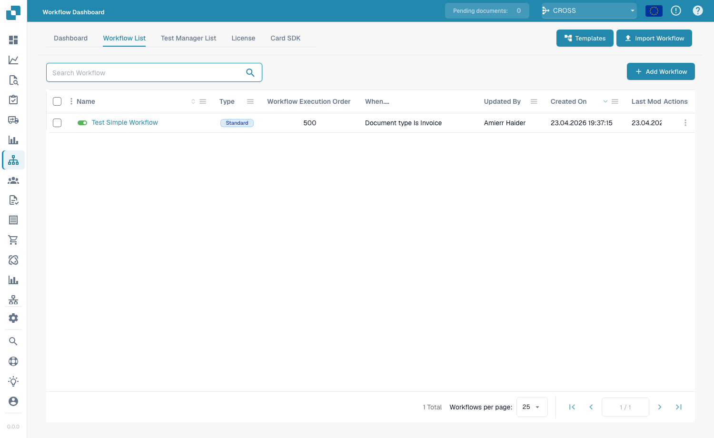
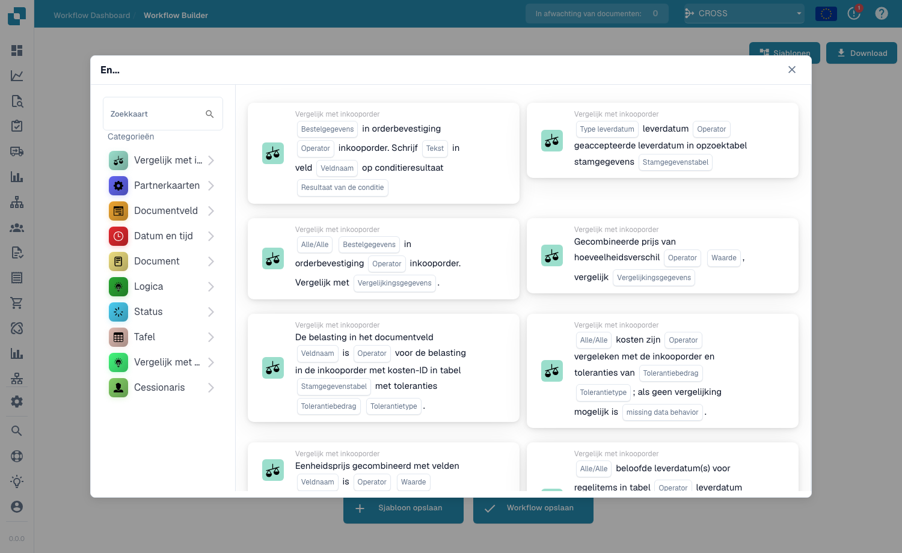

# Standard Workflow

The **Standard Workflow** builder is the linear, card-based editor for automating document processing. A workflow is made of three groups of cards — **When** (the trigger), **And** (additional conditions) and **Then** (the actions to run). When a document matches the When/And conditions, the Then actions run automatically.

## Create and test a Standard Workflow 

Create a complete Standard Workflow in the real DocBits interface: match the invoice, check its number and an amount above 1000, assign a reviewer and change the status. Save the rule, run three test scenarios and confirm the document’s actual result.



[Watch with subtitles](https://docbits-videos.fra1.cdn.digitaloceanspaces.com/settings-assistant/standard-workflow-admin/v2/en.html) · [Open video](https://docbits-videos.fra1.cdn.digitaloceanspaces.com/settings-assistant/standard-workflow-admin/v2/en.mp4) · [Subtitles (WebVTT)](https://docbits-videos.fra1.cdn.digitaloceanspaces.com/settings-assistant/standard-workflow-admin/v2/en.vtt) · [Transcript](https://docbits-videos.fra1.cdn.digitaloceanspaces.com/settings-assistant/standard-workflow-admin/v2/en.txt) · 4:24

Chapters and transcript

| Chapter | Start |
| --- | --- |
| What this workflow does | [0:00](https://docbits-videos.fra1.cdn.digitaloceanspaces.com/settings-assistant/standard-workflow-admin/v2/en.mp4#t=0.000) |
| Name the workflow | [0:17](https://docbits-videos.fra1.cdn.digitaloceanspaces.com/settings-assistant/standard-workflow-admin/v2/en.mp4#t=17.000) |
| When: document type | [0:29](https://docbits-videos.fra1.cdn.digitaloceanspaces.com/settings-assistant/standard-workflow-admin/v2/en.mp4#t=29.583) |
| And: invoice number | [0:44](https://docbits-videos.fra1.cdn.digitaloceanspaces.com/settings-assistant/standard-workflow-admin/v2/en.mp4#t=44.167) |
| And: amount above 1000 | [0:59](https://docbits-videos.fra1.cdn.digitaloceanspaces.com/settings-assistant/standard-workflow-admin/v2/en.mp4#t=59.875) |
| Then: assign a reviewer | [1:17](https://docbits-videos.fra1.cdn.digitaloceanspaces.com/settings-assistant/standard-workflow-admin/v2/en.mp4#t=77.458) |
| Then: change the status | [1:33](https://docbits-videos.fra1.cdn.digitaloceanspaces.com/settings-assistant/standard-workflow-admin/v2/en.mp4#t=93.625) |
| Check and save | [1:48](https://docbits-videos.fra1.cdn.digitaloceanspaces.com/settings-assistant/standard-workflow-admin/v2/en.mp4#t=108.167) |
| Check the saved rule | [2:06](https://docbits-videos.fra1.cdn.digitaloceanspaces.com/settings-assistant/standard-workflow-admin/v2/en.mp4#t=126.708) |
| Prepare the test scenario | [2:21](https://docbits-videos.fra1.cdn.digitaloceanspaces.com/settings-assistant/standard-workflow-admin/v2/en.mp4#t=141.542) |
| Run the positive test | [2:45](https://docbits-videos.fra1.cdn.digitaloceanspaces.com/settings-assistant/standard-workflow-admin/v2/en.mp4#t=165.042) |
| Test the boundary value | [3:07](https://docbits-videos.fra1.cdn.digitaloceanspaces.com/settings-assistant/standard-workflow-admin/v2/en.mp4#t=187.083) |
| Test another invoice number | [3:26](https://docbits-videos.fra1.cdn.digitaloceanspaces.com/settings-assistant/standard-workflow-admin/v2/en.mp4#t=206.083) |
| Check the document result | [3:46](https://docbits-videos.fra1.cdn.digitaloceanspaces.com/settings-assistant/standard-workflow-admin/v2/en.mp4#t=226.375) |
| Enable the tested rule | [4:06](https://docbits-videos.fra1.cdn.digitaloceanspaces.com/settings-assistant/standard-workflow-admin/v2/en.mp4#t=246.833) |

**What this workflow does**

All right, I build a complete Standard Workflow for a training invoice. Above one thousand, it should go to a reviewer and wait for approval. I use a dedicated invoice number so this example cannot select other documents.

**Name the workflow**

In Workflow List, I click New Workflow. I give the workflow a clear name before adding cards. This organization opens the Standard builder directly.

**When: document type**

Under When, I open the card library and select the document type card. I set the operator to Is and choose Invoice. This defines the document type that the rule checks.

**And: invoice number**

Under And, I add a document field condition. I select invoice_id, choose Equals and enter our training invoice number. This extra condition keeps the demonstration restricted to the intended invoice.

**And: amount above 1000**

I add another And condition for total_amount. I choose Greater Than and enter one thousand. Exactly one thousand does not satisfy this condition. I use an amount and currency that match the training document.

**Then: assign a reviewer**

Under Then, I select Assign document to User. I choose Docs User A2, our documentation test reviewer. This action assigns the document without creating an email notification.

**Then: change the status**

I add a second action to change the status to Pending Approval. I set Trigger Workflows to false. This example does not need another workflow run when its own action changes the status.

**Check and save**

Before saving, I read the full rule again. Invoice, the exact training number and an amount above one thousand must match. Then the two actions run in the displayed order. I click Save Workflow and check the confirmation.

**Check the saved rule**

Back in the list, I check that the saved workflow exists and inspect its active status. Saving can already enable a workflow. I deactivate this training rule while I prepare the tests.

**Prepare the test scenario**

In Test Manager, I add a scenario and select our saved workflow. I enter a clear scenario name and upload the input and expected-result JSON files. The input contains our invoice number, an amount of seventeen eighty-five and Ready for validation. The expected status is Pending Approval.

**Run the positive test**

I send the scenario, then choose Run Test from its menu. I reopen the list to load the saved result. Pass checks the expected document status. This sandbox’s card detail panel does not display the individual messages reliably, so I also verify the actual document.

**Test the boundary value**

Next I test exactly one thousand. The invoice number and document type still match, but Greater Than must be false. In this fixture, the expected status stays Ready for validation. I save and run this separate scenario, then check its result.

**Test another invoice number**

I add another scenario with a different invoice number and an amount above one thousand. The amount alone must not start the actions. I save and run the scenario with the original status as its expected result. These negative cases check the limits of the rule.

**Check the document result**

On Dashboard, I find our training document. Its actual status is Pending Approval, and it is assigned to Docs User A2. This confirms the visible result of both actions. The manual test caused this change; it does not prove automatic processing.

**Enable the tested rule**

Back in Workflow List, I activate the tested rule and check that its switch is on. Activation should follow a review of conditions, recipients and test results. I switch this training rule off again after showing the control.

## How to access

Open **Workflow Dashboard → Workflow List**, then click **New Workflow** to create a new Standard workflow, or click an existing workflow to edit it.

<figure><figcaption>
The Workflow List — each row is a workflow you can open, toggle on/off or edit.
</figcaption></figure>

## The When / And / Then model

<figure><figcaption>
The Standard Workflow canvas. This example triggers on invoices in a sub-organization and assigns them to a user.
</figcaption></figure>

- **When** — the trigger that starts the workflow (e.g. *Document type is Invoice*).
- **And** — extra conditions that must also be true (e.g. *Document is part of sub-organization*). Leave empty to run on every match of the When card.
- **Then** — the actions to perform (e.g. *Assign the document to the user*, create a task, call an API, send an email).

## Adding cards

Click **Add Card** in any group to open the card library. Cards are organised by category so you can find the building block you need:

<figure><figcaption>
The <strong>Add Card</strong> library — condition cards, comparison cards, action cards and more, grouped by category.
</figcaption></figure>

Save with **Save Workflow**, or save the layout as a reusable template with **Save Template**.

## Workflow Templates

The **Templates** button in the workflow toolbar opens the **Workflow Templates** library, where you can manage the templates that are saved in your organization:

<figure><figcaption>
The <strong>Workflow Templates</strong> dialog — saved templates and, with <strong>Show default Templates</strong> enabled, the built-in default templates.
</figcaption></figure>

- The list shows each template's **Name**, **Updated By** and **Last Modified On**.
- Turn on **Show default Templates** to include the built-in default templates in the list.
- Use the row's **Actions** menu to **Duplicate** a template, or to **Delete** a saved template — the built-in defaults cannot be deleted.
- Click a template row to open it in the **Template Designer**, which uses the same When/And/Then canvas as the Standard Workflow designer. Save your changes with **Save Template**.
- To start a new workflow from a template, open the template in the designer, adjust the cards, and save it as a workflow with **Save Workflow**.

## Next steps

- See what each card does in the **Cards** section.
- Combine cards into proven solutions with the **Workflow Pattern Guides**.
- For branching flows with parallel paths (Wait ALL / Wait ANY / OR), use the **Advanced Workflow** builder.
