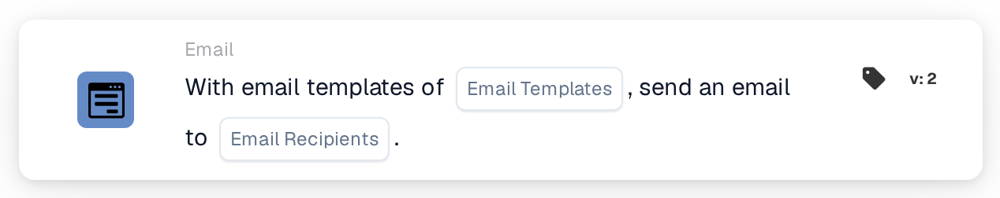

# Send Email

<figure><figcaption>
Version 2
</figcaption></figure>

## Purpose:

This workflow card sends an email based on one or more email templates. The recipients are not entered as fixed addresses: they are chosen by their role in the workflow, for example the user or group the document is assigned to, or the users and groups returned by a decision table. This keeps the workflow valid when the people behind these roles change.

To send an email to selected user groups instead, the card **Send Email to Groups** can be used, see [Send Email to Groups](send-email-groups-guide.md).

## Components of the Card:

1. **Email Templates**
   * **Description:** The email templates used for the email.
   * **Detail:** One or more email templates of the organization can be selected. Each selected template is sent to each recipient. When the workflow runs for a document, a template that is set up for a specific document type is only sent if the document has that document type.
2. **Email Recipients**
   * **Description:** Who receives the email.
   * **Options:** One or more of the following can be selected:
     * **Assigned user/group of document:** The user or group the document is currently assigned to.
     * **Returned user/group of decision table:** The users and groups returned by a decision table evaluated earlier in the same workflow, for example with the card **Decision Table has Returns**.
     * **User assigned to supplier:** The assigned user of the supplier, in workflows started by a change of a supplier's status.
     * **Referrer of supplier:** The referrer of the supplier, in workflows started by a change of a supplier's status.

## Functionality:

* **Collecting the Recipients:** The card collects the recipients of all selected options. A recipient that results from more than one option receives the email only once.
* **Action Execution:** The email is sent with the selected templates. When the workflow runs for a document, the templates can use the document's field values. The result is recorded in the workflow log together with the names of the recipients.
* **Without a Document:** The card can also run in workflows that are not started for a document, for example workflows started by a change of a supplier's status. In such a workflow, the option **Assigned user/group of document** does not add a recipient.
* **Missing Data:**
  * If no email template or no recipient option is selected on the card, the card does not run and reports the missing data in the workflow log.
  * If a selected option does not lead to anyone, for example because the document has no assignee or the decision table returned nobody, that option adds no recipient.
* **Errors:** If the email service rejects the request or does not answer in time, the card ends with an error.

## Setup and Configuration:

* The email templates should be set up in the organization before they can be selected on the card.
* The card can be added from the **Email** category. After that, one or more templates are selected in **Email Templates** and one or more options in **Email Recipients**.
* For the option **Returned user/group of decision table**, a decision table should be evaluated earlier in the same workflow.

## Conclusion:

The "Send Email" workflow card informs the people involved in a document or supplier process automatically, using prepared templates. Because recipients are chosen by role, the same workflow keeps reaching the right people when assignments change.
