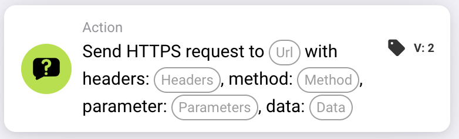

# Send HTTPS request to

**Call API**, Version 2, ergänzt den konfigurierten Pfad um die DocBits-API-Basis und verwendet den aktuellen Organisationskontext. **Send HTTPS Request**, Version 2, verwendet eine externe URL und eigene Header. Ein vollständig fremder URL-Wert ist kein austauschbarer Call-API-Pfad. Beide Karten simulieren im Advanced-Test den Versand.

Die geprüfte HTTPS-Aktion protokolliert Status und Antworttext, stellt aber keinen frei benannten JSON-Antwortspeicher für Folgekarten bereit. Call API wertet den Antworttext über eine Bool-Konvertierung aus. HTTP 200, ein gültiger JSON-Body und eine fachlich erfolgreiche Folgeaktion sind daher getrennte Nachweise. Erfinden Sie keine Zugriffssyntax wie `api.response.cost_center`.

Für `{"cost_center":"4711"}` aus einem Fremdsystem vereinbaren Sie einen ausdrücklich unterstützten Rückschreibweg oder Callback in ein Dokumentfeld. Prüfen Sie das gespeicherte Feld und lesen Sie es im dafür vorgesehenen Folgelauf. Für direkten Antwortdatentransfer ist eine Karte oder Erweiterung mit dokumentiertem Ausgabevertrag erforderlich. JSON in der Kartenkonfiguration bestätigt außerdem nicht automatisch die tatsächlich gesendeten JSON-Bytes.

Verwenden Sie ein eigenes Testziel und prüfen Sie Methode, Header, tatsächlichen Body, Status und Antwortschema. Nehmen Sie 4xx, 5xx, Timeout, ungültiges JSON und doppelte Auslösung ab. Wiederholen Sie Schreibaufrufe erst, nachdem ein möglicher erster Empfang geprüft wurde. Die URL im Beispiel ist ein reservierter Platzhalter; sie wurde nicht als erreichbarer Dienst getestet.

[P1: API-Aufruf und Weiterverwendung der Antwort prüfen](../../masterclass/api-response-contract.md)

<figure><figcaption></figcaption></figure>

<figure><figcaption></figcaption></figure>
