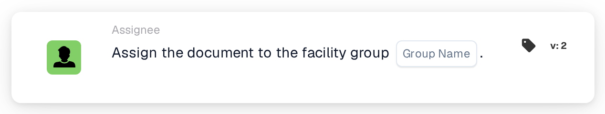

# Assign Document to Facility Group

<figure><figcaption>
Version 2
</figcaption></figure>

## Purpose:

This workflow card assigns a document to the group that is responsible for the facility of its purchase order. The facility is not selected on the card: it is taken from the purchase orders the document is matched with. The card then looks for a user group whose name contains both the group name entered on the card and the facility code, and assigns the document to that group.

This is useful when the same kind of team exists once per facility, for example one approval group per plant or warehouse, and each document should go to the team of the facility it was ordered for.

For an assignment that is added to a sequence of approvers instead of being made directly, the card **Assign Sequentially to Facility Group** can be used.

## Components of the Card:

1. **Group Name**
   * **Description:** The name part that the facility groups have in common.
   * **Detail:** A text that is compared with the names of the user groups of the organization. A group matches if its name contains this text and the facility code of the purchase order. The comparison ignores upper and lower case. For example, with the group name **Approver** and a purchase order for facility **1000**, a group called **Approver 1000** would match.

## Functionality:

* **Finding the Facility:** The card reads the purchase orders the document is matched with and collects the facility code (the location of the purchase order) of each of them.
* **Finding the Group:** For every facility code, the card looks for user groups whose name contains both the **Group Name** from the card and the facility code. Facility codes for which no group is found are listed in the workflow log.
* **Action Execution:** The document is assigned to the matching group. If several groups match, for example because the document is matched with purchase orders of different facilities, the document is assigned to only one of them; which one is not determined by the card.
* **Missing Data:**
  * If no group name is entered on the card, the card does not run and reports the missing data in the workflow log.
  * If the document is not matched with a purchase order, the card reports the missing data instead of assigning the document.
  * If no group matches any of the facility codes, the document is not assigned and the workflow log notes that no matching group was found.

## Setup and Configuration:

* The user groups should be named so that each name contains the common name part and the facility code, for example **Approver 1000**, **Approver 2000**.
* The card can be added from the **Assignee** category. After that, the common name part of the groups is entered in the **Group Name** field.
* As the facility comes from the matched purchase orders, the card is best used in workflows for documents that have already been matched with a purchase order.

## Conclusion:

The "Assign Document to Facility Group" workflow card routes documents to the team of the facility they were ordered for. One card covers all facilities, as long as the user groups follow a consistent naming scheme with the facility code in their names.
