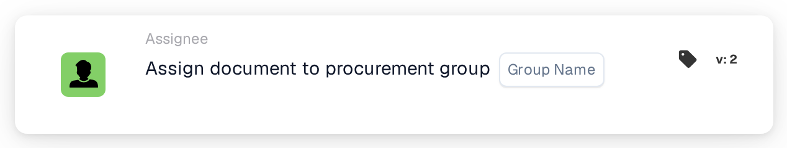

# Assign document to procurement group

<figure><figcaption>
Version 2
</figcaption></figure>

## **Purpose:**

The **"Assign to Procurement Group"** workflow card is used to assign a document to a specified procurement group within the system. This helps streamline document management by ensuring that the appropriate team handles the document based on its assigned procurement group.

## **Components of the Card:**

1. **Procurement Group**
   * **Description:** Specifies the procurement group to which the document will be assigned.
   * **Detail:** The selected procurement group will be responsible for processing and managing the document.

## **Functionality:**

* **Condition Evaluation:**\
  The card only executes its action if both the **"Where"** and **"And Sections"** evaluate as true.
* **Action Execution:**\
  If both conditions are true, the document is assigned to the specified procurement group. If either condition is false, no actions are taken, and the document remains unassigned.

## **Setup and Configuration:**

* **Select Procurement Group:** Choose the procurement group to assign the document to from the dropdown list.

## **Conclusion:**

The **"Assign to Procurement Group"** workflow card provides a simple yet effective way to ensure that documents are automatically assigned to the correct procurement team for further processing.
