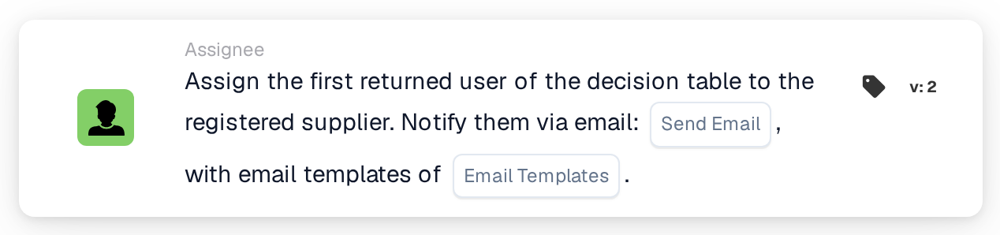

# Assign First Decision Table User to Supplier

<figure><figcaption>
Version 2
</figcaption></figure>

## Purpose:

This workflow card sets the assigned user of a registered supplier based on a decision table. The first user returned by the decision table becomes the supplier's assigned user, the internal contact responsible for the supplier. The returned users can also be informed by email.

Like **Assign User to Supplier**, the card does not work on a document: it is meant for workflows that are started by a change of a supplier's status, for example with the When card **Supplier status changed**. The user is determined by a decision table evaluated earlier in the same workflow, for example with the card **Decision Table has Returns**, instead of being selected on the card.

## Components of the Card:

1. **Send Email**
   * **Description:** The email setting of the card.
   * **Options:** **True** or **False**.
   * **Detail:** With **True**, the emails are sent with the selected email templates. With **False**, no email is sent. If **Send Email** is not set, no email is sent either.
2. **Email Templates**
   * **Description:** The email templates used for the email.
   * **Detail:** One or more email templates of the organization can be selected. The templates are used when **Send Email** is **True**.

## Functionality:

* **Reading the Decision Table:** The card reads the users returned by the decision table earlier in the workflow. Only returned users are taken into account, not groups.
* **Email Notification:** When emails are sent, they go to all users returned by the decision table, not only to the first one. The emails are sent before the user is assigned to the supplier.
* **Action Execution:** The first returned user is saved as the assigned user of the supplier whose status changed. If the supplier already has an assigned user, that user is replaced. The result is recorded in the workflow log.
* **Missing Data:**
  * If the decision table returned no user, nothing is assigned and the card reports the missing data in the workflow log.
  * If **Send Email** is **True** but no email template is selected, the card stops without assigning the user and reports the missing data.
  * If **Send Email** is not set, the workflow log notes the missing setting and the user is assigned without an email.
* **Errors:** If the email or supplier service rejects the request or does not answer in time, the card ends with an error. If sending the emails fails, the user is not assigned to the supplier.

## Setup and Configuration:

* The card can be used in a workflow that is started by a change of a supplier's status. A decision table that returns users should be evaluated earlier in the same workflow.
* The card can be added from the **Assignee** category. After that, **Send Email** can be set and one or more email templates can be selected.

## Conclusion:

The "Assign First Decision Table User to Supplier" workflow card assigns a responsible contact to a supplier according to rules kept in a decision table. The optional email lets the returned users know about the supplier right away.
