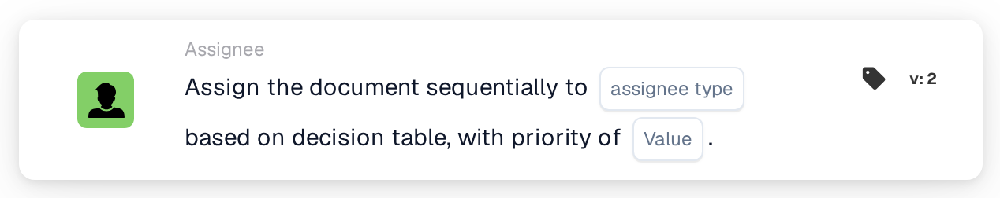
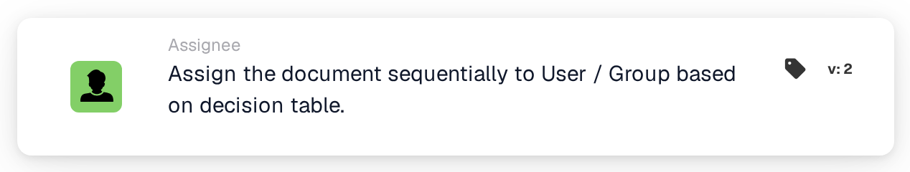

# Assign Sequentially to User/Group

<figure><figcaption>
Version 2
</figcaption></figure>

<figure><figcaption>
Assign the document sequentially to User / Group based on decision table. — Version 2
</figcaption></figure>

## **Purpose**

The "**Assign the Document Sequentially to User/Group Based on Decision Table**" workflow card dynamically assigns documents to either a user or a group, depending on the decision table's evaluation. This ensures that documents are routed appropriately based on predefined rules.

## **Components of the Card**

1. **Priority (Value)**
   * **Description**: Specifies the priority level for assignments, where lower numbers represent higher priority.
   * **Detail**: A numeric input field where the priority value can be set to control the sequence of assignment.

## **Functionality**

* **Decision Table Evaluation**:\
  The decision table evaluates predefined conditions to decide whether the document is assigned to a user or a group.
* **Document Assignment**:
  * If the decision table returns a user, the document is assigned directly to that user.
  * If the decision table returns a group, the document is assigned to the group sequentially, respecting the specified priority value.

## **Setup and Configuration**

1. Add the **Assign the Document Sequentially** card to your workflow.
2. Configure the **Priority (Value)** field:
   * Enter a numeric value to set the assignment priority.
3. Save and activate the workflow to apply the configuration.

## **Conclusion**

The "**Assign the Document Sequentially to User/Group Based on Decision Table**" workflow card ensures efficient and dynamic document routing. By leveraging decision table logic and priority values, the card facilitates accurate assignment to either a user or a group, streamlining document workflows.
