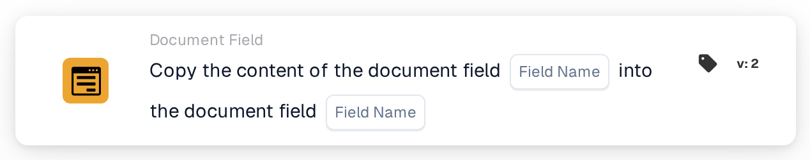

# Copy Document Field into Document Field

<figure><figcaption>
Version 2
</figcaption></figure>

## Purpose:

This workflow card copies the content of one document field into another document field of the same document. It can be used, for example, to fill a field that is needed for an export or a later card with a value that was already extracted into a different field.

## Components of the Card:

1. **Field Name** (first)
   * **Description:** The document field whose content is copied.
   * **Detail:** The name of a document field. The name is compared exactly, including upper and lower case. The field itself is not changed.
2. **Field Name** (second)
   * **Description:** The document field the content is copied into.
   * **Detail:** The name of a document field. Its current content is replaced by the copied content.

## Functionality:

* **Reading the Value:** The card looks for the first field among the document's fields and reads its value. The value found is noted in the workflow log.
* **Action Execution:** The value is written into the second field and the document is saved. The copied value is taken over as it is, without conversion. If the second field does not exist on the document yet, it is added. After a successful copy, later cards in the workflow work with the new value.
* **Missing Data:**
  * If one of the two field names is not set on the card, the card does not run and reports the missing data in the workflow log.
  * If the document has no field with the first name, nothing is copied and the card reports that the field was not found in the document.
* **Errors:** If the document cannot be saved, for example because its current status does not allow changes, the card ends with an error and the second field keeps its previous content.

## Setup and Configuration:

* The card can be added from the **Document Field** category. After that, the field to copy from is set in the first **Field Name** slot and the field to copy into in the second.
* As the value is copied without conversion, the two fields should hold the same kind of data, for example text into text or a date into a date.

## Conclusion:

The "Copy Document Field into Document Field" workflow card transfers values between fields without manual work. It keeps related fields consistent and lets later steps of a workflow use a value under the field name they expect.
