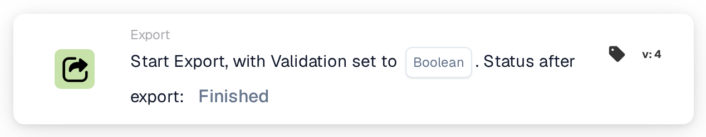

# Start Export

<figure><figcaption>
Version 1
</figcaption></figure>

<figure><figcaption>
Version 2
</figcaption></figure>

<figure><figcaption>
Version 3
</figcaption></figure>

<figure><figcaption>
Version 4
</figcaption></figure>

## **Purpose:**

The **"Start Export"** workflow card is designed to initiate the export process for a document. This card functions as a trigger within the workflow to seamlessly start the export operation once the conditions in the preceding sections are satisfied.

## **Components of the Card:**

1. **Action**
   1. **Description**: Initiates the export process for the document.
   2. **Detail**: The card uses the configured export settings in the system to process and export the document.

## **Functionality:**

* **Condition Evaluation**: The system evaluates the conditions set in the **"Where"** and **"And Sections"** of the workflow. If all conditions are true, the export process begins.
* **Document Export**: The document is processed and exported using the default or previously defined export configuration.

## **Setup and Configuration:**

This card does not require specific configuration as it uses the export settings already defined in the system. Users need to ensure that:

1. The **"Where"** and **"And Sections"** conditions are correctly configured, as the card only executes if these conditions evaluate to true.
2. A valid export configuration is associated with the document in the system.

## **Conclusion:**

The **"Start Export"** workflow card provides a streamlined and automated way to trigger the export process. By relying on pre-configured settings and conditional evaluations, it ensures efficient and accurate document processing.
