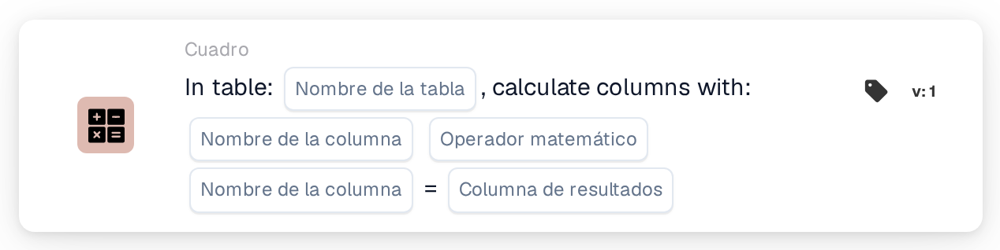

# Calcular columnas con

<figure><figcaption>
Versión 1
</figcaption></figure>

<figure><figcaption>
Versión 2
</figcaption></figure>

## **Propósito:**

La tarjeta de flujo de trabajo **"Calcular columnas en la tabla"** se utiliza para realizar cálculos entre columnas de una tabla seleccionada. Permite a los usuarios seleccionar columnas, aplicar una operación matemática y almacenar el resultado en una columna de resultado especificada.

## **Componentes de la tarjeta:**

1. **Nombre de la tabla**
   * **Descripción:** Especifica la **tabla** en la que se calcularán las columnas.
   * **Detalle:** Se proporciona una lista desplegable de todas las **tablas** disponibles para su selección.
2. **Column Name (1ª columna)**
   * **Descripción:** Especifica la **primera columna** que participará en el cálculo.
   * **Detalle:** Se proporciona una lista de todas las **columnas** disponibles para su selección.
3. **Operación**
   * **Descripción:** Define la operación matemática que se aplicará entre las columnas seleccionadas.
   * **Opciones:**
     * **Add (+):** Suma el valor de la segunda columna al valor de la primera columna.
     * **Restar (-):** Resta el valor de la segunda columna del valor de la primera columna.
     * **Multiply (\*):** Multiplica el valor de la primera columna por el valor de la segunda columna.
     * **Dividir (/):** Divide el valor de la primera columna por el valor de la segunda columna.
4. **Column Name (2ª columna)**
   * **Descripción:** Especifica la **segunda columna** que participará en el cálculo.
   * **Detalle:** Se proporciona una lista de **columnas** disponibles para su selección.
5. **Columna de resultados**
   * **Descripción:** Especifica la **columna** donde se almacenará el resultado del cálculo.
   * **Detalle:** Se proporciona una lista de **columnas** disponibles donde se guardará el valor calculado.

## **Funcionalidad:**

* **Evaluación de la condición:**\
  La tarjeta solo ejecuta su acción si las secciones **"Cuando"** y **"Y"** se evalúan como verdaderas.
* **Cálculo de columnas:**\
  La tarjeta realiza la operación matemática seleccionada entre las dos columnas elegidas.
* **Almacenamiento del resultado:**\
  El resultado del cálculo se almacena en la **columna de resultado** seleccionada.

## **Configuración:**

* **Seleccionar la Table:**\
  Elija la **tabla** donde se calcularán las columnas.
* **Elegir las columnas:**\
  Seleccione la **primera columna** y la **segunda columna** que se usarán en el cálculo.
* **Seleccionar la Operation:**\
  Elija la operación matemática (**Add (+)**, **Restar (-)**, **Multiply (\*)**, **Divide (/)**) que se aplicará entre las columnas.
* **Seleccionar la Result Column:**\
  Elija la **columna de resultado** donde se almacenará el cálculo.

## **Conclusión:**

La tarjeta de flujo de trabajo **"Calcular columnas en la tabla"** permite a los usuarios realizar cálculos dinámicos entre columnas de una tabla y almacenar los resultados en una columna designada. La tarjeta ofrece flexibilidad para aplicar diferentes operaciones matemáticas y garantiza que el resultado se almacene en la columna especificada.

<!-- workflow-card-practical-example-20261021 -->

## Ejemplo práctico

**Cuándo usar:** Calcule los totales de línea a partir de la cantidad y el precio unitario.

**Configuración:** Seleccionar tabla `lines`, columnas `quantity` y `unit_price`, columna de multiplicación y resultado `line_total`.

**Resultado esperado y contraejemplo:** Una fila que contiene `2` y `10` produce `20`. Pruebe otra fila de forma independiente y diagnostique entradas faltantes o no numéricas en lugar de tratarla como un total válido.

Esta es una configuración ilustrativa y un resultado esperado. Utilice campos, usuarios y grupos configurados en su organización de prueba; no es una afirmación de que este ejemplo haya sido ejecutado.
