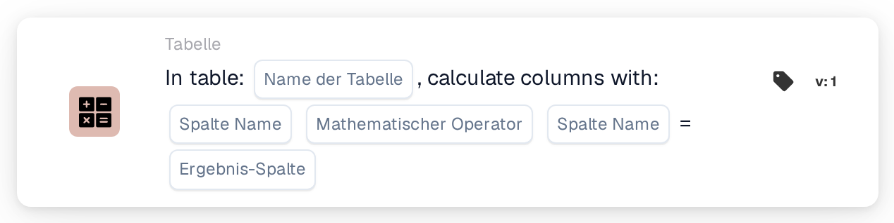
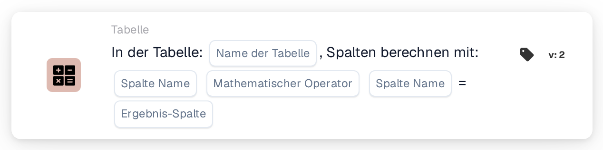

# Berechnen Sie Spalten mit

<figure><figcaption>
Version 1
</figcaption></figure>

<figure><figcaption>
Version 2
</figcaption></figure>

## **Zweck:**

Die Workflow-Karte **„Spalten in der Tabelle berechnen“** wird verwendet, um Berechnungen zwischen Spalten in einer ausgewählten Tabelle durchzuführen. Sie ermöglicht es Benutzern, Spalten auszuwählen, eine mathematische Operation anzuwenden und das Ergebnis in einer angegebenen Ergebnisspalte zu speichern.

## **Bestandteile der Karte:**

1. **Tabellenname**
   * **Beschreibung:** Gibt die **Tabelle** an, in der die Spalten berechnet werden.
   * **Detail:** Zur Auswahl wird eine Dropdown-Liste aller verfügbaren **Tabellen** bereitgestellt.
2. **Spaltenname (1. Spalte)**
   * **Beschreibung:** Gibt die **erste Spalte** an, die an der Berechnung beteiligt ist.
   * **Detail:** Zur Auswahl wird eine Liste aller verfügbaren **Spalten** bereitgestellt.
3. **Betrieb**
   * **Beschreibung:** Legt die mathematische Operation fest, die zwischen den ausgewählten Spalten angewendet wird.
   * **Optionen:**
     * **Addieren (+):** Addiert den Wert der zweiten Spalte zum Wert der ersten Spalte.
     * **Subtrahieren (-):** Subtrahiert den Wert der zweiten Spalte vom Wert der ersten Spalte.
     * **Multiplizieren (\*):** Multipliziert den Wert in der ersten Spalte mit dem Wert in der zweiten Spalte.
     * **Dividieren (/):** Dividiert den Wert in der ersten Spalte durch den Wert in der zweiten Spalte.
4. **Spaltenname (2. Spalte)**
   * **Beschreibung:** Gibt die **zweite Spalte** an, die an der Berechnung beteiligt ist.
   * **Detail:** Zur Auswahl wird eine Liste der verfügbaren **Spalten** bereitgestellt.
5. **Ergebnisspalte**
   * **Beschreibung:** Gibt die **Spalte** an, in der das Ergebnis der Berechnung gespeichert wird.
   * **Detail:** Es wird eine Liste der verfügbaren **Spalten** bereitgestellt, in der der berechnete Wert gespeichert wird.

## **Funktionalität:**

* **Bedingungsauswertung:**\
  Die Karte führt ihre Aktion nur aus, wenn sowohl der **„Wenn“**- als auch der **„Und“**-Abschnitt als erfüllt ausgewertet werden.
* **Spaltenberechnung:**\
  Die Karte führt die ausgewählte mathematische Operation zwischen den beiden gewählten Spalten durch.
* **Ergebnisspeicherung:**\
  Das Ergebnis der Berechnung wird in der ausgewählten **Ergebnisspalte** gespeichert.

## **Einrichtung und Konfiguration:**

* **Tabelle auswählen:**\
  Wählen Sie die **Tabelle**, in der die Spalten berechnet werden.
* **Spalten wählen:**\
  Wählen Sie die **erste Spalte** und die **zweite Spalte**, die in der Berechnung verwendet werden.
* **Operation auswählen:**\
  Wählen Sie die mathematische Operation (**Addieren (+)**, **Subtrahieren (-)**, **Multiplizieren (\*)**, **Dividieren (/)**), die zwischen den Spalten angewendet wird.
* **Ergebnisspalte auswählen:**\
  Wählen Sie die **Ergebnisspalte**, in der die Berechnung gespeichert wird.

## **Fazit:**

Die Workflow-Karte **„Spalten in der Tabelle berechnen“** ermöglicht es Benutzern, dynamische Berechnungen zwischen Spalten in einer Tabelle durchzuführen und die Ergebnisse in einer festgelegten Spalte zu speichern. Die Karte bietet Flexibilität, um verschiedene mathematische Operationen anzuwenden, und stellt sicher, dass das Ergebnis in der angegebenen Spalte gespeichert wird.

<!-- workflow-card-practical-example-20261021 -->

## Praxisbeispiel

**Verwendungszweck:** Zeilensummen aus Menge und Stückpreis berechnen.

**Konfiguration:** Tabelle auswählen `lines`, Spalten `quantity` und `unit_price`, Multiplikations- und Ergebnisspalte `line_total`.

**Erwartetes Ergebnis und Gegenbeispiel:** Eine Zeile, die `2` und `10` enthält, erzeugt `20`. Testen Sie eine andere Zeile unabhängig und diagnostizieren Sie fehlende oder nicht numerische Eingaben, anstatt sie als gültige Summe zu behandeln.

Dies ist eine beispielhafte Konfiguration und ein erwartetes Ergebnis. Verwenden Sie in Ihrer Testorganisation konfigurierte Felder, Benutzer und Gruppen. Es wird nicht behauptet, dass dieses Beispiel ausgeführt wurde.
