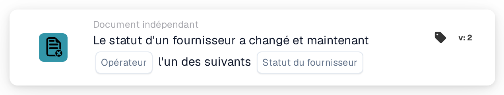

# Changement de statut du fournisseur

<figure><figcaption>
Version 2
</figcaption></figure>

## Objectif :

Cette carte de workflow démarre un workflow (déclencheur) lorsque le statut d'un fournisseur change, par exemple lorsqu'un fournisseur est approuvé ou rejeté. Le workflow s'exécute sans document ; il peut donc servir à prévenir des personnes ou à lancer des étapes de suivi dans l'intégration des fournisseurs.

## Composants de la carte :

1. **Opérateur**
   * **Description :** définit si le nouveau statut du fournisseur devrait être l'un des statuts sélectionnés ou aucun d'entre eux.
   * **Options :**
     * **Est :** la condition est vraie si le nouveau statut est l'un des statuts sélectionnés.
     * **N'est pas :** la condition est vraie si le nouveau statut ne fait pas partie des statuts sélectionnés.
2. **Statut du fournisseur**
   * **Description :** les statuts de fournisseur auxquels le nouveau statut est comparé.
   * **Options :** un ou plusieurs des statuts suivants :
     * **Approuvé**
     * **En attente d'approbation AP**
     * **En attente d'approbation**
     * **En attente d'inscription**
     * **Rejeté**

## Fonctionnalité :

* **Démarrage du workflow :** un changement de statut d'un fournisseur dans la gestion des fournisseurs démarre tous les workflows indépendants des documents activés de l'organisation (à l'exception des workflows webhook et planifiés) et leur transmet le nouveau statut. C'est le cas, par exemple, lorsqu'un nouveau fournisseur est invité (statut en attente d'inscription), lorsqu'un fournisseur est soumis à approbation, approuvé ou rejeté, ou lorsque les données d'un fournisseur sont enregistrées avec un autre statut. Le statut doit faire partie des statuts de fournisseur configurés pour l'organisation ; sinon, aucun workflow n'est démarré. Les workflows ne sont démarrés que si le module workflow est actif pour l'organisation et qu'il existe des workflows actifs.
* **Évaluation de la condition :** la carte compare le statut transmis au workflow aux statuts sélectionnés sur la carte.
* **Exécution de l'action :**
  * **Condition vraie :**\
    Avec **Est**, le nouveau statut est l'un des statuts sélectionnés. Avec **N'est pas**, il ne l'est pas. Le workflow se poursuit avec les cartes suivantes.
  * **Condition fausse :**\
    Si la condition n'est pas remplie, la carte n'est pas satisfaite et les étapes suivantes ne sont pas exécutées.
* **Remarque sur « N'est pas » :** une importation de bon de commande démarre elle aussi tous les workflows indépendants des documents, y compris ceux qui contiennent cette carte. Une importation de bon de commande ne transmet aucun statut de fournisseur ; avec **N'est pas**, une importation de bon de commande rend donc également la carte vraie et le workflow s'exécute. Combiner **N'est pas** avec d'autres conditions peut aider à limiter le workflow aux événements liés aux fournisseurs.
* **Données manquantes :** si aucun statut n'est sélectionné sur la carte, la carte n'évalue pas la condition. Elle signale la saisie manquante (ou une erreur) dans le journal du workflow, et les étapes suivantes ne sont pas exécutées.
* **Opérateur non valide :** si l'opérateur n'est ni **Est** ni **N'est pas**, la carte signale une erreur de configuration de la carte dans le journal du workflow.

## Mise en place et configuration :

* La carte peut être ajoutée depuis le groupe **WHEN**, catégorie **Document indépendant**. Ensuite, l'opérateur et un ou plusieurs statuts sont sélectionnés, les autres conditions et actions sont ajoutées, puis le workflow est enregistré et activé.

## Conclusion :

La carte « Supplier status changed » relie la gestion des fournisseurs aux workflows. Les approbations, les rejets et les autres changements de statut peuvent déclencher directement des notifications et des étapes de suivi ; l'intégration des fournisseurs ne dépend ainsi plus de contrôles manuels.
