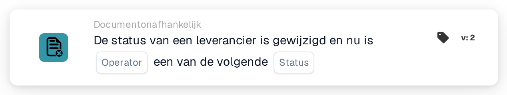

# Leveranciersstatus gewijzigd

<figure><figcaption>
Versie 2
</figcaption></figure>

## Doel:

Deze workflowkaart start een workflow (trigger) wanneer de status van een leverancier verandert, bijvoorbeeld wanneer een leverancier wordt goedgekeurd of afgewezen. De workflow loopt zonder document en kan dus worden gebruikt om mensen op de hoogte te brengen of om vervolgstappen in de onboarding van leveranciers te starten.

## Onderdelen van de kaart:

1. **Operator**
   * **Beschrijving:** Bepaalt of de nieuwe leveranciersstatus een van de geselecteerde statussen hoort te zijn of geen van hen.
   * **Opties:**
     * **Is:** De voorwaarde is waar als de nieuwe status een van de geselecteerde statussen is.
     * **Is niet:** De voorwaarde is waar als de nieuwe status geen van de geselecteerde statussen is.
2. **Status**
   * **Beschrijving:** De leveranciersstatussen waarmee de nieuwe status wordt vergeleken.
   * **Opties:** Een of meer van:
     * **Goedgekeurd**
     * **In afwachting van AP-goedkeuring**
     * **In afwachting van goedkeuring**
     * **In afwachting van registratie**
     * **Afgewezen**

## Functionaliteit:

* **Wanneer de workflow start:** Een statuswijziging van een leverancier in het leveranciersbeheer start alle geactiveerde documentonafhankelijke workflows van de organisatie (behalve webhook- en geplande workflows) en geeft de nieuwe status aan hen door. Dit gebeurt bijvoorbeeld wanneer een nieuwe leverancier wordt uitgenodigd (status in afwachting van registratie), wanneer een leverancier ter goedkeuring wordt aangeboden, wordt goedgekeurd of afgewezen, of wanneer leveranciersgegevens met een andere status worden opgeslagen. De status hoort een van de voor de organisatie geconfigureerde leveranciersstatussen te zijn; anders wordt er geen workflow gestart. Workflows worden alleen gestart als de workflowmodule voor de organisatie actief is en er actieve workflows zijn.
* **Voorwaarde-evaluatie:** De kaart vergelijkt de aan de workflow doorgegeven status met de op de kaart geselecteerde statussen.
* **Actie-uitvoering:**
  * **True-voorwaarde:**\
    Met **Is** is de nieuwe status een van de geselecteerde statussen, met **Is niet** is ze dat niet. De workflow gaat verder met de volgende kaarten.
  * **False-voorwaarde:**\
    Is niet aan de voorwaarde voldaan, dan is niet aan de kaart voldaan en worden de stappen erna niet uitgevoerd.
* **Opmerking over "Is niet":** Een inkooporderimport start ook alle documentonafhankelijke workflows, inclusief workflows met deze kaart. Een inkooporderimport geeft geen leveranciersstatus door, dus met **Is niet** maakt ook een inkooporderimport de kaart waar en wordt de workflow uitgevoerd. Door **Is niet** met verdere voorwaarden te combineren, kan de workflow tot leveranciersgebeurtenissen worden beperkt.
* **Ontbrekende gegevens:** Is er op de kaart geen status geselecteerd, dan evalueert de kaart de voorwaarde niet. Ze meldt de ontbrekende invoer (of een fout) in het workflowlogboek en de stappen erna worden niet uitgevoerd.
* **Ongeldige operator:** Is de operator noch **Is** noch **Is niet**, dan meldt de kaart een fout in de kaartinstelling in het workflowlogboek.

## Opzet en configuratie:

* De kaart kan worden toegevoegd vanuit de groep **WHEN**, categorie **Documentonafhankelijk**. Daarna worden de operator en een of meer statussen geselecteerd, de verdere voorwaarden en acties toegevoegd, en wordt de workflow opgeslagen en geactiveerd.

## Conclusie:

De kaart "Supplier status changed" verbindt het leveranciersbeheer met workflows. Goedkeuringen, afwijzingen en andere statuswijzigingen kunnen direct meldingen en vervolgstappen in gang zetten, zodat de onboarding van leveranciers niet van handmatige controles afhangt.
