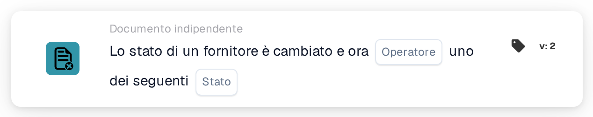

# Stato del fornitore modificato

<figure><figcaption>
Versione 2
</figcaption></figure>

## Scopo:

Questa scheda del workflow avvia un workflow (trigger) quando lo stato di un fornitore cambia, ad esempio quando un fornitore viene approvato o rifiutato. Il workflow viene eseguito senza un documento, quindi può essere utilizzato per avvisare delle persone o per avviare passaggi successivi nell'onboarding dei fornitori.

## Componenti della scheda:

1. **Operatore**
   * **Descrizione:** Definisce se il nuovo stato del fornitore dovrebbe essere uno degli stati selezionati o nessuno di essi.
   * **Opzioni:**
     * **È:** La condizione è vera se il nuovo stato è uno degli stati selezionati.
     * **Non è:** La condizione è vera se il nuovo stato non è uno degli stati selezionati.
2. **Stato**
   * **Descrizione:** Gli stati del fornitore con cui viene confrontato il nuovo stato.
   * **Opzioni:** Uno o più tra:
     * **Approvato**
     * **In attesa di approvazione AP**
     * **In attesa di approvazione**
     * **In attesa di registrazione**
     * **Rifiutato**

## Funzionalità:

* **Quando si avvia il workflow:** Una modifica dello stato di un fornitore nella gestione fornitori avvia tutti i workflow indipendenti dal documento attivi dell'organizzazione (tranne i workflow webhook e quelli pianificati) e trasmette loro il nuovo stato. Ciò avviene, ad esempio, quando viene invitato un nuovo fornitore (stato in attesa di registrazione), quando un fornitore viene inviato per l'approvazione, approvato o rifiutato, oppure quando i dati di un fornitore vengono salvati con uno stato diverso. Lo stato dovrebbe essere uno degli stati fornitore configurati per l'organizzazione; in caso contrario non viene avviato alcun workflow. I workflow vengono avviati solo se il modulo workflow è attivo per l'organizzazione e se esistono workflow attivi.
* **Valutazione della condizione:** La scheda confronta lo stato trasmesso al workflow con gli stati selezionati sulla scheda.
* **Esecuzione dell'azione:**
  * **Condizione vera:**\
    Con **È** il nuovo stato è uno degli stati selezionati, con **Non è** non lo è. Il workflow prosegue con le schede successive.
  * **Condizione falsa:**\
    Se la condizione non è soddisfatta, la scheda non è soddisfatta e i passaggi successivi non vengono eseguiti.
* **Nota su "Non è":** Anche un'importazione di ordini di acquisto avvia tutti i workflow indipendenti dal documento, compresi quelli con questa scheda. Un'importazione di ordini di acquisto non trasmette alcuno stato del fornitore, quindi con **Non è** anche un'importazione di ordini di acquisto rende vera la scheda e il workflow viene eseguito. Combinare **Non è** con ulteriori condizioni può aiutare a limitare il workflow agli eventi relativi ai fornitori.
* **Dati mancanti:** Se sulla scheda non è selezionato alcuno stato, la scheda non valuta la condizione. Segnala l'input mancante (o un errore) nel log del workflow e i passaggi successivi non vengono eseguiti.
* **Operatore non valido:** Se l'operatore non è né **È** né **Non è**, la scheda segnala un errore di configurazione della scheda nel log del workflow.

## Configurazione e impostazione:

* La scheda può essere aggiunta dalla sezione **WHEN**, categoria **Documento indipendente**. Poi si selezionano l'operatore e uno o più stati, si aggiungono le ulteriori condizioni e azioni, e il workflow viene salvato e attivato.

## Conclusione:

La scheda "Supplier status changed" collega la gestione dei fornitori ai workflow. Approvazioni, rifiuti e altre modifiche di stato possono attivare direttamente notifiche e passaggi successivi, così l'onboarding dei fornitori non dipende da controlli manuali.
