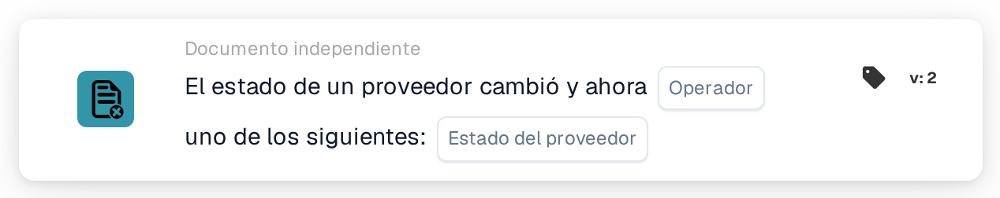

# Cambio de estado del proveedor

<figure><figcaption>
Versión 2
</figcaption></figure>

## Propósito:

Esta tarjeta de flujo de trabajo inicia un flujo de trabajo (disparador) cuando cambia el estado de un proveedor, por ejemplo cuando un proveedor se aprueba o se rechaza. El flujo de trabajo se ejecuta sin documento, por lo que puede utilizarse para notificar a personas o para iniciar pasos de seguimiento en la incorporación de proveedores.

## Componentes de la tarjeta:

1. **Operador**
   * **Descripción:** Define si el nuevo estado del proveedor debería ser uno de los estados seleccionados o ninguno de ellos.
   * **Opciones:**
     * **Es:** La condición es verdadera si el nuevo estado es uno de los estados seleccionados.
     * **No Es:** La condición es verdadera si el nuevo estado no es ninguno de los estados seleccionados.
2. **Estado del proveedor**
   * **Descripción:** Los estados de proveedor con los que se compara el nuevo estado.
   * **Opciones:** Uno o varios de los siguientes:
     * **Aprobado**
     * **Pendiente de aprobación de AP**
     * **Aprobación pendiente**
     * **Registro pendiente**
     * **Rechazado**

## Funcionalidad:

* **Cuándo se inicia el flujo de trabajo:** Un cambio de estado de un proveedor en la gestión de proveedores inicia todos los flujos de trabajo independientes del documento activos de la organización (excepto los flujos de trabajo de webhook y los programados) y les transmite el nuevo estado. Esto ocurre, por ejemplo, cuando se invita a un nuevo proveedor (estado registro pendiente), cuando un proveedor se envía para su aprobación, se aprueba o se rechaza, o cuando los datos de un proveedor se guardan con un estado diferente. El estado tiene que ser uno de los estados de proveedor configurados para la organización; de lo contrario, no se inicia ningún flujo de trabajo. Los flujos de trabajo solo se inician si el módulo de flujos de trabajo está activo para la organización y existen flujos de trabajo activos.
* **Evaluación de la condición:** La tarjeta compara el estado transmitido al flujo de trabajo con los estados seleccionados en la tarjeta.
* **Ejecución de la acción:**
  * **Condición verdadera:**\
    Con **Es**, el nuevo estado es uno de los estados seleccionados. Con **No Es**, no lo es. El flujo de trabajo continúa con las tarjetas siguientes.
  * **Condición falsa:**\
    Si no se cumple la condición, la tarjeta no se cumple y los pasos posteriores no se ejecutan.
* **Nota sobre «No Es»:** Una importación de órdenes de compra también inicia todos los flujos de trabajo independientes del documento, incluidos los flujos de trabajo con esta tarjeta. Una importación de órdenes de compra no transmite ningún estado de proveedor, por lo que, con **No Es**, una importación de órdenes de compra también hace que la tarjeta sea verdadera y el flujo de trabajo se ejecuta. Combinar **No Es** con otras condiciones puede ayudar a limitar el flujo de trabajo a los eventos de proveedores.
* **Datos que faltan:** Si no hay ningún estado seleccionado en la tarjeta, la tarjeta no evalúa la condición. Registra la entrada que falta (o un error) en el registro del flujo de trabajo, y los pasos posteriores no se ejecutan.
* **Operador no válido:** Si el operador no es ni **Es** ni **No Es**, la tarjeta registra un error de configuración de la tarjeta en el registro del flujo de trabajo.

## Configuración:

* La tarjeta se puede añadir desde el grupo **WHEN**, categoría **Documento independiente**. A continuación se seleccionan el operador y uno o varios estados, se añaden las demás condiciones y acciones, y el flujo de trabajo se guarda y se activa.

## Conclusión:

La tarjeta «Supplier status changed» conecta la gestión de proveedores con los flujos de trabajo. Las aprobaciones, los rechazos y otros cambios de estado pueden disparar directamente notificaciones y pasos de seguimiento, de modo que la incorporación de proveedores no depende de comprobaciones manuales.
