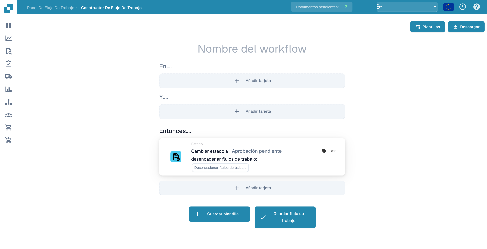
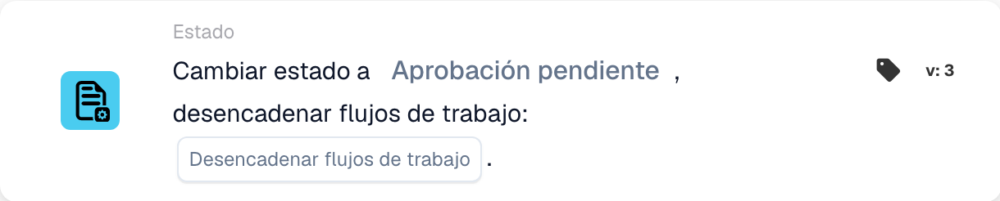
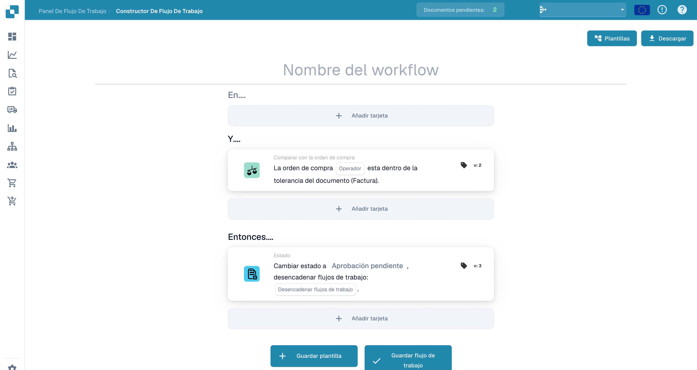
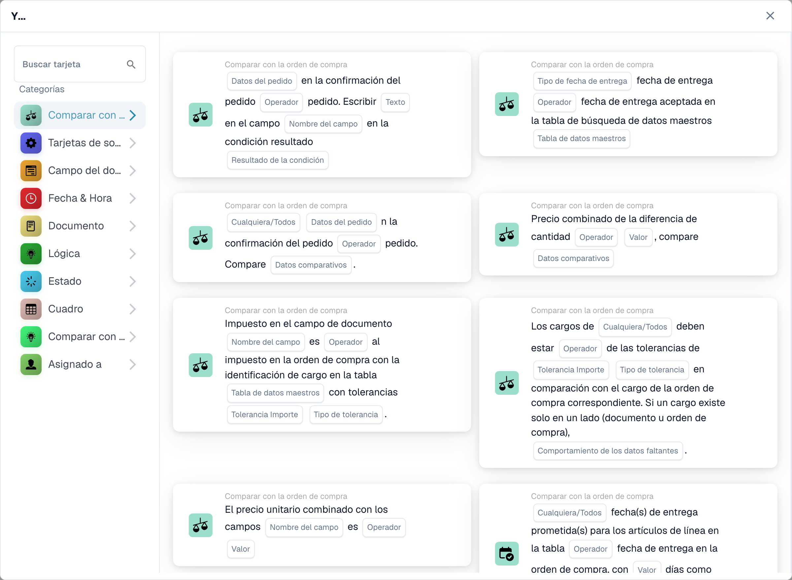

# Asignación y estado — Ejemplos prácticos

Las imágenes actualizadas muestran borradores de condiciones y acciones sin guardar. Adapte los roles y condiciones a su organización.

Para mantener una visión general, puede asignar a los flujos de trabajo diferentes títulos para saber de inmediato de qué tarea trata cada flujo de trabajo.

Cree un nuevo flujo de trabajo: Haga clic en + ADD WORKFLOW

Puede utilizar estos flujos de trabajo (Test 1,2,3) para asignar automáticamente diversos documentos al empleado adecuado de la empresa.

Si una factura u otro documento supera un determinado importe total que requiere revisión y aprobación previas, estos documentos pueden asignarse de inmediato a la persona correcta.

<figure><figcaption></figcaption></figure>

**Prueba 1: Tarjeta Lógica**

When: **Assignee is:** Responsable de entrada

Y: **El tipo de documento es:** Factura

Then: **Assign document to:** Revisor de facturas

.png>)

**Prueba 2: Tarjeta Lógica**

When: **Assignee is:** Responsable de entrada

Y: **El tipo de documento es:** Albarán

Then: **Assign document to:** Revisor de albaranes

.png>)

**Prueba 3: Tarjeta Lógica**

**When:** **Assignee is:** Responsable de entrada

**Y:El tipo de documento es:** Confirmación de pedido

**Then:** **Assign document to:** Revisor de pedidos

.png>)

También es posible, si el documento no está asignado a una sola persona, asignarlo a un empleado concreto desde el principio.

<figure><figcaption></figcaption></figure>

Para tener una visión más sencilla de lo que debe ocurrir con un documento, puede establecer el estado de los documentos entrantes en este flujo de trabajo. Este flujo de trabajo permite ver de inmediato si existe, por ejemplo, una aprobación pendiente.

**Prueba 4: Tarjeta Lógica**

**Cuando:El tipo de documento es:** Albarán

**And:** **Assignee is:** Responsable de entrada

**Luego:Cambiar estado a:** Pendiente de aprobación

<figure><figcaption>
Borrador de flujo para cambiar el estado de un documento.
</figcaption></figure>

.png>)

**Prueba 5: Tarjeta Lógica**

Cuándo: **El tipo de documento es:** Factura

And: **Assignee is:** Revisor de facturas

Luego: **Cambiar estado a:** Pendiente de segunda aprobación

<figure><figcaption></figcaption></figure>

.png>)

Si una factura u otro documento supera un determinado importe total que requiere revisión y aprobación previas, estos documentos pueden asignarse de inmediato a la persona adecuada.

.png>)

**Prueba 6: Tarjeta Lógica**

When: **Assignee is:** Responsable de entrada

Y: Docfield **total\_amount** es **Mayor que 500**

Then: **Assign document to:** Responsable de aprobación

<figure><figcaption></figcaption></figure>

.png>)

También es posible introducir el estado en el flujo de trabajo, de modo que la persona asignada pueda ver de inmediato en qué estado se encuentra el documento y qué debe ocurrir a continuación con él.

**Prueba 7: Tarjeta Lógica**

**When:** **Assignee is:** Responsable de entrada

**Y:** Docfield **total\_amount** es **Mayor que 500**

**Then:** **Assign document to:** Responsable de aprobación

**Cambiar estado a:** Aprobación pendiente

<figure><figcaption>
Acción de cambio de estado en un flujo sin guardar.
</figcaption></figure>

<figure><figcaption></figcaption></figure>

Por ejemplo, si a un documento le falta información concreta o importante, pero esta es relevante y debe incluirse para su procesamiento posterior, puede configurar el flujo de trabajo de modo que estos documentos se reenvíen de inmediato al comprador y a un sustituto (suplente).

<figure><figcaption></figcaption></figure>

**Test 9:**

El flujo de trabajo con estas tarjetas de lógica está diseñado para verificar automáticamente que la cantidad, el precio unitario o el descuento detallados en una confirmación de pedido coincidan con las cifras correspondientes del pedido de compra. Esta verificación garantiza la coherencia y la exactitud entre lo que se pidió y lo que el proveedor confirma que va a entregar.

Puede asignar a estos documentos un estado concreto o asignarlos a un empleado específico.

<figure><figcaption>
Borrador de flujo con una condición de comparación con pedidos.
</figcaption></figure>

<figure><figcaption>
Selector de tarjetas de comparación con pedidos.
</figcaption></figure>

**Tarjeta lógica: Cantidad o precio unitario o coincidencia de descuento**

Esta tarjeta de lógica está diseñada para verificar automáticamente que la cantidad, el precio unitario o el descuento detallados en una confirmación de pedido coincidan con las cifras correspondientes del pedido de compra. Esta verificación garantiza la coherencia y la exactitud entre lo que se pidió y lo que el proveedor confirma que va a entregar.

**Condición de activación**

La lógica se activa cuando se cumple cualquiera de las siguientes condiciones en una confirmación de pedido en relación con el pedido de compra original:

* **Tolerancia de cantidad**: La cantidad de artículos pedidos coincide con la cantidad confirmada por el proveedor.
* **Tolerancia del precio unitario**: El precio por artículo acordado coincide con la confirmación del proveedor.
* **Descuento**: Cualquier descuento aplicado es coherente entre el pedido de compra y la confirmación de pedido.
* **Definir los parámetros de comparación**: Configure los campos específicos (cantidad, precio unitario, descuento) que la tarjeta de lógica comprobará para detectar una coincidencia.
* **Automate Verification**: Configure el sistema para comparar automáticamente estos detalles al recibir una confirmación de pedido.
* **Customize Alerts**: Decida el flujo de trabajo para gestionar las discrepancias, incluida la personalización de las alertas para la revisión manual.

Esta tarjeta de lógica es vital para garantizar que los detalles de una confirmación de pedido se ajusten al pedido de compra original, salvaguardando la integridad del ciclo de aprovisionamiento.

**Test 10:**

Si tiene un cálculo diferente para los recargos, o solo los aplica a algunos artículos, puede utilizar las tarjetas genéricas de cálculo de tablas; algunas de ellas también permiten filtrar mediante expresiones regulares.

<figure><figcaption></figcaption></figure>

Arriba se muestra un ejemplo de cálculo para MTZ con un filtro para los números de artículo que empiezan por 01, 06, 9, 001 o 000.

Con una configuración manual, se recomienda dividir los cálculos que dependen de nuevas columnas en un flujo de trabajo independiente. Para continuar con el cálculo puede utilizar la tarjeta Run Workflow.

**Ejecutar el flujo**

<figure><figcaption></figcaption></figure>

Con esta tarjeta puede especificar el nombre de un flujo de trabajo que debe ejecutarse después del flujo de trabajo actual si se cumplen sus condiciones, y después de las tarjetas "then" anteriores del flujo de trabajo actual. Aunque da prioridad a los flujos de trabajo ejecutables y activos, también permite ejecutar flujos de trabajo desactivados si el documento cumple las condiciones de dichos flujos.

### **Agregar recargos calculados en una columna existente** 

Si desea añadir todos los recargos como un descuento negativo en la columna de descuentos, puede utilizar la tarjeta de cálculo. Puede que ya haya entradas en esta columna; puede configurarla como una de las variables de la tarjeta, restarle el MTZ y volver a añadir el resultado a esta columna. En caso de que haya campos vacíos (recargos solo para algunos artículos), se asumirá un 0 para su cálculo.

**Notificar al usuario para autorizar la confirmación del pedido en DocBits**

Después de calcular los recargos, es posible que desee notificar a un usuario concreto para que autorice la confirmación de pedido. Para ello puede utilizar la tarjeta de notificación.

<figure><figcaption></figcaption></figure>

Según la configuración, al usuario se le asigna una nueva tarea en DocBits y, opcionalmente, un correo electrónico para notificarle su nueva tarea.
