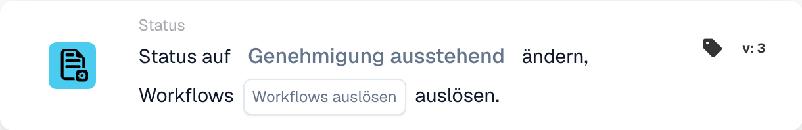
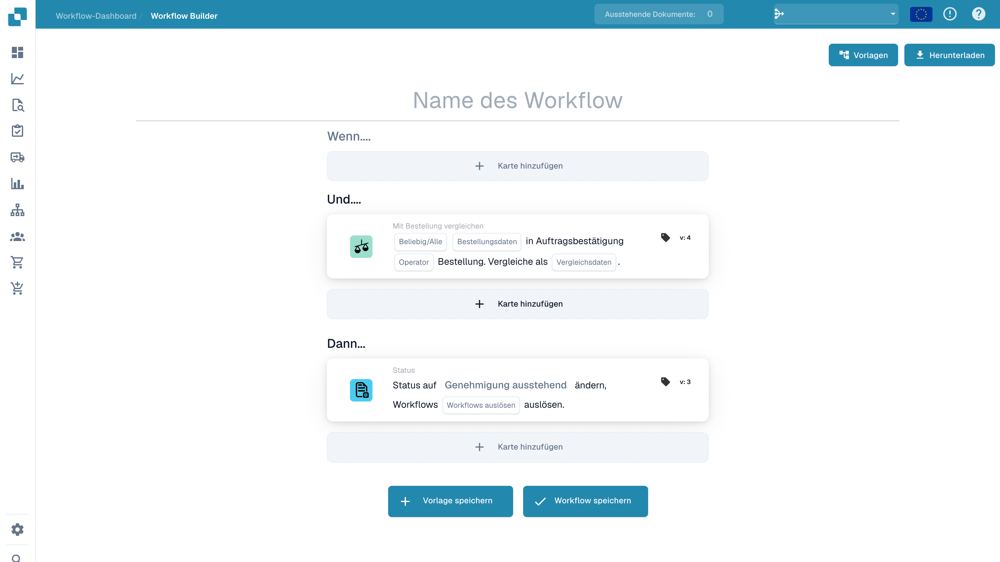
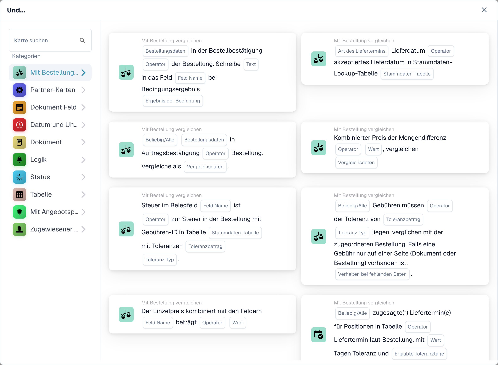

# Zuweisung & Status — Praxisbeispiele

Die neuen Abbildungen zeigen ungespeicherte Entwürfe der jeweiligen Aktion. Rollen und Bedingungen in den Beispielen sind an die eigene Organisation anzupassen.

Um den Überblick zu behalten, können Sie den Workflows verschiedene Überschriften geben, damit Sie sofort erkennen, worum es bei diesem Workflow geht.

Erstellen Sie einen neuen Workflow: Klicken Sie auf + ADD WORKFLOW

Sie können diese Workflows (Test 1, 2, 3) verwenden, um verschiedene Dokumente automatisch dem richtigen Mitarbeiter im Unternehmen zuzuweisen.

Wenn eine Rechnung oder ein anderes Dokument einen bestimmten Gesamtbetrag überschreitet, der eine vorherige Prüfung und Genehmigung erfordert, können diese Dokumente sofort der richtigen Person zugewiesen werden.

<figure><figcaption></figcaption></figure>

**Test 1: Logikkarte**

Wenn: **Zugewiesen an:** Eingangsprüfung

Und: **Dokumenttyp ist:** Invoice

Dann: **Dokument zuweisen an:** Rechnungsprüfung

.png>)

**Test 2: Logikkarte**

Wenn: **Zugewiesen an:** Eingangsprüfung

Und: **Dokumenttyp ist:** Delivery Note

Dann: **Dokument zuweisen an:** Lieferscheinprüfung

.png>)

**Test 3: Logikkarte**

**Wenn:** **Zugewiesen an:** Eingangsprüfung

**Und:** **Dokumenttyp ist:** Order Confirmation

**Dann:** **Dokument zuweisen an:** Auftragsprüfung

.png>)

Es ist auch möglich, ein Dokument von Anfang an einem bestimmten Mitarbeiter zuzuweisen, wenn es nicht einer einzelnen Person zugeordnet ist.

<figure><figcaption></figcaption></figure>

Für eine einfachere Übersicht darüber, was mit einem Dokument geschehen soll, können Sie in diesem Workflow den Status für eingehende Dokumente festlegen. Dieser Workflow ermöglicht es, sofort zu erkennen, ob beispielsweise eine ausstehende Genehmigung vorliegt.

**Test 4: Logikkarte**

**Wenn:** **Dokumenttyp ist:** Delivery Note

**Und:** **Zugewiesen an:** Eingangsprüfung

**Dann:** **Status ändern in:** Genehmigung ausstehend

<figure><figcaption>
Ungespeicherter Workflow-Entwurf zum Ändern eines Dokumentstatus.
</figcaption></figure>

.png>)

**Test 5: Logikkarte**

Wenn: **Dokumenttyp ist:** Invoice

Und: **Zugewiesen an:** Rechnungsprüfung

Dann: **Status ändern in:** Zweite Genehmigung ausstehend

<figure><figcaption></figcaption></figure>

.png>)

Wenn eine Rechnung oder ein anderes Dokument einen bestimmten Gesamtbetrag überschreitet, der eine vorherige Prüfung und Genehmigung erfordert, können diese Dokumente sofort der richtigen Person zugewiesen werden.

.png>)

**Test 6: Logikkarte**

Wenn: **Zugewiesen an:** Eingangsprüfung

Und: Das Dokumentfeld **total\_amount** ist **größer als 500**

Dann: **Dokument zuweisen an:** Freigabeverantwortliche

<figure><figcaption></figcaption></figure>

.png>)

Es ist auch möglich, den Status in den Workflow einzutragen, sodass die zugewiesene Person sofort erkennen kann, welchen Status dieses Dokument hat und was als Nächstes damit geschehen soll.

**Test 7: Logikkarte**

**Wenn:** **Zugewiesen an:** Eingangsprüfung

**Und:** Das Dokumentfeld **total\_amount** ist **größer als 500**

**Dann:** **Dokument zuweisen an:** Freigabeverantwortliche

**Status ändern in:** Genehmigung ausstehend

<figure><figcaption>
Statusänderung als Aktion in einem ungespeicherten Workflow-Entwurf.
</figcaption></figure>

<figure><figcaption></figcaption></figure>

Wenn beispielsweise bestimmte oder wichtige Informationen in einem Dokument fehlen, die aber für die weitere Verarbeitung wichtig sind und enthalten sein müssen, können Sie den Workflow so einrichten, dass diese Dokumente sofort an den Einkäufer und einen Stellvertreter (Ersatz) weitergeleitet werden.

<figure><figcaption></figcaption></figure>

**Test 9:**

Der Workflow mit diesen Logic Cards ist darauf ausgelegt, automatisch zu überprüfen, ob die in einer Auftragsbestätigung angegebene Menge, der Stückpreis oder der Rabatt mit den entsprechenden Angaben in der Bestellung übereinstimmen. Diese Überprüfung gewährleistet Konsistenz und Genauigkeit zwischen dem, was bestellt wurde, und dem, was der Lieferant zu liefern bestätigt.

Sie können diesen Dokumenten einen bestimmten Status geben oder sie einem bestimmten Mitarbeiter zuweisen.

<figure><figcaption>
Ungespeicherter Workflow-Entwurf mit einer Bestellabgleich-Aktion.
</figcaption></figure>

<figure><figcaption>
Workflow-Baustein für den Bestellabgleich im deutschen Auswahldialog.
</figcaption></figure>

**Logikkarte: Übereinstimmung von Menge, Stückpreis oder Rabatt**

Diese Logic Card ist darauf ausgelegt, automatisch zu überprüfen, ob die in einer Auftragsbestätigung angegebene Menge, der Stückpreis oder der Rabatt mit den entsprechenden Angaben in der Bestellung übereinstimmen. Diese Überprüfung gewährleistet Konsistenz und Genauigkeit zwischen dem, was bestellt wurde, und dem, was der Lieferant zu liefern bestätigt.

**Auslösebedingung**

Die Logik wird aktiviert, wenn eine der folgenden Bedingungen in einer Auftragsbestätigung im Vergleich zur ursprünglichen Bestellung erfüllt ist:

* **Menge**: Die Menge der bestellten Artikel stimmt mit der vom Lieferanten bestätigten Menge überein.
* **Stückpreis**: Der vereinbarte Preis pro Artikel stimmt mit der Bestätigung des Lieferanten überein.
* **Rabatt**: Etwaige gewährte Rabatte sind zwischen Bestellung und Auftragsbestätigung konsistent.
* **Vergleichsparameter definieren**: Legen Sie die spezifischen Felder (Menge, Stückpreis, Rabatt) fest, die die Logic Card auf Übereinstimmung prüfen soll.
* **Überprüfung automatisieren**: Konfigurieren Sie das System so, dass es diese Details beim Eingang einer Auftragsbestätigung automatisch vergleicht.
* **Benachrichtigungen anpassen**: Legen Sie den Workflow für den Umgang mit Abweichungen fest, einschließlich der Anpassung von Benachrichtigungen für die manuelle Prüfung.

Diese Logic Card ist entscheidend, um sicherzustellen, dass die Details einer Auftragsbestätigung mit der ursprünglichen Bestellung übereinstimmen, und schützt so die Integrität des Beschaffungszyklus.

**Test 10:**

Wenn Sie eine andere Berechnung für Zuschläge haben oder diese nur bei einigen Artikeln auftreten, können Sie die generischen Tabellenberechnungs-Cards verwenden. Einige davon erlauben auch das Filtern nach regulären Ausdrücken.

<figure><figcaption></figcaption></figure>

Oben sehen Sie ein Berechnungsbeispiel für MTZ mit einem Filter für Artikelnummern, die mit 01, 06, 9, 001 oder 000 beginnen.

Bei einer manuellen Einrichtung wird empfohlen, Berechnungen, die von neuen Spalten abhängen, in einen separaten Workflow auszulagern. Um mit der Berechnung fortzufahren, können Sie die Run Workflow Card verwenden.

**Workflow ausführen**

<figure><figcaption></figcaption></figure>

Mit dieser Card können Sie den Namen eines Workflows angeben, der nach dem aktuellen Workflow ausgeführt werden soll, wenn dessen Bedingungen erfüllt sind und nach den vorherigen Then-Cards des aktuellen Workflows. Während sie ausführbare, aktive Workflows priorisiert, ermöglicht sie auch das Ausführen deaktivierter Workflows, sofern das Dokument die Bedingungen des Workflows erfüllt.

### **Berechnete Zuschläge in eine bestehende Spalte einfügen** 

Wenn Sie alle Zuschläge als negativen Rabatt in die Rabattspalte einfügen möchten, können Sie die Berechnungs-Card verwenden. Es kann sein, dass in dieser Spalte bereits Einträge vorhanden sind; Sie können sie als eine der Variablen auf der Card festlegen, davon den MTZ abziehen und das Ergebnis wieder in diese Spalte einfügen. Falls leere Felder vorhanden sind (Zuschläge nur für einige Artikel), wird für die Berechnung ein Wert von 0 angenommen.

**Benutzer benachrichtigen, um die Auftragsbestätigung in DocBits zu autorisieren**

Nach der Berechnung der Zuschläge möchten Sie möglicherweise einen bestimmten Benutzer benachrichtigen, um die Auftragsbestätigung zu autorisieren. Dafür können Sie die Benachrichtigungs-Card verwenden.

<figure><figcaption></figcaption></figure>

Je nach Einstellungen wird dem Benutzer eine neue Aufgabe in DocBits zugewiesen und optional eine E-Mail gesendet, um ihn über seine neue Aufgabe zu informieren.
