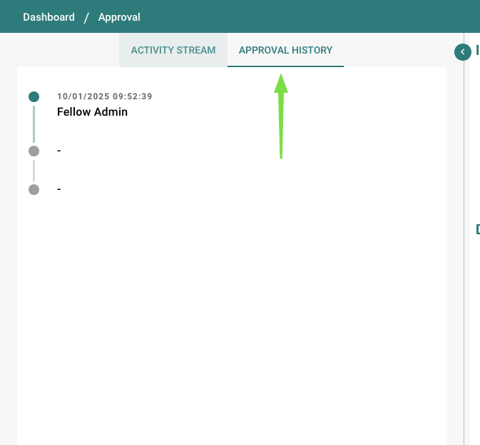
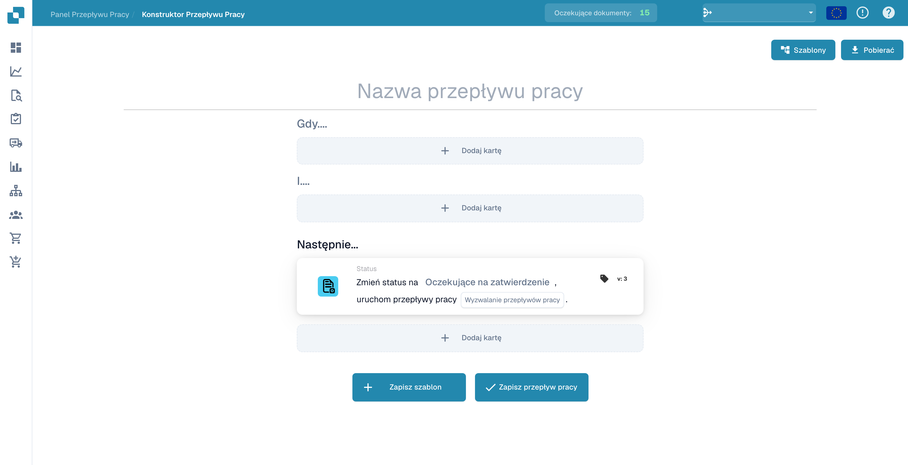
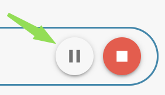
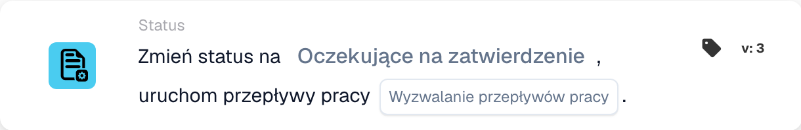
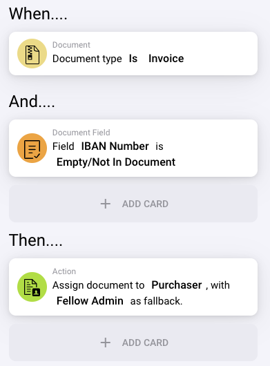
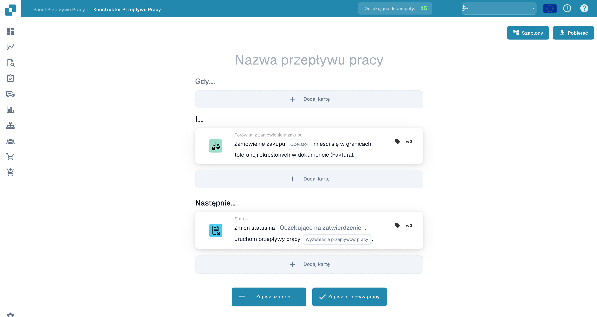
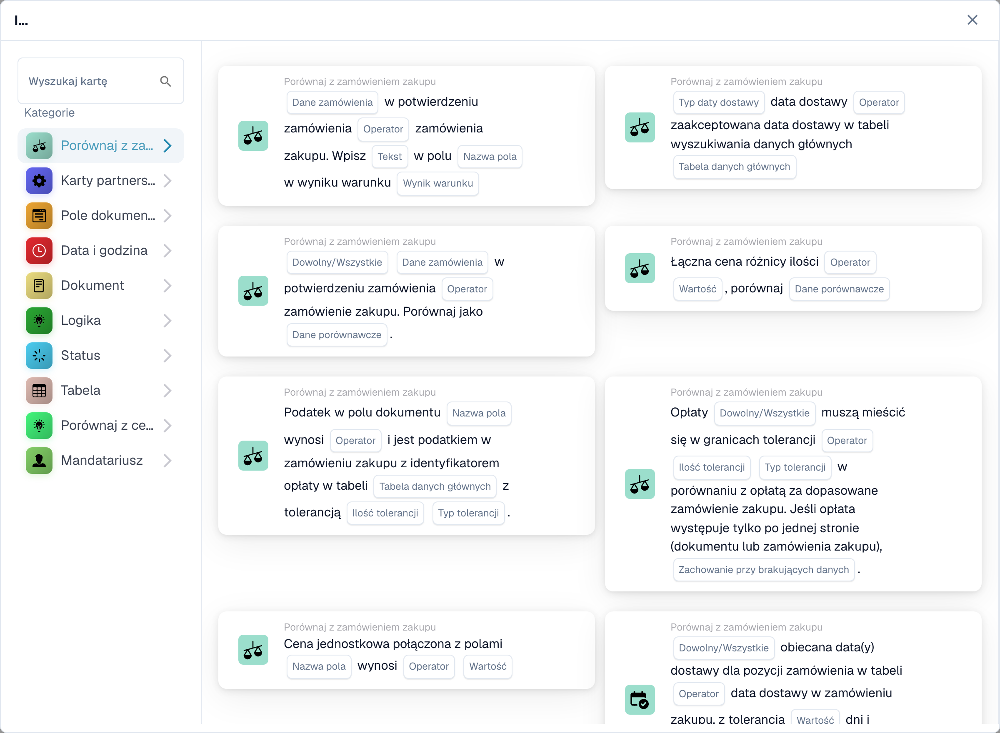

# Przypisanie i status — Przykłady praktyczne

Aby zachować przejrzystość, możesz nadać przepływom pracy różne nagłówki, dzięki czemu od razu będziesz wiedzieć, czego dotyczy dany przepływ pracy.

Utwórz nowy przepływ pracy: Kliknij + ADD WORKFLOW

Możesz użyć tych przepływów pracy (Test 1,2,3), aby automatycznie przypisywać różne dokumenty do właściwego pracownika w firmie.

Jeśli faktura lub inny dokument przekracza określoną kwotę całkowitą, która wymaga wcześniejszego przeglądu i zatwierdzenia, dokumenty te mogą zostać natychmiast przypisane do właściwej osoby.

<figure><figcaption></figcaption></figure>

**Test 1: Karta logiczna**

When: **Assignee is:** Osoba odpowiedzialna za odbiór

Oraz: **Typ dokumentu to:** Faktura

Then: **Assign document to:** Osoba sprawdzająca fakturę

.png>)

**Test 2: Karta logiczna**

When: **Assignee is:** Osoba odpowiedzialna za odbiór

Oraz: **Typ dokumentu to:** Dowód dostawy

Then: **Assign document to:** Osoba sprawdzająca dostawę

.png>)

**Test 3: Karta logiczna**

**When:** **Assignee is:** Osoba odpowiedzialna za odbiór

**And:Typ dokumentu to:** Potwierdzenie zamówienia

**Then:** **Assign document to:** Osoba sprawdzająca zamówienie

.png>)

Możliwe jest również, jeśli dokument nie jest przypisany do pojedynczej osoby, przypisanie go do konkretnego pracownika od samego początku.

<figure><figcaption></figcaption></figure>

Aby ułatwić przegląd tego, co powinno stać się z dokumentem, możesz ustawić status dla dokumentów przychodzących w tym przepływie pracy. Ten przepływ pracy umożliwia natychmiastowe sprawdzenie, czy istnieje na przykład oczekujące zatwierdzenie.

**Test 4: Karta logiczna**

**Kiedy:Typ dokumentu to:** Dowód dostawy

**And:** **Assignee is:** Osoba odpowiedzialna za odbiór

**Następnie:Zmień status na:** Oczekuje na zatwierdzenie

<figure><figcaption>
Niezapisany projekt przepływu zmieniającego status.
</figcaption></figure>

.png>)

**Test 5: Karta logiczna**

Kiedy: **Typ dokumentu to:** Faktura

And: **Assignee is:** Osoba sprawdzająca fakturę

Następnie: **Zmień status na:** Oczekuje na drugie zatwierdzenie

<figure><figcaption></figcaption></figure>

.png>)

Jeśli faktura lub inny dokument przekracza określoną kwotę całkowitą, która wymaga wcześniejszego przeglądu i zatwierdzenia, dokumenty te mogą zostać natychmiast przypisane do właściwej osoby.

.png>)

**Test 6: Karta logiczna**

When: **Assignee is:** Osoba odpowiedzialna za odbiór

Oraz: Docfield **total\_amount** jest **Większy niż 500**

Then: **Assign document to:** Osoba odpowiedzialna za zatwierdzenie

<figure><figcaption></figcaption></figure>

.png>)

Możliwe jest również wprowadzenie statusu do przepływu pracy, dzięki czemu przypisana osoba może natychmiast zobaczyć, jaki status ma ten dokument i co powinno z nim dalej nastąpić.

**Test 7: Karta logiczna**

**When:** **Assignee is:** Osoba odpowiedzialna za odbiór

**And:** Docfield **total\_amount** jest **Większy niż 500**

**Then:** **Assign document to:** Osoba odpowiedzialna za zatwierdzenie

**Zmień status na:** Oczekuje na zatwierdzenie

<figure><figcaption>
Działanie zmiany statusu w projekcie przepływu.
</figcaption></figure>

<figure><figcaption></figcaption></figure>

Na przykład, jeśli w dokumencie brakuje pewnych lub ważnych informacji, które są jednak istotne i muszą zostać uwzględnione do dalszego przetwarzania, możesz skonfigurować przepływ pracy tak, aby dokumenty te były natychmiast przekazywane do kupującego oraz osoby zastępującej (zastępcy).

<figure><figcaption></figcaption></figure>

**Test 9:**

Przepływ pracy z tymi kartami logiki jest zaprojektowany tak, aby automatycznie weryfikować, czy ilość, cena jednostkowa lub rabat wyszczególnione w potwierdzeniu zamówienia są zgodne z odpowiadającymi im wartościami w zamówieniu zakupu. Ta weryfikacja zapewnia spójność i dokładność między tym, co zamówiono, a tym, co dostawca potwierdza dostarczyć.

Możesz nadać tym dokumentom określony status lub przypisać je do konkretnego pracownika.

<figure><figcaption>
Projekt przepływu z warunkiem porównania z zamówieniem zakupu.
</figcaption></figure>

<figure><figcaption>
Wybór warunków porównania z zamówieniem zakupu.
</figcaption></figure>

**Karta logiczna: ilość, cena jednostkowa lub rabat**

Ta karta logiki jest zaprojektowana tak, aby automatycznie weryfikować, czy ilość, cena jednostkowa lub rabat wyszczególnione w potwierdzeniu zamówienia są zgodne z odpowiadającymi im wartościami w zamówieniu zakupu. Ta weryfikacja zapewnia spójność i dokładność między tym, co zamówiono, a tym, co dostawca potwierdza dostarczyć.

**Warunek wyzwalający**

Logika jest aktywowana, gdy w potwierdzeniu zamówienia w odniesieniu do oryginalnego zamówienia zakupu spełniony jest którykolwiek z następujących warunków:

* **Ilość**: Ilość zamówionych pozycji jest zgodna z ilością potwierdzoną przez dostawcę.
* **Cena jednostkowa**: Uzgodniona cena za pozycję jest zgodna z potwierdzeniem dostawcy.
* **Rabat**: Wszelkie zastosowane rabaty są spójne między zamówieniem zakupu a potwierdzeniem zamówienia.
* **Określenie parametrów porównania**: Skonfiguruj konkretne pola (ilość, cena jednostkowa, rabat), których zgodność będzie sprawdzać karta logiki.
* **Automate Verification**: Skonfiguruj system tak, aby automatycznie porównywał te szczegóły po otrzymaniu potwierdzenia zamówienia.
* **Customize Alerts**: Zdecyduj o przepływie pracy do obsługi rozbieżności, w tym o dostosowaniu alertów do przeglądu ręcznego.

Ta karta logiki jest niezbędna do zapewnienia, że szczegóły potwierdzenia zamówienia są zgodne z oryginalnym zamówieniem zakupu, chroniąc integralność cyklu zakupowego.

**Test 10:**

Jeśli masz inne obliczenie dla dopłat lub masz je tylko na niektórych pozycjach, możesz użyć generycznych kart obliczeń tabeli, z których niektóre umożliwiają również filtrowanie według wyrażeń regularnych.

<figure><figcaption></figcaption></figure>

Powyżej znajduje się przykład obliczenia dla MTZ z filtrem dla numerów pozycji zaczynających się od 01, 06, 9, 001 lub 000.

W przypadku konfiguracji ręcznej zaleca się podzielenie obliczeń, które zależą od nowych kolumn, na osobny przepływ pracy. Aby kontynuować obliczenia, możesz użyć karty Run Workflow.

**Uruchom przepływ**

<figure><figcaption></figcaption></figure>

Za pomocą tej karty możesz określić nazwę przepływu pracy, który ma zostać uruchomiony po bieżącym przepływie pracy, jeśli jego warunki są spełnione, oraz po poprzednich kartach then bieżącego przepływu pracy. Chociaż priorytetowo traktuje uruchamialne, aktywne przepływy pracy, umożliwia również uruchamianie dezaktywowanych przepływów pracy, jeśli dokument spełnia warunki przepływów pracy.

### **Dodawanie obliczonych dopłat do istniejącej kolumny** 

Jeśli chcesz dodać wszystkie dopłaty jako ujemny rabat do kolumny rabatu, możesz użyć karty obliczeń. W tej kolumnie mogą istnieć wpisy, możesz ustawić ją jako jedną ze zmiennych na karcie, odjąć od niej MTZ i dodać wynik z powrotem do tej kolumny. W przypadku gdy istnieją puste pola (dopłaty tylko dla niektórych pozycji), na potrzeby obliczeń przyjmie wartość 0

**Powiadom użytkownika o konieczności zatwierdzenia potwierdzenia zamówienia w DocBits**

Po obliczeniu dopłat możesz chcieć powiadomić konkretnego użytkownika, aby autoryzował potwierdzenie zamówienia. W tym celu możesz użyć karty powiadomień

<figure><figcaption></figcaption></figure>

W zależności od ustawień użytkownikowi zostaje przypisane nowe zadanie w DocBits oraz opcjonalnie wiadomość e-mail powiadamiająca go o nowym zadaniu.

Zaktualizowane obrazy pokazują niezapisane projekty warunków i działań. Dostosuj role oraz warunki do własnej organizacji.
