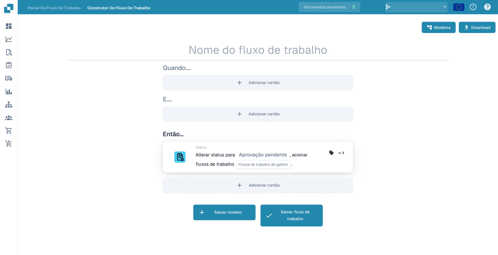
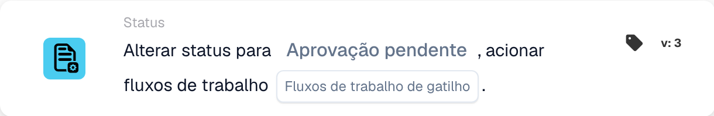
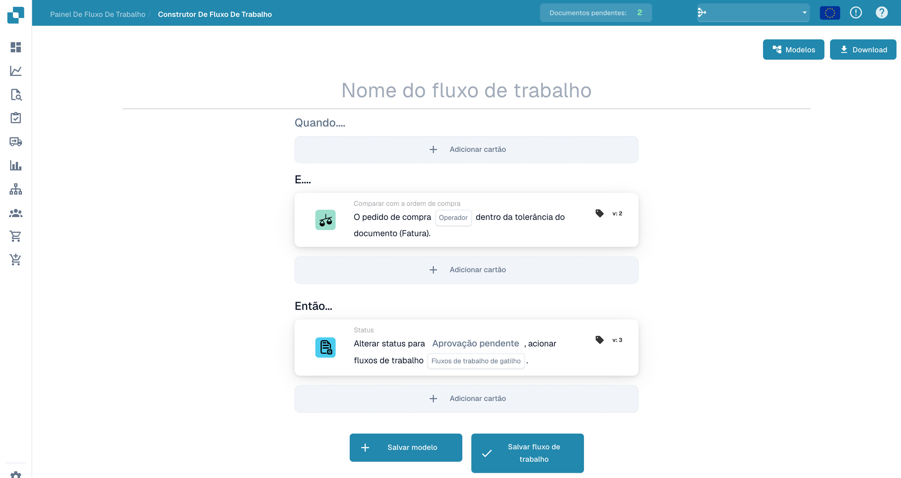

# Atribuição e status — Exemplos práticos

Para manter uma visão geral, você pode atribuir títulos diferentes aos workflows, de modo a saber imediatamente sobre qual tarefa cada workflow trata.

Criar um novo Workflow: Clique em + ADD WORKFLOW

Você pode usar esses workflows (Test 1,2,3) para atribuir automaticamente diversos documentos ao colaborador certo na empresa.

Se uma fatura ou outro documento exceder um determinado valor total que exija revisão e aprovação prévias, esses documentos podem ser atribuídos imediatamente à pessoa correta.

<figure><figcaption></figcaption></figure>

**Teste 1: Cartão lógico**

When: **Assignee is:** Responsável pela receção

And: **Document type is:** Invoice

Then: **Assign document to:** Responsável pela verificação da fatura

.png>)

**Teste 2: Cartão lógico**

When: **Assignee is:** Responsável pela receção

And: **Document type is:** Delivery Note

Then: **Assign document to:** Responsável pela verificação da entrega

.png>)

**Teste 3: Cartão lógico**

**When:** **Assignee is:** Responsável pela receção

**And:** **Document type is:** Order Confirmation

**Then:** **Assign document to:** Responsável pela verificação da encomenda

.png>)

Também é possível, caso o documento não esteja atribuído a uma única pessoa, atribuí-lo a um colaborador específico desde o início.

<figure><figcaption></figcaption></figure>

Para uma visão geral mais fácil do que deve acontecer com um documento, você pode definir o status dos documentos recebidos neste workflow. Este workflow torna possível ver imediatamente se há, por exemplo, uma aprovação pendente.

**Teste 4: Cartão lógico**

**When:** **Document type is:** Delivery Note

**And:** **Assignee is:** Responsável pela receção

**Then:** **Change Status to:** Pending Approval

<figure><figcaption>
Rascunho de fluxo para alterar o estado, sem guardar.
</figcaption></figure>

.png>)

**Teste 5: Cartão lógico**

When: **Document type is:** Invoice

And: **Assignee is:** Responsável pela verificação da fatura

Then: **Change Status to:** Pending Second Approval

<figure><figcaption></figcaption></figure>

.png>)

Se uma fatura ou outro documento exceder um determinado valor total que exija revisão e aprovação prévias, esses documentos podem ser atribuídos imediatamente à pessoa certa.

.png>)

**Teste 6: Cartão lógico**

When: **Assignee is:** Responsável pela receção

And: Docfield **total\_amount** is **Greater than 500**

Then: **Assign document to:** Responsável pela aprovação

<figure><figcaption></figcaption></figure>

.png>)

Também é possível inserir o status no workflow, para que a pessoa atribuída possa ver imediatamente em qual status este documento se encontra e o que deve acontecer em seguida com ele.

**Teste 7: Cartão lógico**

**When:** **Assignee is:** Responsável pela receção

**And:** Docfield **total\_amount** is **Greater then 500**

**Then:** **Assign document to:** Responsável pela aprovação

**Change Status to:** Pending Approval

<figure><figcaption>
Ação de alteração de estado num rascunho de fluxo.
</figcaption></figure>

<figure><figcaption></figcaption></figure>

Por exemplo, se faltarem informações específicas ou importantes em um documento, mas que sejam essenciais e devam ser incluídas para o processamento posterior, você pode configurar o workflow para que esses documentos sejam encaminhados imediatamente ao comprador e a um substituto (suplente).

<figure><figcaption></figcaption></figure>

**Teste 9:**

O Workflow com esses logic cards foi projetado para verificar automaticamente se a quantidade, o preço unitário ou o desconto detalhados em uma confirmação de pedido correspondem aos valores correspondentes no pedido de compra. Essa verificação garante consistência e precisão entre o que foi pedido e o que o fornecedor confirma entregar.

Você pode atribuir a esses documentos um status específico ou atribuí-los a um colaborador específico.

<figure><figcaption>
Rascunho de fluxo com condição de comparação com uma ordem de compra.
</figcaption></figure>

<figure><figcaption>
Seleção de condições de comparação com uma ordem de compra. Mesa significa tabela de dados e Cessionário indica a atribuição a um responsável.
</figcaption></figure>

**Cartão lógico: correspondência da quantidade, do preço unitário ou do desconto**

Este logic card foi projetado para verificar automaticamente se a quantidade, o preço unitário ou o desconto detalhados em uma confirmação de pedido correspondem aos valores correspondentes no pedido de compra. Essa verificação garante consistência e precisão entre o que foi pedido e o que o fornecedor confirma entregar.

**Trigger Condition**

A lógica é ativada quando qualquer uma das seguintes condições é atendida em uma confirmação de pedido em relação ao pedido de compra original:

* **Quantidade**: A quantidade de itens pedidos corresponde à quantidade confirmada pelo fornecedor.
* **Preço unitário**: O preço por item acordado corresponde à confirmação do fornecedor.
* **Desconto**: Quaisquer descontos aplicados são consistentes entre o pedido de compra e a confirmação de pedido.
* **Define Comparison Parameters**: Configure os campos específicos (quantidade, preço unitário, desconto) que o logic card verificará para uma correspondência.
* **Automate Verification**: Configure o sistema para comparar automaticamente esses detalhes ao receber uma confirmação de pedido.
* **Customize Alerts**: Decida sobre o fluxo de trabalho para lidar com discrepâncias, incluindo a personalização de alertas para revisão manual.

Este logic card é vital para garantir que os detalhes de uma confirmação de pedido estejam alinhados com o pedido de compra original, protegendo a integridade do ciclo de compras.

**Teste 10:**

Se você tiver um cálculo diferente para sobretaxas, ou tiver sobretaxas apenas em alguns itens, você pode usar os generic table calculation cards; alguns deles também permitem filtrar por expressões regulares.

<figure><figcaption></figcaption></figure>

Acima está um exemplo de cálculo para MTZ com um filtro para números de item que começam com 01, 06, 9, 001 ou 000.

Com uma configuração manual, é recomendável dividir os cálculos que dependem de novas colunas em um workflow separado. Para continuar com o cálculo, você pode usar o card Run Workflow.

**Executar o fluxo**

<figure><figcaption></figcaption></figure>

Com este card você pode especificar o nome de um workflow que deve ser executado após o workflow atual, caso suas condições sejam atendidas, e após os then cards anteriores do workflow atual. Embora ele priorize workflows executáveis e ativos, também permite executar workflows desativados se o documento atender às condições do workflow.

### **Adicionar encargos calculados a uma coluna existente** 

Se você quiser adicionar todas as sobretaxas como um desconto negativo na coluna de desconto, você pode usar o calculation card. Pode haver entradas nesta coluna; você pode defini-la como uma das variáveis no card, ter o MTZ subtraído dela e adicionar o resultado de volta a esta coluna. Caso existam campos vazios (sobretaxas apenas para alguns itens), ele assumirá 0 para o seu cálculo.

**Notificar o utilizador para autorizar a confirmação da encomenda no DocBits**

Após calcular as sobretaxas, você pode querer notificar um usuário específico para autorizar a confirmação de pedido. Para isso, você pode usar o notification card.

<figure><figcaption></figcaption></figure>

Dependendo das configurações, o usuário recebe uma nova tarefa atribuída no DocBits e, opcionalmente, um e-mail para notificá-lo sobre sua nova tarefa.

As imagens atualizadas mostram rascunhos de condições e ações sem guardar. Adapte os perfis e as condições à sua organização.
