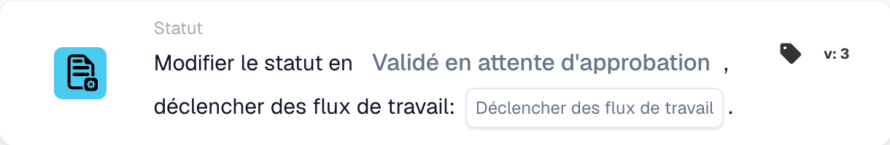
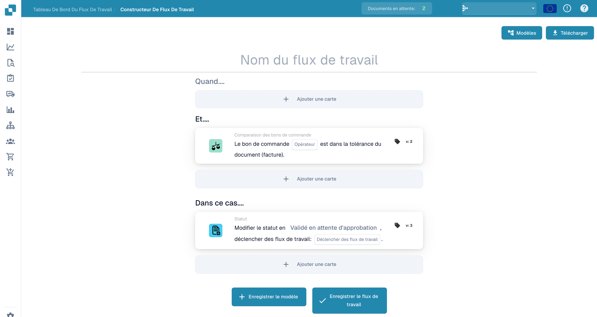

# Attribution et statut — Exemples pratiques

Pour garder une vue d'ensemble, vous pouvez donner aux flux de travail différents intitulés afin de savoir immédiatement de quelle tâche ce flux de travail traite.

Créer un nouveau flux de travail : Cliquez sur + ADD WORKFLOW

Vous pouvez utiliser ces flux de travail (Test 1, 2, 3) pour assigner automatiquement divers documents au bon employé de l'entreprise.

Si une facture ou un autre document dépasse un certain montant total qui nécessite un examen et une approbation préalables, ces documents peuvent être immédiatement assignés à la bonne personne.

<figure><figcaption></figcaption></figure>

**Test 1 : Logic Card**

When : **Assignee is:** Responsable de réception

And : **Document type is:** Invoice

Then : **Assign document to:** Réviseur des factures

.png>)

**Test 2 : Logic Card**

When : **Assignee is:** Responsable de réception

Et : **Le type de document est :** Bon de livraison

Then : **Assign document to:** Réviseur des livraisons

.png>)

**Test 3 : Logic Card**

**When :** **Assignee is:** Responsable de réception

**And :** **Document type is:** Order Confirmation

**Then :** **Assign document to:** Réviseur des commandes

.png>)

Il est également possible, si le document n'est pas assigné à une seule personne, de l'assigner dès le départ à un employé spécifique.

<figure><figcaption></figcaption></figure>

Pour avoir une vue d'ensemble plus facile de ce qui doit arriver à un document, vous pouvez définir le statut des documents entrants dans ce flux de travail. Ce flux de travail permet de voir immédiatement s'il y a, par exemple, une approbation en attente.

**Test 4 : Logic Card**

**Quand :Le type de document est :** Bon de livraison

**And :** **Assignee is:** Responsable de réception

**Puis :Changer le statut en :** En attente d'approbation

<figure><figcaption>
Brouillon non enregistré d’un workflow de changement de statut.
</figcaption></figure>

.png>)

**Test 5 : Logic Card**

When : **Document type is:** Invoice

And : **Assignee is:** Réviseur des factures

Ensuite : **Changer le statut en :** En attente de la deuxième approbation

<figure><figcaption></figcaption></figure>

.png>)

Si une facture ou un autre document dépasse un certain montant total qui nécessite un examen et une approbation préalables, ces documents peuvent être immédiatement assignés à la bonne personne.

.png>)

**Test 6 : Logic Card**

When : **Assignee is:** Responsable de réception

Et : Docfield **total\_amount** est **Supérieur à 500**

Then : **Assign document to:** Responsable des approbations

<figure><figcaption></figcaption></figure>

.png>)

Il est également possible de saisir le statut dans le flux de travail, afin que la personne assignée puisse voir immédiatement quel est le statut de ce document et ce qui doit lui arriver ensuite.

**Test 7 : Logic Card**

**When :** **Assignee is:** Responsable de réception

**Et :** Docfield **total\_amount** est **Supérieur à 500**

**Then :** **Assign document to:** Responsable des approbations

**Changer le statut en :** En attente d'approbation

<figure><figcaption>
Action de changement de statut dans un brouillon de workflow.
</figcaption></figure>

<figure><figcaption></figcaption></figure>

Par exemple, si certaines informations ou des informations importantes manquent dans un document, mais qu'elles sont importantes et doivent être incluses pour un traitement ultérieur, vous pouvez configurer le flux de travail de sorte que ces documents soient immédiatement transmis à l'acheteur et à un remplaçant (substitut).

<figure><figcaption></figcaption></figure>

**Test 9 :**

Le flux de travail avec ces logic cards est conçu pour vérifier automatiquement que la quantité, le prix unitaire ou la remise détaillés dans une confirmation de commande correspondent aux chiffres correspondants de la commande d'achat. Cette vérification garantit la cohérence et l'exactitude entre ce qui a été commandé et ce que le fournisseur confirme livrer.

Vous pouvez donner à ces documents un statut spécifique ou les assigner à un employé spécifique.

<figure><figcaption>
Brouillon de workflow avec une condition de comparaison de commande.
</figcaption></figure>

<figure><figcaption>
Sélection des conditions de comparaison avec une commande.
</figcaption></figure>

**Carte Logique : Quantité ou Prix Unitaire ou Correspondance de Remise**

Cette logic card est conçue pour vérifier automatiquement que la quantité, le prix unitaire ou la remise détaillés dans une confirmation de commande correspondent aux chiffres correspondants de la commande d'achat. Cette vérification garantit la cohérence et l'exactitude entre ce qui a été commandé et ce que le fournisseur confirme livrer.

**Condition de déclenchement**

La logique est activée lorsque l'une des conditions suivantes est remplie dans une confirmation de commande par rapport à la commande d'achat d'origine :

* **Tolérance de quantité** : La quantité d'articles commandés correspond à la quantité confirmée par le fournisseur.
* **Tolérance de prix unitaire** : Le prix par article convenu correspond à la confirmation du fournisseur.
* **Rabais** : Toutes les remises appliquées sont cohérentes entre la commande d'achat et la confirmation de commande.
* **Définir les paramètres de comparaison** : Configurez les champs spécifiques (quantité, prix unitaire, remise) que la logic card vérifiera pour une correspondance.
* **Automatiser la vérification** : Configurez le système pour comparer automatiquement ces détails à la réception d'une confirmation de commande.
* **Personnaliser les alertes** : Décidez du flux de travail pour la gestion des divergences, y compris la personnalisation des alertes pour révision manuelle.

Cette logic card est essentielle pour garantir que les détails d'une confirmation de commande correspondent à la commande d'achat d'origine, préservant l'intégrité du cycle d'approvisionnement.

**Test 10 :**

Si vous avez un calcul différent pour les surcharges, ou si vous ne les avez que sur certains articles, vous pouvez utiliser les cartes génériques de calcul de tableau ; certaines d'entre elles permettent également de filtrer par expressions régulières.

<figure><figcaption></figcaption></figure>

Ci-dessus se trouve un exemple de calcul pour MTZ avec un filtre pour les numéros d'article commençant par 01, 06, 9, 001 ou 000.

Avec une configuration manuelle, il est conseillé de séparer les calculs qui dépendent de nouvelles colonnes dans un flux de travail distinct. Pour poursuivre le calcul, vous pouvez utiliser la carte Run Workflow.

**Exécuter le flux**

<figure><figcaption></figcaption></figure>

Avec cette carte, vous pouvez spécifier le nom d'un flux de travail à exécuter après le flux de travail actuel si ses conditions sont remplies, et après les cartes then précédentes du flux de travail actuel. Bien qu'elle priorise les flux de travail exécutables et actifs, elle vous permet également d'exécuter des flux de travail désactivés si le document remplit les conditions du flux de travail.

### **Ajouter des surcharges calculées dans une colonne existante** 

Si vous souhaitez ajouter toutes les surcharges comme une remise négative dans la colonne de remise, vous pouvez utiliser la carte de calcul. Il peut y avoir des entrées dans cette colonne ; vous pouvez la définir comme l'une des variables de la carte, y soustraire le MTZ et ajouter le résultat à nouveau dans cette colonne. Au cas où il y aurait des champs vides (surcharges uniquement pour certains articles), il supposera une valeur de 0 pour son calcul.

**Notifier un utilisateur pour qu'il autorise la confirmation de commande dans DocBits**

Après avoir calculé les surcharges, vous pouvez vouloir notifier un utilisateur spécifique pour qu'il autorise la confirmation de commande. Pour cela, vous pouvez utiliser la carte de notification.

<figure><figcaption></figcaption></figure>

Selon les paramètres, l'utilisateur se voit assigner une nouvelle tâche dans DocBits et, en option, un e-mail pour l'informer de sa nouvelle tâche.

Les images actualisées montrent des brouillons non enregistrés de conditions et d’actions. Adaptez les rôles et conditions à votre organisation.
