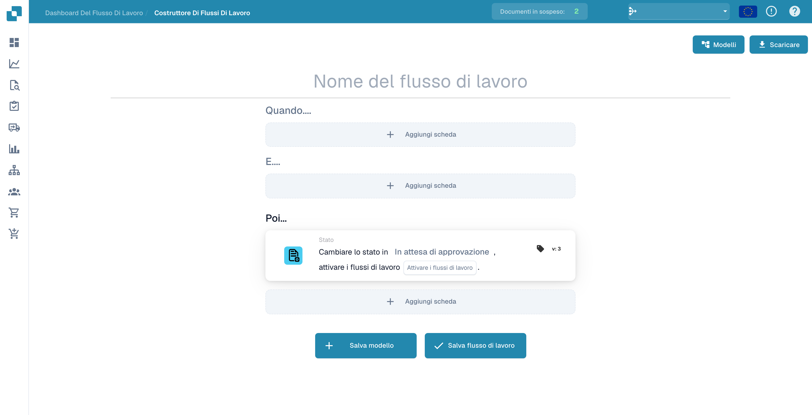
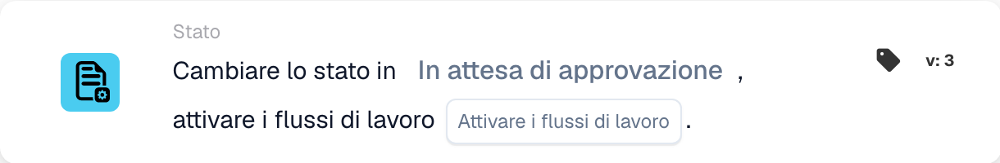
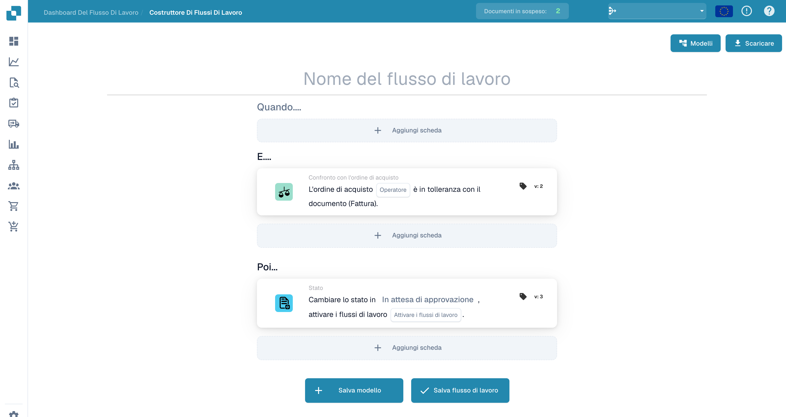
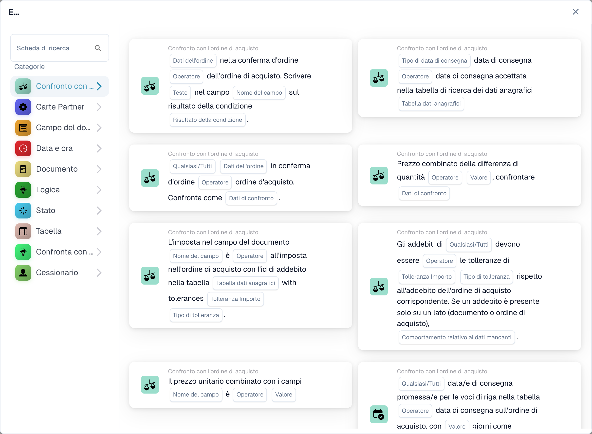

# Assegnazione e stato — Esempi pratici

Per mantenere una visione d'insieme, puoi assegnare ai workflow intestazioni diverse, così da capire immediatamente di quale attività si occupa ciascun workflow.

Crea un nuovo Workflow: fai clic su + ADD WORKFLOW

Puoi utilizzare questi workflow (Test 1,2,3) per assegnare automaticamente i vari documenti al dipendente giusto in azienda.

Se una fattura o un altro documento supera un determinato importo totale che richiede una revisione e un'approvazione preventive, questi documenti possono essere assegnati immediatamente alla persona corretta.

<figure><figcaption></figcaption></figure>

**Test 1: Scheda logica**

When: **Assignee is:** Responsabile della ricezione

E: **Il tipo di documento è:** Fattura

Then: **Assign document to:** Revisore delle fatture

.png>)

**Test 2: Scheda logica**

When: **Assignee is:** Responsabile della ricezione

E: **Il tipo di documento è:** Nota di consegna

Then: **Assign document to:** Revisore delle consegne

.png>)

**Test 3: Scheda logica**

**When:** **Assignee is:** Responsabile della ricezione

**E:Il tipo di documento è:** Conferma d'ordine

**Then:** **Assign document to:** Revisore degli ordini

.png>)

È inoltre possibile, se il documento non è assegnato a una singola persona, assegnarlo fin dall'inizio a un dipendente specifico.

<figure><figcaption></figcaption></figure>

Per avere una visione più semplice di cosa debba accadere a un documento, puoi impostare lo stato dei documenti in entrata in questo workflow. Questo workflow consente di vedere immediatamente se, ad esempio, è presente un'approvazione in sospeso.

**Test 4: Scheda logica**

**Quando:Il tipo di documento è:** Nota di consegna

**And:** **Assignee is:** Responsabile della ricezione

**Poi:Cambia stato in:** In attesa di approvazione

<figure><figcaption>
Bozza non salvata di un workflow di modifica dello stato.
</figcaption></figure>

.png>)

**Test 5: Scheda logica**

Quando: **Il tipo di documento è:** Fattura

And: **Assignee is:** Revisore delle fatture

Quindi: **Cambia stato in:** In attesa di seconda approvazione

<figure><figcaption></figcaption></figure>

.png>)

Se una fattura o un altro documento supera un determinato importo totale che richiede una revisione e un'approvazione preventive, questi documenti possono essere assegnati immediatamente alla persona giusta.

.png>)

**Test 6: Scheda logica**

When: **Assignee is:** Responsabile della ricezione

E: Docfield **total\_amount** è **Maggiore di 500**

Then: **Assign document to:** Responsabile delle approvazioni

<figure><figcaption></figcaption></figure>

.png>)

È inoltre possibile inserire lo stato nel workflow, in modo che la persona assegnata possa vedere immediatamente in quale stato si trova il documento e cosa dovrà accadere successivamente.

**Test 7: Scheda logica**

**When:** **Assignee is:** Responsabile della ricezione

**E:** Docfield **total\_amount** è **Maggiore di 500**

**Then:** **Assign document to:** Responsabile delle approvazioni

**Cambia stato in:** In attesa di approvazione

<figure><figcaption>
Azione di modifica dello stato in una bozza di workflow.
</figcaption></figure>

<figure><figcaption></figcaption></figure>

Ad esempio, se in un documento mancano informazioni specifiche o importanti, ma necessarie e che devono essere incluse per l'ulteriore elaborazione, puoi configurare il workflow in modo che questi documenti vengano immediatamente inoltrati all'acquirente e a un sostituto (rimpiazzo).

<figure><figcaption></figcaption></figure>

**Test 9:**

Il Workflow con queste logic card è progettato per verificare automaticamente che la quantità, il prezzo unitario o lo sconto indicati in una conferma d'ordine corrispondano ai valori corrispondenti nell'ordine di acquisto. Questa verifica garantisce coerenza e accuratezza tra ciò che è stato ordinato e ciò che il fornitore conferma di consegnare.

Puoi assegnare a questi documenti uno stato specifico o assegnarli a un dipendente specifico.

<figure><figcaption>
Bozza di workflow con una condizione di confronto con un ordine.
</figcaption></figure>

<figure><figcaption>
Selezione delle condizioni di confronto con un ordine di acquisto.
</figcaption></figure>

**Scheda logica: quantità o prezzo unitario o corrispondenza sconto**

Questa logic card è progettata per verificare automaticamente che la quantità, il prezzo unitario o lo sconto indicati in una conferma d'ordine corrispondano ai valori corrispondenti nell'ordine di acquisto. Questa verifica garantisce coerenza e accuratezza tra ciò che è stato ordinato e ciò che il fornitore conferma di consegnare.

**Trigger Condition**

La logica si attiva quando una qualsiasi delle seguenti condizioni viene soddisfatta in una conferma d'ordine rispetto all'ordine di acquisto originale:

* **Quantità**: la quantità degli articoli ordinati corrisponde alla quantità confermata dal fornitore.
* **Prezzo unitario**: il prezzo per articolo concordato corrisponde alla conferma del fornitore.
* **Sconto**: eventuali sconti applicati sono coerenti tra l'ordine di acquisto e la conferma d'ordine.
* **Definire i parametri di confronto**: configura i campi specifici (quantità, prezzo unitario, sconto) di cui la logic card verificherà la corrispondenza.
* **Automate Verification**: configura il sistema per confrontare automaticamente questi dettagli alla ricezione di una conferma d'ordine.
* **Customize Alerts**: decidi il workflow per la gestione delle discrepanze, inclusa la personalizzazione degli avvisi per la revisione manuale.

Questa logic card è fondamentale per garantire che i dettagli di una conferma d'ordine siano allineati con l'ordine di acquisto originale, salvaguardando l'integrità del ciclo di approvvigionamento.

**Test 10:**

Se hai un calcolo diverso per i sovrapprezzi, oppure li applichi solo ad alcuni articoli, puoi utilizzare le card generiche di calcolo della tabella; alcune di esse consentono anche di filtrare tramite espressioni regolari.

<figure><figcaption></figcaption></figure>

Sopra è riportato un esempio di calcolo per MTZ con un filtro per i numeri di articolo che iniziano con 01, 06, 9, 001 o 000.

Con una configurazione manuale è consigliabile suddividere i calcoli che dipendono da nuove colonne in un workflow separato. Per proseguire con il calcolo puoi utilizzare la card Run Workflow.

**Eseguire il flusso**

<figure><figcaption></figcaption></figure>

Con questa card puoi specificare il nome di un workflow che deve essere eseguito dopo il workflow corrente, se le sue condizioni sono soddisfatte e dopo le precedenti card "then" del workflow corrente. Pur dando priorità ai workflow eseguibili e attivi, consente anche di eseguire workflow disattivati se il documento soddisfa le condizioni del workflow.

### **Aggiunta dei supplementi calcolati in una colonna esistente** 

Se desideri aggiungere tutti i sovrapprezzi come sconto negativo nella colonna dello sconto, puoi utilizzare la card di calcolo. Potrebbero esserci già voci in questa colonna: puoi impostarla come una delle variabili sulla card, sottrarvi il MTZ e aggiungere nuovamente il risultato in questa colonna. Nel caso siano presenti campi vuoti (sovrapprezzi solo per alcuni articoli), assumerà uno 0 per il suo calcolo.

**Notificare l’utente per autorizzare la conferma d’ordine in DocBits**

Dopo aver calcolato i sovrapprezzi, potresti voler notificare a un utente specifico di autorizzare la conferma d'ordine. A tale scopo puoi utilizzare la card di notifica.

<figure><figcaption></figcaption></figure>

A seconda delle impostazioni, all'utente viene assegnata una nuova attività in DocBits e, facoltativamente, un'email per notificargli la nuova attività.

Le immagini aggiornate mostrano bozze non salvate di condizioni e azioni. Adattare ruoli e condizioni alla propria organizzazione.
